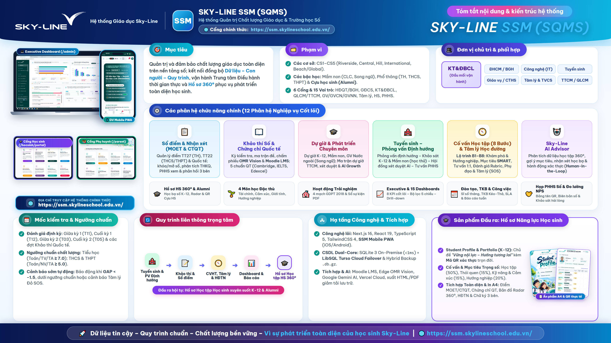

# SKY-LINE SSM (SQMS Portal)
### Hệ thống Quản trị Chất lượng Giáo dục & Điều hành Trường học Số — Hệ thống Giáo dục Sky-Line

- **URL Chính thức:** [https://ssm.skylineschool.edu.vn/](https://ssm.skylineschool.edu.vn/)
- **Tài liệu Đặc tả Toàn diện Tính năng:** [`docs/MO_TA_TOAN_DIEN_TINH_NANG_SSM.md`](./docs/MO_TA_TOAN_DIEN_TINH_NANG_SSM.md)
- **Tài liệu Hồ sơ Học sinh 360°:** [`docs/MO_TA_HO_SO_HOC_TAP_HOC_SINH_SKYLINE.md`](./docs/MO_TA_HO_SO_HOC_TAP_HOC_SINH_SKYLINE.md)
- **Cẩm nang Vận hành SSM PWA Mobile:** [`SSM_PWA_MANUAL.md`](./SSM_PWA_MANUAL.md)
- **Kiến trúc Trợ lý AI (Enterprise SSM AI):** [`docs/ai/SSM_AI_ARCHITECTURE.md`](./docs/ai/SSM_AI_ARCHITECTURE.md)
- **Kiến trúc Phân hệ Cựu học sinh (Sky-Line Alumni):** [`docs/SKYLINE_ALUMNI_ARCHITECTURE_AND_AUDIT.md`](./docs/SKYLINE_ALUMNI_ARCHITECTURE_AND_AUDIT.md)
- **Poster Tổng quan Hệ thống (4K Vector):** [`docs/POSTER_SKYLINE_SSM_4K.png`](./docs/POSTER_SKYLINE_SSM_4K.png)

---

## 1. Giới thiệu Tổng quan

**SKY-LINE SSM (School Quality Management System – SQMS)** là nền tảng quản trị chất lượng giáo dục, điều hành công việc và hồ sơ học tập điện tử 360° hợp nhất của **Hệ thống Giáo dục Sky-Line**, đáp ứng toàn diện hoạt động quản lý và giảng dạy trên tất cả các cơ sở (`CS1` – `CS5`) xuyên suốt từ bậc **Mầm non**, **Phổ thông K-12 (Tiểu học, THCS, THPT)** đến mạng lưới **Cựu học sinh (Sky-Line Alumni)**.

---

## 2. TRỌNG TÂM: Trung tâm Điều hành Thông minh & Hệ sinh thái Dashboard Đa tầng

Hệ thống **Dashboard của SKY-LINE SSM** được xây dựng như một **Trung tâm Chỉ huy & Điều hành Giáo dục Thời gian thực (Real-time Educational Command Center)** theo chu trình:

$$\mathbf{Observe\ (Quan\ sát)} \longrightarrow \mathbf{Understand\ (Thấu\ hiểu)} \longrightarrow \mathbf{Drill\text{-}down\ (Đào\ sâu)} \longrightarrow \mathbf{Act\ (Hành\ động\ ngay)}$$

### 2.1. Executive Admin Dashboard – Trung tâm Điều hành Quản trị (`/admin`)
- **Bộ lọc Thống nhất 5 Chiều (`AdminUnifiedFilterBar`)**: Lọc đồng bộ toàn bộ biểu đồ và KPI theo *Năm học × Cơ sở (`CS1`–`CS5`) × Cấp học (Mầm non, Tiểu học, THCS, THPT) × Khối lớp × Khoảng thời gian*, kèm chế độ **Auto-Refresh**.
- **8 Thẻ KPI Điều hành Cốt lõi (`8 Core Executive KPIs`)**:
  1. **Tổng Sĩ số Học sinh Đang học** (Tách Phổ thông & Mầm non, biến động `± HS ròng`, sĩ số TB/lớp, tổng HS đầu cấp).
  2. **Quy mô Lớp học & Biến động Lưu chuyển** (Số lớp hoạt động, số HS *Nhập mới / Chuyển đi / Đổi lớp*).
  3. **Khảo thí Đầu vào & Kỳ thi** (Tổng hồ sơ KSĐV K-12 & Mầm non, `% đạt/nhập học`, hồ sơ chờ duyệt, tổng kỳ thi & giải thưởng).
  4. **Chất lượng Học tập & Phổ điểm** (Điểm TB toàn hệ thống, `% đạt chuẩn ≥ 5.0`, `% Giỏi/XS ≥ 8.0`, Đánh giá năng lực & HS hỗ trợ).
  5. **Cố vấn Học tập & Mục tiêu HS** (Tổng mục tiêu SMART, độ phủ HS lập mục tiêu & số phiên tư vấn 1-1).
  6. **Dự giờ & Đánh giá Tiết dạy** (`% hoàn tất phiếu`, tổng số tiết mở dự giờ, số GV có định mức).
  7. **Hỗ trợ Học tập & Tâm lý** (Tổng hồ sơ active: *Phụ đạo học tập, Tư vấn tâm lý, Cam kết đầu vào*).
  8. **Tiến độ Nhiệm vụ Điều hành** (Tỷ lệ `% hoàn thành`, số việc *Hoàn thành / Đang làm / Quá hạn*).
- **Trung tâm Cảnh báo Thông minh (`SmartAlertCenter`)**: Tự động phát hiện và phân loại cảnh báo theo 3 mức 🔴 **CRITICAL (Nghiêm trọng)**, 🟠 **WARNING (Cảnh báo)**, 🔵 **INFO (Thông tin)** kèm nút hành động trực tiếp (**Zero Dead-End**).
- **Hệ thống Biểu đồ Tương tác Đa chế độ**:
  - *Biểu đồ kết hợp Xu hướng Sĩ số 12 Tháng* (`ComposedChart`: Cột chồng Phổ thông + Mầm non & Đường tổng sĩ số).
  - *Biểu đồ Phân bố Sĩ số 3 Chế độ*: Chuyển đổi tức thì giữa **Theo Cơ sở (`CS1`–`CS5` màu chuẩn hóa)**, **Theo Cấp học (`Donut PieChart`)** và **Theo Khối lớp**.
  - *Biểu đồ Chất lượng Học tập 2 Chế độ*: Xem **Theo Môn học** (ĐTB & đường `% đạt chuẩn`) hoặc **Theo Phổ điểm (Score Bands)**.
  - *Biểu đồ Cố vấn Học tập & Dự giờ Chuyên môn* (Xem theo Cấp học hoặc Xếp loại tiết dạy).
  - *Khối Phân tích Học sinh Đầu cấp (Khối 1, 6, 10) & Luồng Chuyển trường* (Nội tỉnh / Ngoại tỉnh / Quốc tế) tích hợp **Bảng tra cứu & lọc nhanh học sinh đầu cấp ngay trên Dashboard**.

### 2.2. Hệ thống Dashboard Phân quyền theo 5 Vai trò (`Role-Aware Dashboards`)
- **Dashboard Giáo viên (`/teacher`)**: Tự động đổi màu theo Cơ sở công tác (`useCampusTheme`), Banner đếm ngược hạn chốt (`DeadlineCountdownBanner`), KPI cá nhân và 3 phân vùng tác nghiệp nhanh (*GVCN, GVBM, Tiện ích*).
- **Dashboard Tổ trưởng Chuyên môn (`TTCM`)**: Chuyển đổi 1 chạm giữa *Chế độ Cá nhân* và *Chế độ Quản lý Tổ*; giám sát độ phủ dự giờ, tỷ lệ đạt chuẩn môn của tổ và duyệt đề thi/phiếu dự giờ.
- **Dashboard QLCM / Trưởng Bộ phận**: Đối sánh chất lượng và tiến độ giữa các Tổ bộ môn và Khối lớp.
- **Dashboard Giám đốc Cơ sở (`GDCS`)**: Bức tranh điều hành tổng thể riêng của từng cơ sở (`CS1`–`CS5`).
- **Dashboard Ban KT&ĐBCL**: Đối chuẩn chất lượng liên cơ sở (Cross-Campus Benchmark) và kiểm toán tiến độ nhập liệu toàn hệ thống.

### 2.3. 10 Dashboard Chuyên sâu theo Phân hệ (`Domain Dashboards`)
Bao gồm: (1) *Dashboard Khảo thí Số OMR/LMS*, (2) *Dashboard 5 Chuẩn Chứng chỉ Quốc tế (Cambridge/IELTS/Edexcel)*, (3) *Dashboard Giám sát Tiến độ Nhập điểm & Phổ điểm*, (4) *Dashboard Phân tích Chất lượng Lớp dạy của GVBM*, (5) *Dashboard Cố vấn Học tập & SGSI*, (6) *Dashboard 4 Môn học Đặc thù*, (7) *Dashboard Hoạt động Trải nghiệm*, (8) *Dashboard Mạng lưới Cựu học sinh Alumni*, (9) *Dashboard Hài lòng NPS*, và (10) *Dashboard Báo cáo Tuần & SLA Công việc*.

---

## 3. Tóm tắt 12 Phân hệ Nghiệp vụ Cốt lõi

| STT | Phân hệ | Tính năng nổi bật |
| :--- | :--- | :--- |
| **01** | **Quản trị Hệ thống & Bảo mật (`SYSTEM`)** | Quản lý nhóm quyền RBAC động, tài khoản nhân sự & PHHS, quản lý đa cơ sở, cổng ảnh học sinh, nhật ký kiểm toán (`AuditLog`), sao lưu & đồng bộ CSDL. |
| **02** | **Khảo thí & Đảm bảo Chất lượng (`KT&ĐBCL`)** | **Khảo thí Số (OMR Vision & Moodle LMS)**, **KT&ĐBCL Connect** (hỗ trợ 2 chiều), **Quản lý Kỳ thi & Thành tích**, **Khảo thí Quốc tế** (Cambridge YLE/KET/PET, IELTS, Pearson Edexcel, Checkpoint), **Sổ điểm MOET (TT27/TT22) & CTQT**, Phân tích phổ điểm & Benchmark đa cơ sở, Import KQHT & Họp Phụ huynh số. |
| **03** | **Môn học Đặc thù Sky-Line (`SPECIAL_SUBJECTS`)** | Quản lý khung chương trình, phân công, nhật ký giảng dạy và sổ đánh giá 4 môn bản sắc: **GD Cảm xúc Xã hội (CXXH 1–9)**, **GD Giới tính (GDGT 6–9)**, **GD Tài chính (FIN_EDU 2–9)**, **GD Hướng nghiệp (GDHN 6–12)**. |
| **04** | **Hoạt động Trải nghiệm (`EXPERIENTIAL`)** | Danh mục HĐTN chuẩn 4 mạch GDPT 2018 & chủ đề tháng, phân bổ về lớp, đánh giá mức độ tham gia của học sinh, xuất Sổ sự kiện & Báo cáo PDF. |
| **05** | **Học liệu Số & Tiện ích (`LEARNING_RESOURCES`)** | Thư viện Sách giáo khoa điện tử tích hợp **Hỏi đáp AI trực tiếp trên nội dung sách**; Tiện ích **In bảng tên Họp PHHS khổ A4 kèm Mã QR định danh trọn đời**. |
| **06** | **Quản lý Đào tạo & TKB (`TRAINING`)** | Quản lý năm học, tổ chuyên môn, lớp học, giáo viên, phân công giảng dạy, **Thời khóa biểu Kéo & Thả (tích hợp Solver)**, quản lý học sinh lưu chuyển và theo dõi sỹ số tháng. |
| **07** | **Cố vấn Học tập (`8 Bước B1–B8`) & Tâm lý (`ADVISORY`)** | **Lộ trình Cố vấn 8 bước (`B1–B8`)**, Quản trị Sổ mục tiêu SMART 4 nhóm trọng số (*Học tập 50%, Thói quen 15%, Kỹ năng & Cảm xúc 15%, Hướng nghiệp 20%*), đánh giá Rubric `1–5`, tính $\text{GAP} = \text{Actual} - \text{Target}$, **Chỉ số SGSI**, Cảnh báo sớm 3 màu (Xanh/Vàng/Đỏ SOS), Tham vấn tâm lý 1-1, Phụ đạo & Bồi dưỡng. |
| **08** | **Hồ sơ Năng lực Học sinh 360° & Tra cứu (`STUDENT_360`)** | **Sản phẩm đầu ra trọng tâm (`Student Profile & Portfolio`)**: Học bạ điện tử tích lũy K-12 chủ đề *"Vững nội lực – Hướng tương lai"*, **Bản đồ Năng lực Vector Radar 360°**, khung chữ ký 3 bên, Mã QR xác thực trọn đời, 4 công cụ tra cứu chuyên sâu và xuất in PDF chuẩn A4 chống tràn trang. |
| **09** | **Cựu học sinh (`SKY-LINE ALUMNI`)** | Kế thừa hồ sơ học sinh tốt nghiệp, cấp/thu hồi Mã QR định danh bảo mật, Cổng Alumni tự cập nhật xác thực OTP, quy trình phê duyệt dữ liệu tự khai, theo dõi hành trình Đại học & Sự nghiệp toàn cầu. |
| **10** | **Tuyển sinh – Phỏng vấn Định hướng (`ASSESSMENT`)** | Tổ chức phỏng vấn định hướng & khảo sát tuyển sinh đầu vào cho cả **Phổ thông K-12** và **Mầm non** (5 lĩnh vực phát triển & đánh giá học thử), phân công chấm, Hội đồng xét duyệt tích hợp AI và gửi Email kết quả tự động. |
| **11** | **Khảo sát Định kỳ, Phẩm chất & NPS (`SURVEY`)** | Thiết kế khảo sát đa đối tượng (PHHS, Học sinh, Giáo viên), đo lường **KPI Phẩm chất HS & Tự hào Sky-Line (`IP2.1`)**, phân tích chỉ số hài lòng **NPS (Net Promoter Score)** và theo dõi xử lý phản hồi phụ huynh. |
| **12** | **Dự giờ & Phát triển Chuyên môn (`OBSERVATION`)** | Quản lý dự giờ **Phổ thông K-12**, **Mầm non**, và **Giáo viên Nước ngoài (Song ngữ Anh/Việt)**; Ma trận dự giờ TTCM, theo dõi định mức, xét duyệt đánh giá lại và **AI Growth – Đổi mới tiết dạy**. |

---

## 4. Hệ thống Đồng hành 3 Chiều (`Cổng Học sinh & Cổng Phụ huynh`) & Sản phẩm Đầu ra

### 4.1. Cổng Học sinh (`/hocsinh/portal`) — Học tập, Rèn luyện & Cố vấn 3 Chiều
Phát triển toàn diện theo **5 Trụ cột** (*Trí tuệ – Thể chất – Tâm hồn – Kỹ năng – Hội nhập*) với **8 phân hệ trực tuyến**:
1. **Hành trình Trưởng thành (`KPI IP2.1 • 5 Phẩm chất & Pride NPS`)**: Tự nhìn nhận 5 phẩm chất theo 14 tiêu chí, bổ sung minh chứng và phản hồi Pride NPS.
2. **Khảo sát Tâm lý & Hướng nghiệp (`SKL_PSYCH`)**: 5 bộ công cụ chuẩn quốc tế (*DISC, EPI, HOLLAND, EQ Lyusin, MBTI*).
3. **Sổ Mục tiêu SMART (`3 Giai đoạn • Sprint 7N`)**: Xây dựng 4 nhóm mục tiêu năm học (trọng số 50%/15%/15%/20%) và Sprint hành động 7 ngày.
4. **Nhật ký Cố vấn 1:1 (`Đồng hành 3 chiều`)**: Xem nhận xét từ GVCN/CVHT, lịch gặp cố vấn và viết nhật ký phản tư.
5. **Khảo sát Định kỳ**, **6. Trung tâm Thông báo**, **7. Ảnh thẻ & Hồ sơ Số**, và **8. Em Cần Hỗ trợ (`SOS`)** gửi tin nhắn bảo mật tới GVCN & Phòng Tâm lý học đường.

### 4.2. Cổng Phụ huynh (`/parent`) — Quản lý & Đồng hành 3 Chiều
Kết nối trực tiếp giữa *Phụ huynh – GVCN/GVBM – Học sinh* qua **8 phân hệ**:
1. **Điểm Kiểm tra & Trao đổi**, **2. Khảo sát Định kỳ**, **3. Cố vấn & Nhật ký GVCN**, **4. Hồ sơ Học tập 360°**, **5. Trao đổi & Đồng hành (`CSAT/NPS`)**, **6. Họp Phụ huynh Số (`Lịch họp, Mã QR điểm danh & Biên bản`)**, **7. Trung tâm Thông báo**, và **8. Khảo sát Tâm lý & Hướng nghiệp (`SKL_PSYCH`)**.

### 4.3. Sản phẩm Đầu ra Trọng tâm: Hồ sơ Năng lực Học sinh (`Student Comprehensive Profile & Portfolio`)
- **Trang bìa cá nhân hóa (`Student Profile`)**: Thông điệp `DISCOVER • GROW • SHINE • TOGETHER`, chủ đề năm học *"Vững nội lực – Hướng tương lai"*, Mã học sinh (`Student ID`) và **Mã QR xác thực trọn đời**.
- **Nội dung tích lũy K-12 chuẩn A4**: Thông tin học sinh, Cố vấn học tập 4 nhóm mục tiêu trọng số & chấm điểm Rubric (`1–5`), Kết quả học tập văn hóa (`MOET TT27/TT22`) & Quốc tế (`CTQT`), Chứng chỉ quốc tế (*Cambridge, IELTS, Edexcel, IC3/MOS*), Bản đồ năng lực Vector Radar 360°, 4 Môn đặc thù, Hoạt động trải nghiệm, Bảng vàng thành tích và **Khung chữ ký xác thực 3 bên** (*Học sinh – GVCN – Ban Giám hiệu*).

---

👉 Xem chi tiết đầy đủ từng phân hệ, kiến trúc Dashboard và danh mục chức năng tại: **[`docs/MO_TA_TOAN_DIEN_TINH_NANG_SSM.md`](./docs/MO_TA_TOAN_DIEN_TINH_NANG_SSM.md)**.
