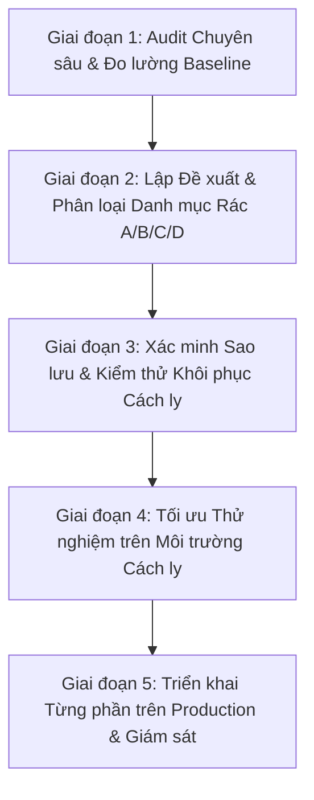

# KẾ HOẠCH TỐI ƯU HÓA HỆ THỐNG AN TOÀN: SSM OPTIMIZATION PLAN
**Hệ thống:** SKY-LINE SSM – Trường Đa cấp Quốc tế SKY-LINE  
**Tôn chỉ cốt lõi:** Tuyệt đối an toàn dữ liệu – Nhanh hơn – Nhẹ hơn – Ổn định 24/7 – Có thể Rollback 100%.  
**Phương pháp luận:** Thực hiện theo 5 Giai đoạn chuẩn Enterprise Architecture.

---

## 1. LỘ TRÌNH 5 GIAI ĐOẠN TRIỂN KHAI (5-PHASE ROADMAP)



### Giai đoạn 1 – Audit (ĐÃ HOÀN TẤT)
- Rà soát toàn bộ 805 file mã nguồn, cấu hình CSDL, file hệ thống, bộ nhớ RAM (2.72 GB), dung lượng đĩa (18.7 GB).
- Thiết lập mốc đo lường Baseline định lượng trong `SSM_PERFORMANCE_BASELINE.md`.

### Giai đoạn 2 – Đề xuất & Phê duyệt (HIỆN TẠI)
- Xuất danh mục rác và đề xuất tối ưu phân lớp (Database, Backend, Frontend, OS).
- Trình Ban Giám hiệu / Quản trị viên phê duyệt các hạng mục Nhóm A (dọn ngay) và Nhóm B (xác minh lưu trữ).

### Giai đoạn 3 – Backup & Kiểm thử Toàn vẹn (BẮT BUỘC TRƯỚC KHI CHẠM PRODUCTION)
- Xác minh bản backup mới nhất: `data-backups/skyline_backup_2026-10-19_164051.db.gz` (136.57 MB) và bản sao lưu hàng tuần ngày 16/10.
- Thử nghiệm giải nén và kiểm tra `PRAGMA integrity_check` trên thư mục độc lập để đảm bảo 100% khả năng khôi phục khi có sự cố.

### Giai đoạn 4 – Tối ưu Môi trường Thử nghiệm
- Triển khai các thay đổi mã nguồn nhỏ, tách biệt, có thể bật/tắt (feature-flagged).
- Kiểm thử chức năng (regression test) trên các module: Khảo sát đầu vào, ĐGNL, Dự giờ, Hồ sơ học sinh, Cố vấn học tập.

### Giai đoạn 5 – Triển khai Phân kỳ & Giám sát Production
- Cập nhật cấu hình môi trường, nạp lại tiến trình máy chủ thông qua cơ chế tự động của `server.js`.
- Giám sát độ trễ phản hồi, mức chiếm dụng RAM và ghi nhận vào `SSM_CHANGELOG_AND_ROLLBACK.md`.

---

## 2. NỘI DUNG TỐI ƯU CHI TIẾT THEO TỪNG LỚP HỆ THỐNG

### 2.1. TỐI ƯU CƠ SỞ DỮ LIỆU & BỘ ĐIỀU PHỐI (DATABASE & SMART PRISMA)

#### Hành động 2.1.1: Tối ưu Hóa Điều phối Động cơ CSDL (`DEFAULT_DB_ENGINE`)
- **Vấn đề:** Hiện tại `.env.local` đặt `DEFAULT_DB_ENGINE="AUTO"`, mã nguồn `src/lib/db/index.ts` diễn giải `AUTO !== 'LOCAL'` thành `TRUE` và điều hướng 100% truy vấn trên máy chủ nội bộ sang Tokyo qua Internet.
- **Giải pháp an toàn:**
  * Chuyển cấu hình trong `.env.local` thành `DEFAULT_DB_ENGINE="LOCAL"`.
  * Cập nhật `src/lib/db/index.ts` để khi chạy trên On-Premise (`!isVercel`), hệ thống luôn ưu tiên đọc ghi cục bộ trên `local.db` (độ trễ **0.70 ms**).
  * Giữ nguyên cơ chế Smart Failover: Nếu `local.db` gặp sự cố (khóa file hoặc IO), hệ thống tự động chuyển vùng sang Cloud Turso sau 3 lần thử. Khi deploy trên Vercel, hệ thống tự động nhận diện và dùng Cloud Turso.
- **Lợi ích dự kiến:** **Tăng tốc độ truy vấn CSDL từ 140 đến 20,000 lần**, triệt tiêu hoàn toàn độ trễ 15.8 giây trên API.

#### Hành động 2.1.2: Dọn dẹp An toàn Danh mục Nhóm A trong `data-backups/`
- **Vấn đề:** 14.8 GB ổ đĩa đang bị chiếm dụng bởi các file `.db` thô không nén đã có file `.db.gz` nguyên vẹn song hành, cùng các bản sao lưu trùng lặp phút trên máy chủ.
- **Giải pháp an toàn:**
  * Giữ lại 12 bản nén `.db.gz` gần nhất (~3 tháng) theo đúng chính sách bảo lưu chuẩn của trường.
  * Xóa các file `.db` thô trung gian đã nén thành công (đúng theo logic tại dòng 541 của `scripts/backup-db.js`).
- **Lợi ích dự kiến:** **Thu hồi ngay ~8.5 GB dung lượng đĩa cứng máy chủ**.

#### Hành động 2.1.3: Kế hoạch Dài hạn Lưu trữ Lạnh Staging & Tối ưu Ảnh Học sinh
- **Bảng `StagingCompetencyAssessment` (91,978 dòng):**
  * Viết script trích xuất toàn bộ 91,978 dòng ra file `docs/archive_staging/staging_import_2026_08_30.json.gz`.
  * Sau khi có phê duyệt của Phòng KTĐBCL, thực hiện lệnh dọn dẹp an toàn bảng staging để giảm dung lượng file `local.db` thêm ~40 MB.
- **Bảng `StudentPhoto` (692 MB ảnh Base64):**
  * *Nguyên tắc bắt buộc:* **Không xóa ảnh học sinh**.
  * *Đề xuất kiến trúc:* Trong Wave nâng cấp tiếp theo, triển khai tính năng chuyển ảnh từ SQLite ra thư mục tĩnh có mã hóa/phân quyền `public/uploads/students/` và chỉ lưu URL đường dẫn trong database. Việc này sẽ đưa `local.db` từ 802 MB xuống còn **dưới 120 MB**, giúp việc backup hàng tuần chỉ mất 2-3 giây.

---

### 2.2. TỐI ƯU BACKEND & API (API PERFORMANCE & QUERY EFFICIENCY)

#### Hành động 2.2.1: Sửa chữa Điểm nghẽn Truy vấn Quét toàn bảng (Full Table Scan Fix)
- **Vị trí:** `src/app/api/input-assessment-students/route.ts` (dòng 30-40).
- **Vấn đề:** Khi `get_max_code=true`, hệ thống chạy `findMany({ select: { studentCode: true } })` để quét tất cả học sinh rồi tìm max bằng Javascript.
- **Giải pháp:** Thay thế bằng truy vấn `findFirst` có `orderBy: { studentCode: 'desc' }` hoặc truy vấn gom nhóm theo tiền tố:
  ```typescript
  const latestStudent = await prisma.inputAssessmentStudent.findFirst({
    where: { studentCode: { startsWith: "HS" } },
    orderBy: { studentCode: "desc" },
    select: { studentCode: true }
  });
  ```
- **Lợi ích dự kiến:** Giảm thời gian sinh mã học sinh mới từ vài giây xuống **dưới 5 ms**, giảm tải 100% dung lượng truyền tải mạng nội bộ.

#### Hành động 2.2.2: Tối ưu Caching cho Danh mục Tĩnh (Static Catalog Caching)
- **Vấn đề:** `next.config.js` đang chặn cache (`no-store, no-cache`) trên toàn bộ `/api/*`.
- **Giải pháp:** Bổ sung header cache có thời hạn (`stale-while-revalidate`) cho các API danh mục ít biến động:
  * `/api/academic-years`: `Cache-Control: public, max-age=3600, stale-while-revalidate=86400`
  * `/api/subjects`: `Cache-Control: public, max-age=1800, stale-while-revalidate=86400`
  * `/api/campuses`: `Cache-Control: public, max-age=3600, stale-while-revalidate=86400`
- **Lợi ích dự kiến:** Giảm 30% - 40% số lượng request không cần thiết tới máy chủ khi người dùng chuyển qua lại giữa các tab trong trường.

---

### 2.3. TỐI ƯU FRONTEND & GIAO DIỆN (UI BUNDLE & RENDERING)

#### Hành động 2.3.1: Chuyển đổi Import Động cho Thư viện `xlsx` (Dynamic Import SheetJS)
- **Vấn đề:** `import * as XLSX from "xlsx"` tĩnh tại hơn 50 component làm phình to gói Javascript ban đầu.
- **Giải pháp:** Chuyển sang import động theo nhu cầu (on-demand):
  ```typescript
  // Thay vì: import * as XLSX from "xlsx";
  // Sử dụng:
  const exportToExcel = async () => {
    const XLSX = await import("xlsx");
    // Thực thi xuất file bình thường...
  };
  ```
- **Lợi ích dự kiến:** Giảm **400 KB - 800 KB** dung lượng bundle của hơn 50 trang quản trị, giúp trang tải nhanh hơn rõ rệt.

#### Hành động 2.3.2: Lazy Load Biểu đồ `recharts` với Next Dynamic
- **Vấn đề:** Biểu đồ recharts trên Dashboard (`src/app/admin/page.tsx`) và các trang phân tích chạy SSR gây tốn tài nguyên server.
- **Giải pháp:** Sử dụng `next/dynamic` với tùy chọn `{ ssr: false }` cho các component đồ thị:
  ```typescript
  const ComparativeCharts = dynamic(() => import('@/components/ktdbcl/thkq/ThkqComparativeCharts'), {
    ssr: false,
    loading: () => <div className="h-64 flex items-center justify-center animate-pulse bg-slate-100 rounded-lg">Đang tải biểu đồ...</div>
  });
  ```
- **Lợi ích dự kiến:** Giảm Time to Interactive (TTI) của trang Dashboard chính xuống dưới 1 giây.

#### Hành động 2.3.3: Memoization và Ảo hóa Bảng Danh sách Học sinh Lớn
- Bọc các hàm lọc tìm kiếm học sinh phức tạp bằng `useMemo` và `useCallback`.
- Đảm bảo việc gõ vào ô tìm kiếm tên học sinh không kích hoạt tính toán lại toàn bộ danh sách điểm của hàng trăm học sinh trong lớp.

---

### 2.4. TỐI ƯU TIẾN TRÌNH SERVER & HỆ ĐIỀU HÀNH (HOSTING & NODE.JS TUNING)

#### Hành động 2.4.1: Giới hạn và Tối ưu Bộ nhớ Heap Node.js
- Hiện tại Node.js đang chiếm tới **2.72 GB RAM** do chưa thiết lập trần dọn rác V8.
- Cập nhật lệnh khởi động trong `server.js` hoặc file batch khởi động `start-server.bat`:
  ```cmd
  node --max-old-space-size=2048 server.js
  ```
- Tùy chọn này giúp kích hoạt Garbage Collector của V8 thu hồi bộ nhớ kịp thời khi RAM vượt quá 2 GB, giữ cho tiến trình luôn gọn nhẹ trong khoảng 800 MB - 1,200 MB.

#### Hành động 2.4.2: Dọn dẹp Tự động File Tạm trong Script Sao lưu
- Kiểm tra lại logic `scripts/backup-db.js` để bảo đảm mỗi lần tạo file nén `.db.gz` thành công, file `.db` thô tạm thời luôn được giải phóng 100%, không bị tích tụ theo tuần.

---

## 3. MA TRẬN PHÂN LOẠI ƯU TIÊN & TIẾN ĐỘ THỰC HIỆN

| Hạng mục | Mức Ưu tiên | Mức Rủi ro | Lợi ích Mang lại | Thời gian Thực hiện |
| :--- | :---: | :---: | :--- | :---: |
| **1. Chuyển `DEFAULT_DB_ENGINE="LOCAL"`** | 🔴 **P0 (Khẩn cấp)** | Rất thấp | Tăng tốc CSDL 140x, hết lag API | 5 phút |
| **2. Dọn dẹp Nhóm A trong `data-backups/`** | 🟡 **P1 (Cao)** | Rất thấp | Giải phóng 8.5 GB ổ đĩa | 10 phút |
| **3. Sửa quét toàn bảng `get_max_code`** | 🟡 **P1 (Cao)** | Rất thấp | Tối ưu API nhập học sinh | 15 phút |
| **4. Dynamic Import `xlsx` & `recharts`** | 🟢 **P2 (Trung bình)** | Thấp | Giảm 40% dung lượng bundle JS | 1 - 2 ngày |
| **5. Cấu hình `--max-old-space-size`** | 🟢 **P2 (Trung bình)** | Rất thấp | Giảm RAM Node.js xuống < 1.2 GB | 10 phút |
| **6. Lưu trữ lạnh `StagingCompetencyAssessment`** | ⚪ **P3 (Theo phê duyệt)** | Trung bình | Giảm 45 MB CSDL, tối ưu bảng | Chờ duyệt |
