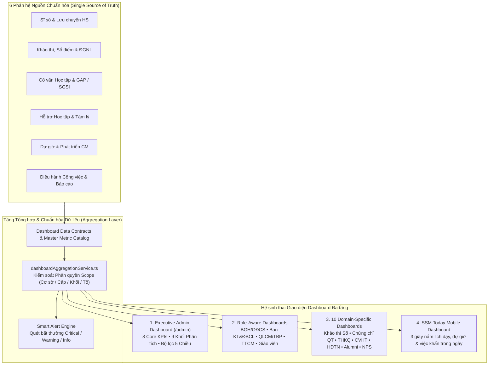
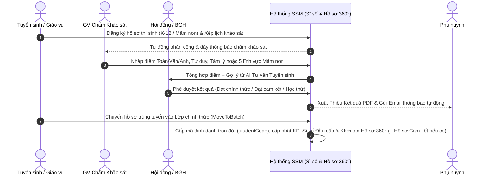
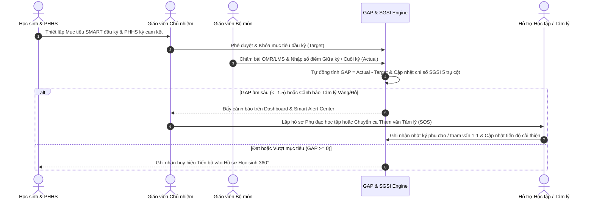

# TÀI LIỆU ĐẶC TẢ TOÀN DIỆN CÁC TÍNH NĂNG HỆ THỐNG SKY-LINE SSM (SQMS)

**Hệ thống:** Quản trị Chất lượng Giáo dục & Điều hành Trường học Số — **SKY-LINE SSM (SQMS Portal)**  
**Đơn vị chủ quản:** Hệ thống Giáo dục Sky-Line (Sky-Line Education System)  
**Địa chỉ truy cập:** [https://ssm.skylineschool.edu.vn/](https://ssm.skylineschool.edu.vn/)  
**Phạm vi áp dụng:** Toàn bộ các cơ sở đào tạo (`CS1` – `CS5`), xuyên suốt từ bậc **Mầm non**, **Phổ thông K-12 (Tiểu học – THCS – THPT)** đến mạng lưới **Cựu học sinh (Sky-Line Alumni)**.  
**Phiên bản tài liệu:** Baseline v2.5 (Cập nhật toàn diện Tháng 10/2026)

---

## MỤC LỤC

1. [Tổng quan Tầm nhìn & Kiến trúc Hệ thống](#1-tổng-quan-tầm-nhìn--kiến-trúc-hệ-thống)
2. [Hệ sinh thái 5 Cổng Giao diện Đa Đối tượng (Multi-Portal)](#2-hệ-sinh-thái-5-cổng-giao-diện-đa-đối-tượng-multi-portal)
3. [TRỌNG TÂM: Trung tâm Điều hành Thông minh & Hệ sinh thái Dashboard Đa tầng](#3-trọng-tâm-trung-tâm-điều-hành-thông-minh--hệ-sinh-thái-dashboard-đa-tầng)
   - [3.1. Triết lý Thiết kế & Kiến trúc Dữ liệu Dashboard Tập trung](#31-triết-lý-thiết-kế--kiến-trúc-dữ-liệu-dashboard-tập-trung)
   - [3.2. Executive Admin Dashboard – Trung tâm Điều hành Quản trị Toàn Hệ thống (/admin)](#32-executive-admin-dashboard--trung-tâm-điều-hành-quản-trị-toàn-hệ-thống-admin)
   - [3.3. Hệ thống Dashboard Phân quyền theo 5 Vai trò Tác nghiệp (Role-Aware Dashboards)](#33-hệ-thống-dashboard-phân-quyền-theo-5-vai-trò-tác-nghiệp-role-aware-dashboards)
   - [3.4. Hệ thống 10 Dashboard Chuyên sâu theo Phân hệ Nghiệp vụ (Domain Dashboards)](#34-hệ-thống-10-dashboard-chuyên-sâu-theo-phân-hệ-nghiệp-vụ-domain-dashboards)
4. [Chi tiết 12 Phân hệ Nghiệp vụ Cốt lõi](#4-chi-tiết-12-phân-hệ-nghiệp-vụ-cốt-lõi)
   - [Phân hệ 1: Quản trị Hệ thống, Phân quyền & Bảo mật (SYSTEM)](#phân-hệ-1-quản-trị-hệ-thống-phân-quyền--bảo-mật-system)
   - [Phân hệ 2: Khảo thí & Đảm bảo Chất lượng Giáo dục (KT&ĐBCL)](#phân-hệ-2-khảo-thí--đảm-bảo-chất-lượng-giáo-dục-ktđbcl)
   - [Phân hệ 3: Quản lý Môn học Đặc thù Sky-Line (SPECIAL SUBJECTS)](#phân-hệ-3-quản-lý-môn-học-đặc-thù-sky-line-special-subjects)
   - [Phân hệ 4: Quản lý Hoạt động Trải nghiệm & Dự án (EXPERIENTIAL)](#phân-hệ-4-quản-lý-hoạt-động-trải-nghiệm--dự-án-experiential)
   - [Phân hệ 5: Học liệu Số & Tiện ích Sư phạm (LEARNING RESOURCES)](#phân-hệ-5-học-liệu-số--tiện-ích-sư-phạm-learning-resources)
   - [Phân hệ 6: Quản lý Đào tạo, Thời khóa biểu & Sỹ số (TRAINING)](#phân-hệ-6-quản-lý-đào-tạo-thời-khóa-biểu--sỹ-số-training)
   - [Phân hệ 7: Cố vấn Học tập, Tâm lý Học đường & Chỉ số SGSI (ADVISORY)](#phân-hệ-7-cố-vấn-học-tập-tâm-lý-học-đường--chỉ-số-sgsi-advisory)
   - [Phân hệ 8: Hồ sơ Học sinh 360° & Trung tâm Tra cứu (STUDENT 360 & LOOKUP)](#phân-hệ-8-hồ-sơ-học-sinh-360--trung-tâm-tra-cứu-student-360--lookup)
   - [Phân hệ 9: Quản lý Mạng lưới Cựu học sinh (SKY-LINE ALUMNI)](#phân-hệ-9-quản-lý-mạng-lưới-cựu-học-sinh-sky-line-alumni)
   - [Phân hệ 10: Khảo sát Năng lực Đầu vào & Tuyển sinh (ENTRANCE ASSESSMENT)](#phân-hệ-10-khảo-sát-năng-lực-đầu-vào--tuyển-sinh-entrance-assessment)
   - [Phân hệ 11: Khảo sát Định kỳ, Phản hồi Đa chiều & Đo lường NPS (SURVEY & NPS)](#phân-hệ-11-khảo-sát-định-kỳ-phản-hồi-đa-chiều--đo-lường-nps-survey--nps)
   - [Phân hệ 12: Dự giờ, Phát triển Chuyên môn & AI Growth (OBSERVATION)](#phân-hệ-12-dự-giờ-phát-triển-chuyên-môn--ai-growth-observation)
5. [Đặc tả Chi tiết các Cổng Chuyên biệt (Parent, Student, Online Exam, Alumni & QR)](#5-đặc-tả-chi-tiết-các-cổng-chuyên-biệt-parent-student-online-exam-alumni--qr)
6. [Điều hành Công việc, Báo cáo Tuần & Trợ lý Trí tuệ Nhân tạo (SSM AI & PWA)](#6-điều-hành-công-việc-báo-cáo-tuần--trợ-lý-trí-tuệ-nhân-tạo-ssm-ai--pwa)
7. [Ma trận Phân quyền 15 Vai trò Người dùng (Actors & Role Matrix)](#7-ma-trận-phân-quyền-15-vai-trò-người-dùng-actors--role-matrix)
8. [Các Luồng Nghiệp vụ Liên Phân hệ Khép kín (End-to-End Workflows)](#8-các-luồng-nghiệp-vụ-liên-phân-hệ-khép-kín-end-to-end-workflows)
9. [Danh mục Biểu mẫu Xuất bản (PDF/Excel) & Hệ thống Thông báo Tự động](#9-danh-mục-biểu-mẫu-xuất-bản-pdfexcel--hệ-thống-thông-báo-tự-động)
10. [Tổng kết Các Chỉ số Quy mô & Kiến trúc Kỹ thuật](#10-tổng-kết-các-chỉ-số-quy-mô--kiến-trúc-kỹ-thuật)

---

## 1. TỔNG QUAN TẦM NHÌN & KIẾN TRÚC HỆ THỐNG

**SKY-LINE SSM (School Quality Management System – SQMS)** là nền tảng quản trị chất lượng giáo dục, điều hành tác nghiệp và hồ sơ học tập điện tử hợp nhất được thiết kế chuyên biệt cho Hệ thống Giáo dục Sky-Line.

### Triết lý Vận hành Hợp nhất ("THE ONE ARCHITECTURE")
1. **ONE Source of Truth per Domain**: Mỗi phân hệ nghiệp vụ là chủ quản duy nhất của dữ liệu chuyên môn (Khảo thí, Dự giờ, Cố vấn, Hỗ trợ học tập, Hoạt động trải nghiệm); Hồ sơ 360° và Hệ thống Dashboard điều hành tổng hợp dữ liệu trực tiếp theo thời gian thực.
2. **ONE Lifelong Student Identity**: Mỗi học sinh có một mã định danh duy nhất (`studentCode`) liên thông xuyên suốt từ Mầm non, Tiểu học, THCS, THPT cho đến khi trở thành Cựu học sinh (Alumni), không đứt gãy lịch sử qua các năm học.
3. **ONE Canonical Subject & Competency Mapping**: Chuẩn hóa danh mục môn học và từ điển năng lực dùng chung trên toàn hệ thống, kết nối đồng bộ điểm số MOET, Chương trình Quốc tế (CTQT) và Mục tiêu học tập.
4. **ONE Deterministic Analytics & GAP Engine**: Công thức tính toán khoảng cách mục tiêu $\text{GAP} = \text{Actual} - \text{Target}$, phổ điểm, độ lệch chuẩn và chỉ số **SGSI** hoàn toàn tất định, chính xác 100%.
5. **ONE Dual-Core Database Engine**: Kết hợp **SQLite 3 On-Premise** (độ trễ truy vấn $< 1\text{ms}$) và **LibSQL Turso Cloud Failover** kèm cơ chế sao lưu lai tự động (Hybrid Backup Engine).
6. **ONE Dual-Run Experience (Desktop & Mobile PWA)**: Giao diện tự động thích ứng giữa **Web Desktop** ($\ge 1200\text{px}$) phục vụ phân tích Dashboard/bảng biểu chuyên sâu và **SSM PWA Mobile** ($< 768\text{px}$) phục vụ tác nghiệp nhanh 1 chạm.
7. **ONE Bilingual Interface (VI / EN)**: Hỗ trợ chuyển đổi song ngữ Tiếng Việt – Tiếng Anh tức thì cho đội ngũ Giáo viên Việt Nam và Giáo viên Nước ngoài (GVNN).
8. **ONE RBAC & SBAC Security Model**: Phân quyền đa tầng theo Vai trò (Role-Based) kết hợp Phạm vi Cơ sở / Tổ bộ môn / Lớp phụ trách (Scope-Based) và phòng chống truy cập chéo (Anti-IDOR).

---

## 2. HỆ SINH THÁI 5 CỔNG GIAO DIỆN ĐA ĐỐI TƯỢNG (MULTI-PORTAL)

| STT | Cổng Giao diện | Đường dẫn gốc | Đối tượng sử dụng | Chức năng trọng tâm |
| :--- | :--- | :--- | :--- | :--- |
| **1** | **Admin & Executive Portal** | `/admin` | Super Admin, HĐQT, Ban Giám hiệu (BGH), Giám đốc Cơ sở (GĐCS), Ban KT&ĐBCL, Giáo vụ, CTHS, Tuyển sinh | Trung tâm Điều hành Quản trị (Executive Dashboard), quản trị 12 phân hệ, phê duyệt kết quả, cấu hình hệ thống, giám sát tiến độ & KPI. |
| **2** | **Teacher Workspace Portal** | `/teacher` | Giáo viên Chủ nhiệm (GVCN), Giáo viên Bộ môn (GVBM), GV Mầm non, GV Nước ngoài (GVNN), Tổ trưởng CM (TTCM) | Dashboard Giáo viên & TTCM, Sổ giáo viên điện tử, quản lý lớp chủ nhiệm, nhập sổ điểm MOET/CTQT, cố vấn học tập, phụ đạo/bồi dưỡng, dự giờ, khảo thí số. |
| **3** | **Parent Portal** | `/parent` | Phụ huynh học sinh (PHHS) | Dashboard Phụ huynh, theo dõi điểm số, xem Hồ sơ năng lực 360° của con, trao đổi 2 chiều với GVCN/GVBM, xem nhật ký cố vấn và thực hiện khảo sát định kỳ. |
| **4** | **Student Portal** | `/hocsinh/portal` | Học sinh toàn trường | Dashboard Học sinh (5 trụ cột năm học), Sổ mục tiêu SMART, tự nhìn nhận (Self-Reflection), xem Bản đồ năng lực Radar, gửi yêu cầu hỗ trợ, nộp ảnh thẻ. |
| **5** | **Alumni & QR Verification Portal** | `/alumni/portal` & `/profile/verify/[code]` | Cựu học sinh, Giáo viên, Phụ huynh | Xác thực Hồ sơ Học tập trọn đời qua mã QR trên bảng tên/học bạ; Cựu học sinh tự cập nhật lộ trình Đại học, Học bổng và Nghề nghiệp qua xác thực OTP. |

---

## 3. TRỌNG TÂM: TRUNG TÂM ĐIỀU HÀNH THÔNG MINH & HỆ SINH THÁI DASHBOARD ĐA TẦNG

Hệ thống **Dashboard của SKY-LINE SSM** không chỉ là trang biểu đồ thống kê tĩnh, mà được kiến tạo như một **Trung tâm Chỉ huy & Điều hành Giáo dục Thời gian thực (Real-time Educational Command Center)** vận hành theo chu trình khép kín:

$$\mathbf{Observe\ (Quan\ sát)} \longrightarrow \mathbf{Understand\ (Thấu\ hiểu)} \longrightarrow \mathbf{Drill\text{-}down\ (Đào\ sâu)} \longrightarrow \mathbf{Act\ (Hành\ động\ ngay)}$$

### 3.1. Triết lý Thiết kế & Kiến trúc Dữ liệu Dashboard Tập trung
- **ONE Metric Catalog (`dashboardDataContract.ts`)**: Mọi chỉ số điều hành (`OBS_COMPLETION_RATE`, `GOAL_ATTAINMENT_RATE`, `ASSESSMENT_PASS_RATE`, `SUPPORT_ACTIVE_COUNT`...) đều có định nghĩa, đơn vị tính, công thức chuẩn và chủ quản dữ liệu duy nhất.
- **Zero Dead-End Dashboard (Không điểm cụt)**: 100% thẻ KPI, biểu đồ và dòng cảnh báo trên Dashboard đều tích hợp **liên kết Drill-down trực tiếp** đưa người quản lý đến đúng danh sách học sinh, lớp học hoặc phiếu nghiệp vụ cần xử lý mà không phải tìm kiếm lại từ menu.
- **Thanh Bộ lọc Thống nhất 5 Chiều (`AdminUnifiedFilterBar`)**:
  - Cho phép lọc chéo toàn bộ Dashboard tức thì theo: **(1) Năm học** $\times$ **(2) Cơ sở (`CS1`–`CS5` / Toàn hệ thống)** $\times$ **(3) Cấp học (Mầm non, Tiểu học, THCS, THPT)** $\times$ **(4) Khối lớp** $\times$ **(5) Khoảng thời gian**.
  - Tích hợp công tắc **Tự động làm mới (Auto-Refresh)** và hiển thị thời điểm đồng bộ dữ liệu gần nhất (`Data Freshness`).
- **Hệ Màu Nhận diện Thương hiệu theo Cơ sở (Campus Color Coding)**:
  - `CS1` *(Sky-Line Central)*: Xanh Sky-Line (`#48BFE3`)
  - `CS2` *(Sky-Line Riverside)*: Xanh Tím (`#6C5CE7`)
  - `CS3` *(Sky-Line Hill)*: Tím than đậm (`#2E1065`)
  - `CS4` *(Sky-Line International)*: Vàng hổ phách (`#D97706`)
  - `CS5` *(Sky-Line Global)*: Xám xanh (`#475569`)

---

### 3.2. Executive Admin Dashboard – Trung tâm Điều hành Quản trị Toàn Hệ thống (`/admin`)
*Mã nguồn: `src/app/admin/page.tsx` • Dành cho HĐQT, Ban Giám hiệu, Giám đốc Cơ sở và Ban KT&ĐBCL*

Giao diện **Executive Dashboard** được bố cục khoa học thành **9 Khối Phân tích Chiến lược** giúp lãnh đạo nắm bắt toàn diện "sức khỏe" học thuật và vận hành của toàn hệ thống chỉ trên một màn hình:

#### A. Hệ thống 8 Thẻ KPI Điều hành Cốt lõi (`8 Core Executive KPI Cards`)
Mỗi thẻ KPI hiển thị đồng thời **Chỉ số chính**, **Xu hướng biến động (`Trend Up/Down`)**, **Chỉ số đối sánh phụ (`Sub-metrics`)**, **Thanh tiến độ (`Progress Bar`)** và **Nút Drill-down**:
1. **KPI 1 – Tổng Sĩ số Học sinh Đang học**: Tổng quy mô toàn trường, tách rõ *Phổ thông K-12* và *Mầm non*, biến động tăng/giảm ròng (`± HS ròng`), sĩ số trung bình/lớp và quy mô học sinh đầu cấp $\rightarrow$ *Drill-down: Quản lý & Chốt sĩ số (`/admin/sy-so`)*.
2. **KPI 2 – Quy mô Lớp học & Biến động Lưu chuyển**: Tổng số lớp hoạt động (Phổ thông & Mầm non), thống kê tức thời số lượng học sinh *Nhập mới*, *Chuyển đi*, *Đổi lớp* $\rightarrow$ *Drill-down: Quản lý lưu chuyển HS (`/admin/student-transfers`)*.
3. **KPI 3 – Khảo thí Đầu vào & Kỳ thi**: Tổng hồ sơ dự khảo sát đầu vào, tỷ lệ `% đạt/nhập học`, tách số lượng *K-12*, *Mầm non*, số hồ sơ *Chờ duyệt*, tổng số kỳ thi và giải thưởng đạt được $\rightarrow$ *Drill-down: Xét duyệt kết quả KSĐV (`/admin/xet-duyet-ket-qua`)*.
4. **KPI 4 – Chất lượng Học tập & Phổ điểm**: Điểm trung bình chung toàn hệ thống (thang 10), tỷ lệ `% đạt chuẩn (≥ 5.0)`, tỷ lệ `% Giỏi/Xuất sắc (≥ 8.0)`, tổng số bản ghi Đánh giá năng lực và số học sinh đang nhận hỗ trợ $\rightarrow$ *Drill-down: Báo cáo chất lượng KT&ĐBCL (`/admin/ktdbcl/thong-ke-bao-cao`)*.
5. **KPI 5 – Cố vấn Học tập & Mục tiêu Học sinh**: Tổng số mục tiêu SMART đã thiết lập, số học sinh đã lập mục tiêu, số học sinh đã được tư vấn 1-1 và tổng số phiên tham vấn $\rightarrow$ *Drill-down: Điều hành Cố vấn học tập (`/admin/co-van-hoc-tap`)*.
6. **KPI 6 – Dự giờ & Đánh giá Tiết dạy**: Tỷ lệ hoàn thành phiếu đánh giá dự giờ (`Số phiếu đã chấm / Số lượt đăng ký`), tổng số tiết mở dự giờ, số tiết đang mở và số giáo viên có định mức $\rightarrow$ *Drill-down: Tổng hợp dự giờ toàn trường (`/admin/tong-hop-du-gio`)*.
7. **KPI 7 – Hỗ trợ Học tập & Tâm lý**: Tổng số hồ sơ đang theo dõi can thiệp (*Phụ đạo học tập*, *Tư vấn tâm lý*, *Học sinh diện cam kết đầu vào*) và số ca đã hoàn tất hỗ trợ $\rightarrow$ *Drill-down: Quản lý hồ sơ hỗ trợ (`/admin/ktdbcl/support`)*.
8. **KPI 8 – Tiến độ Nhiệm vụ Điều hành**: Tỷ lệ `% hoàn thành` công việc giao xuống các phòng ban/tổ chuyên môn, số việc *Hoàn thành*, *Đang làm* và cảnh báo đỏ số việc *Quá hạn* $\rightarrow$ *Drill-down: Bảng điều hành công việc (`/admin/tasks`)*.

#### B. Trung tâm Cảnh báo Thông minh (`Smart Alert Center`)
- Tự động quét dữ liệu toàn hệ thống theo thời gian thực để đẩy các cảnh báo bất thường lên đầu trang theo 3 cấp độ nghiêm trọng:
  - 🔴 **Nghiêm trọng (`CRITICAL`)**: Học sinh có cảnh báo tâm lý Đỏ SOS, học sinh tụt giảm điểm số đột biến ($\text{GAP} < -1.5$), công việc điều hành hoặc sổ điểm quá hạn khóa sổ.
  - 🟠 **Cảnh báo (`WARNING`)**: Hồ sơ khảo sát đầu vào chờ xét duyệt, phiếu dự giờ quá hạn 48h chưa chấm, yêu cầu mở khóa sổ điểm đang chờ duyệt.
  - 🔵 **Thông tin (`INFO`)**: Học sinh mới nộp đề xuất mục tiêu học tập chờ GVCN xác nhận, thông báo cập nhật dữ liệu định kỳ.

#### C. Tổ hợp Biểu đồ Phân tích Chuyên sâu Đa Chế độ (Interactive Multi-Mode Charts)
1. **Biểu đồ Kết hợp Xu hướng Biến động Sĩ số 12 Tháng (`ComposedChart`)**: Kết hợp biểu đồ cột chồng (*Sĩ số Phổ thông* + *Sĩ số Mầm non*) và biểu đồ đường (*Tổng sĩ số toàn trường*) qua từng tháng trong năm học.
2. **Biểu đồ Phân bố Sĩ số Đa chiều (3 Chế độ chuyển đổi)**:
   - *Tab 1 – Theo Cơ sở*: Biểu đồ cột so sánh quy mô `CS1`–`CS5` kèm bảng tỷ trọng `%` và chi tiết PT/MN từng cơ sở.
   - *Tab 2 – Theo Cấp học*: Biểu đồ tròn (`Donut PieChart`) tỷ lệ Mầm non, Tiểu học, THCS, THPT.
   - *Tab 3 – Theo Khối lớp*: Biểu đồ cột phân bố từng khối (có bộ lọc con: *Tất cả*, *Phổ thông K-12*, *Mầm non*).
3. **Biểu đồ Phân tích Khảo thí Đầu vào & Kỳ thi Học sinh**: Đối sánh số lượng thí sinh K-12 và Mầm non theo từng trạng thái (*Tổng hồ sơ, Đã chấm, Đạt/Nhập học, Chờ duyệt*) kèm dải thẻ tóm tắt Kỳ thi & Giải thưởng.
4. **Biểu đồ Phân tích Chất lượng Học tập & Phổ điểm (2 Chế độ chuyển đổi)**:
   - *Tab 1 – Theo Môn học (`ComposedChart`)*: Cột Điểm trung bình từng môn kết hợp đường tỷ lệ `% đạt chuẩn ≥ 5.0`.
   - *Tab 2 – Phổ điểm (`Score Distribution BarChart`)*: Phân bố số lượng đầu điểm theo các dải điểm (`< 5.0`, `5.0–6.5`, `6.5–8.0`, `8.0–9.0`, `9.0–10`).
5. **Biểu đồ Phân tích Cố vấn Học tập & Mục tiêu SMART**: Biểu đồ thanh ngang phân loại mục tiêu theo lĩnh vực kèm 4 chỉ số thực thi (*HS đã nộp phiếu, HS đã tư vấn 1-1, Tổng buổi tư vấn, PHHS đã ký cam kết*).
6. **Biểu đồ Phân tích Dự giờ & Chất lượng Tiết dạy (2 Chế độ chuyển đổi)**:
   - *Tab 1 – Theo Cấp học*: Đối sánh 3 chỉ số *Số tiết mở – Lượt đăng ký – Phiếu hoàn tất* giữa các cấp học.
   - *Tab 2 – Xếp loại Tiết dạy*: Phân bố số phiếu đánh giá theo các mức xếp loại chất lượng giờ dạy.
7. **Bảng Điều hành Công việc Trực tiếp**: Thanh tỷ trọng tiến độ công việc màu hóa và danh sách cuộn nhanh các nhiệm vụ gần nhất kèm trạng thái *Quá hạn / Đang xử lý / Hoàn thành*.
8. **Khối Phân tích Học sinh Đầu cấp (Khối 1, Khối 6, Khối 10) & Nguồn Lưu chuyển**:
   - Thống kê chuyên biệt 3 khối đầu cấp theo nguồn tuyển sinh (*Qua Khảo sát đầu vào, Tuyển thẳng từ Mẫu giáo lớn Sky-Line, Trực tiếp/Khác*).
   - Đối sánh luồng **Nhập học mới** vs **Học sinh chuyển trường** theo 3 phạm vi địa lý: *Nội tỉnh, Ngoại tỉnh, Quốc tế/Du học*.
   - **Bảng Tra cứu Học sinh Đầu cấp Tích hợp**: Nút *"Tra cứu HS đầu cấp"* cho phép mở bảng dữ liệu chi tiết có phân trang, tìm kiếm và lọc ngay trên mặt Dashboard.

---

### 3.3. Hệ thống Dashboard Phân quyền theo 5 Vai trò Tác nghiệp (Role-Aware Dashboards)
Thông qua tầng dịch vụ `dashboardAggregationService.ts`, mỗi vai trò khi đăng nhập sẽ nhận được bộ chỉ số KPI, biểu đồ và **Action Center (Việc cần làm)** đúng với phạm vi trách nhiệm của mình:

| Vai trò | Phạm vi Dữ liệu (Scope) | Các Chỉ số & Khối Điều hành Trọng tâm trên Dashboard |
| :--- | :--- | :--- |
| **1. Giáo viên (`TEACHER` – GVCN / GVBM)** | Các lớp giảng dạy & Lớp chủ nhiệm được phân công | • **Đồng hồ & Lời chào theo khung giờ** + Giao diện tự động đổi màu theo Cơ sở (`useCampusTheme`). • **Banner đếm ngược hạn chốt (`DeadlineCountdownBanner`)**: Nhắc hạn khóa sổ điểm, nộp báo cáo tuần. • **KPI Cá nhân**: Tiến độ dự giờ cá nhân (`%`), Học sinh cần chú ý (GAP âm lớn), Mục tiêu HS chờ duyệt, Đợt trải nghiệm cần chấm. • **3 Phân vùng Tác nghiệp Nhanh**: *Công tác GVCN*, *Công tác GVBM*, *Tiện ích & Phát triển CM*. |
| **2. Tổ trưởng Chuyên môn (`TTCM`)** | Toàn bộ giáo viên & môn học thuộc Tổ chuyên môn | • **Nút chuyển đổi chế độ 1 chạm**: *Chế độ Giáo viên (Cá nhân)* $\leftrightarrow$ *Chế độ Quản lý (Tổ CM)*. • **KPI Cấp Tổ**: Tiến độ dự giờ toàn tổ (`%`), Độ phủ giáo viên trong tổ được dự giờ (`%`), Tỷ lệ đạt chuẩn bộ môn của tổ (`%`), Số đề thi & phiếu dự giờ chờ TTCM duyệt. • **Ma trận Dự giờ TTCM**: Giám sát chéo lượt dự giờ giữa các thành viên trong tổ. |
| **3. Quản lý Chuyên môn / Trưởng Bộ phận (`QLCM / TBP`)** | Các Tổ chuyên môn & Khối lớp thuộc cấp học phụ trách | • **So sánh Liên Tổ (Cross-Department Benchmark)**: Đối sánh chất lượng điểm số, tiến độ nhập điểm và tỷ lệ hoàn thành dự giờ giữa các tổ bộ môn. • **Giám sát Hỗ trợ Học tập & Tâm lý cấp Khối**: Theo dõi số lượng học sinh diện cảnh báo Vàng/Đỏ và tiến độ phụ đạo/bồi dưỡng. |
| **4. Giám đốc Cơ sở / Ban Giám hiệu (`GDCS / BGH`)** | Toàn bộ hoạt động của Cơ sở (`CS1`–`CS5`) hoặc Toàn trường | • **Executive Dashboard cấp Cơ sở**: Toàn bộ 8 KPI cốt lõi, biến động sĩ số tháng, tỷ lệ chuyển trường, tiến độ công việc các bộ phận và chỉ số hài lòng phụ huynh (NPS) tại cơ sở. |
| **5. Ban Khảo thí & ĐBCL (`KT_DBCL`)** | Toàn bộ 5 Cơ sở trên toàn hệ thống | • **Đối chuẩn Liên Cơ sở (Cross-Campus Quality Benchmark)**: So sánh phổ điểm, độ lệch chuẩn, kết quả chứng chỉ quốc tế giữa 5 cơ sở. • **Kiểm toán Chất lượng Dữ liệu (Data Quality Audit)**: Giám sát tiến độ nhập sổ điểm toàn trường, duyệt yêu cầu mở khóa sổ điểm và xử lý ticket trên *KT&ĐBCL Connect*. |

---

### 3.4. Hệ thống 10 Dashboard Chuyên sâu theo Phân hệ Nghiệp vụ (Domain Dashboards)
Ngoài Dashboard trung tâm, mỗi phân hệ lớn đều sở hữu một **Sub-Dashboard chuyên sâu** phục vụ phân tích nghiệp vụ đặc thù:
1. **Dashboard Khảo thí Số (OMR & LMS)** (`/admin/ktdbcl/khao-thi-so?tab=overview`): Giám sát kỳ kiểm tra đang mở, tiến độ quét phiếu OMR, đồng bộ Moodle LMS và phân tích độ khó đề thi.
2. **Dashboard Chuyên biệt 5 Chuẩn Khảo thí Quốc tế** (`/admin/ktdbcl/international-exams`): Phân tích chuyên sâu từng hệ chứng chỉ (*Cambridge YLE Shields, KET/PET Scale, IELTS Band Distribution, Pearson Edexcel, Cambridge Checkpoint*) và tỷ lệ đạt mục tiêu chuẩn đầu ra Sky-Line.
3. **Dashboard Giám sát Tiến độ Nhập điểm & Phổ điểm** (`/admin/ktdbcl/thong-ke-bao-cao`): Theo dõi thời gian thực `%` hoàn thành sổ điểm của từng giáo viên, biểu đồ phân tán tương quan điểm số (`scatter-plot`) và tổng hợp phản hồi PHHS.
4. **Dashboard Phân tích Chất lượng Bộ môn dành cho Giáo viên** (`/teacher/phan-tich-chat-luong`): Gồm 4 tab phân tích (*So sánh Cơ sở/Khối, Ma trận chất lượng lớp dạy, Đối sánh Tổ bộ môn, Biểu đồ trực quan*) kèm ngăn kéo theo dõi từng học sinh (`StudentTrackingDrawer`).
5. **Dashboard Cố vấn Học tập & SGSI** (`/admin/co-van-hoc-tap?tab=dashboard`): Giám sát độ phủ mục tiêu SMART, phân bố khoảng cách mục tiêu $\text{GAP}$ và bản đồ cảnh báo sớm 3 màu (Xanh – Vàng – Đỏ SOS).
6. **Dashboard Môn học Đặc thù Sky-Line** (`/admin/special-subjects`): Giám sát tiến độ giảng dạy và kết quả đánh giá 4 môn *Giáo dục Cảm xúc (CXXH), Giới tính (GDGT), Tài chính (FIN_EDU), Hướng nghiệp (GDHN)*.
7. **Dashboard Giám sát Hoạt động Trải nghiệm** (`/admin/experiential-activities/reports`): Thống kê tỷ lệ triển khai sự kiện theo 4 mạch GDPT 2018 và mức độ tham gia của học sinh toàn trường.
8. **Dashboard Mạng lưới Cựu học sinh – Alumni Analytics** (`/admin/alumni` & `/admin/alumni/bao-cao`): Bản đồ phân bố cựu học sinh theo quốc gia du học, top trường đại học, nhóm ngành nghề và tỷ lệ xác thực hồ sơ QR.
9. **Dashboard Phân tích Chỉ số Hài lòng NPS** (`/admin/nps` & `/admin/surveys/[id]/results`): Biểu đồ tỷ lệ *Promoters – Passives – Detractors*, điểm NPS theo từng cơ sở và danh mục dịch vụ nhà trường.
10. **Dashboard Báo cáo Tuần & SLA Công việc** (`/admin/weekly-reports` & `/admin/tasks`): Thống kê tỷ lệ nộp báo cáo tuần đúng hạn trước 14h00 Thứ Năm và tỷ lệ hoàn thành nhiệm vụ (SLA) theo từng phòng ban/tổ chuyên môn.

---

## 4. CHI TIẾT 12 PHÂN HỆ NGHIỆP VỤ CỐT LÕI

### Phân hệ 1: Quản trị Hệ thống, Phân quyền & Bảo mật (`SYSTEM`)
*Đường dẫn quản trị: `/admin/roles`, `/admin/users`, `/admin/campuses`, `/admin/parents`, `/admin/student-portal`, `/admin/logs`, `/admin/maintenance`*

1. **Quản lý Nhóm quyền Động (Dynamic RBAC Matrix)**:
   - Thiết lập quyền chi tiết (`canRead`, `canCreate`, `canUpdate`, `canDelete`) cho từng vai trò trên hơn 80 modules và sub-modules.
   - Tự động điều hướng trang chủ (Default Landing Route) theo đúng quyền hạn được cấp của từng nhân sự.
2. **Quản lý Tài khoản Nhân sự & Phân quyền Cơ sở**:
   - Quản lý danh sách tài khoản cán bộ, giáo viên, nhân viên; gán phạm vi quản lý theo một hoặc nhiều Cơ sở (`CS1` – `CS5`).
   - Hỗ trợ khóa/mở khóa tài khoản, cấp lại mật khẩu và thu hồi phiên đăng nhập từ xa trên các thiết bị.
3. **Quản lý Tài khoản Phụ huynh (`PARENTS`)**:
   - Quản lý danh bạ tài khoản PHHS, liên kết chính xác tài khoản phụ huynh với một hoặc nhiều con đang theo học tại các cơ sở khác nhau (`ParentStudentLink`).
4. **Cổng Ảnh Học sinh (`STUDENT_PORTAL_CONFIG`)**:
   - Cấu hình đợt thu thập ảnh thẻ học sinh trực tuyến; hỗ trợ tải ảnh hàng loạt (Bulk Upload), chuẩn hóa kích thước và đồng bộ ảnh thẻ xuyên suốt các năm học theo `studentCode`.
5. **Nhật ký Kiểm toán Hệ thống (`AUDIT_LOGS`)**:
   - Ghi vết toàn bộ các thao tác quan trọng (đăng nhập, sửa điểm, mở khóa sổ điểm, phê duyệt hồ sơ, xuất dữ liệu) kèm thời gian, địa chỉ IP, tài khoản thực hiện và giá trị cũ/mới.
6. **Sao lưu Tự động & Bảo trì CSDL (`MAINTENANCE`)**:
   - **Hybrid Backup Engine**: Kết hợp lịch sao lưu tự động định kỳ và tạo bản sao lưu nén `.db.gz` tức thời trên giao diện web.
   - **Đồng bộ Dual-Core DB**: Công cụ đồng bộ dữ liệu giữa SQLite cục bộ (`local.db`) và đám mây LibSQL Turso, đảm bảo khả năng chịu lỗi (Failover) 24/7.

---

### Phân hệ 2: Khảo thí & Đảm bảo Chất lượng Giáo dục (`KT&ĐBCL`)

#### 2.1. Khảo thí Số – OMR & LMS (`KTDBCL_KHAO_THI_SO`)
*Đường dẫn: `/admin/ktdbcl/khao-thi-so` & `/teacher/khao-thi-so`*
- Quy trình khảo thí số hóa khép kín 8 bước chuẩn hóa:
  1. **Tổng quan Khảo thí**: Dashboard theo dõi các kỳ kiểm tra đang diễn ra trên toàn hệ thống.
  2. **Kỳ kiểm tra & Thi bù**: Thiết lập đợt kiểm tra định kỳ (Giữa kỳ, Cuối kỳ, KSCL) và quản lý danh sách học sinh thi bù.
  3. **Phân công Khảo thí**: Phân công giáo viên ra đề, phản biện đề, coi kiểm tra và chấm bài.
  4. **Ma trận & Hồ sơ Đề kiểm tra**: Xây dựng và kiểm định tự động ma trận đề theo 4 mức độ nhận thức (*Nhận biết – Thông hiểu – Vận dụng – Vận dụng cao*), trộn đề trắc nghiệm tự động ra nhiều mã đề độc lập và xuất phiếu trả lời trắc nghiệm OMR chuẩn in A4.
  5. **Lịch & Coi kiểm tra**: Quản lý phòng thi, sơ đồ chỗ ngồi và biên bản coi thi.
  6. **Chấm bài Tự động (Edge OMR Vision & Moodle LMS)**:
     - **Chấm phiếu giấy OMR**: Sử dụng công nghệ xử lý ảnh thị giác máy tính (`edgeOmrVisionEngine`) nhận diện ô tô chì tốc độ cao, hỗ trợ hàng đợi ngoại tuyến (`omrIndexedDbQueue`).
     - **Đồng bộ LMS**: Kết nối trực tiếp với hệ thống **Moodle LMS** (`moodleClient`) để kiểm tra cấu hình bài thi trực tuyến và kéo kết quả làm bài tự động.
  7. **Kết quả & Duyệt điểm**: Đối soát, hậu kiểm sai số và phê duyệt bảng điểm chính thức.
  8. **Báo cáo & Lưu trữ**: Phân tích độ khó câu hỏi, phổ điểm kỳ thi và lưu trữ hồ sơ khảo thí.

#### 2.2. KT&ĐBCL Connect – Kênh Hỗ trợ & Điều phối Nghiệp vụ 2 Chiều (`KTDBCL_CONNECT`)
*Đường dẫn: `/admin/ktdbcl/connect` & `/teacher/ktdbcl-connect`*
- **Kênh tiếp nhận & Xử lý Yêu cầu (Tickets)**: Giáo viên gửi yêu cầu hỗ trợ nghiệp vụ (điều chỉnh điểm, xử lý sự cố khảo thí, thắc mắc quy chế) kèm tệp đính kèm; Ban KT&ĐBCL tiếp nhận, phân công xử lý và phản hồi trực tiếp theo luồng hội thoại.
- **Trợ lý AI Gợi ý Phản hồi**: Tích hợp AI tự động gợi ý câu trả lời chuẩn quy chế cho cán bộ KT&ĐBCL.
- **Thông báo Nghiệp vụ Chính thức**: Ban hành thông báo khảo thí đến đúng đối tượng giáo viên/cơ sở và theo dõi trạng thái "Đã đọc".
- **Kho Tri thức & Hướng dẫn (Knowledge Base)**: Lưu trữ văn bản quy chế, hướng dẫn quy trình khảo thí để giáo viên tra cứu nhanh.

#### 2.3. Quản lý Kỳ thi Học sinh Giỏi & Thành tích (`KTDBCL_EXAMS`)
*Đường dẫn: `/admin/ktdbcl/categories`, `/rounds`, `/achievements`, `/exams`, `/students`, `/results`*
- Quản lý danh mục các cuộc thi học thuật, năng khiếu, thể thao, nghệ thuật, STEM/Robotics, KHKT từ cấp Trường, Quận/Huyện, Thành phố, Quốc gia đến Quốc tế.
- Quản lý vòng thi, danh sách học sinh đăng ký dự thi, ghi nhận điểm số từng vòng và trao giải thưởng/huy chương (Vàng, Bạc, Đồng, Khuyến khích, Công nhận).
- Tự động đồng bộ thành tích vào **Bảng Vàng Thành tích** trong Hồ sơ Học sinh 360°.

#### 2.4. Khảo thí Quốc tế & Quản lý Chứng chỉ (`KTDBCL_INTERNATIONAL_EXAMS`)
*Đường dẫn: `/admin/ktdbcl/international-exams`*
- **Bộ máy Quy tắc Chuẩn Quốc tế (Rule Engine 5 Hệ Chứng chỉ)**:
  1. **Cambridge Young Learners (Starters / Movers / Flyers)**: Chấm theo thang Khiên (0–5 khiên/kỹ năng, tổng 0–15 khiên).
  2. **Cambridge Main Suite (KET / PET)**: Thang điểm Cambridge English Scale, phân hạng Grade A/B/C và quy chiếu khung CEFR (A2, B1, B2).
  3. **IELTS Academic / General**: Thang Band 0.0–9.0 (bước điểm 0.5) cho 4 kỹ năng *Listening, Reading, Writing, Speaking* và tự động tính điểm *Overall* theo quy tắc làm tròn chuẩn quốc tế.
  4. **Pearson Edexcel International (iPrimary / iLowerSecondary)**: Đánh giá độc lập từng môn (*Mathematics, Science, English*) và phân loại mức đạt chuẩn P1–P3, S1–S4.
  5. **Cambridge Checkpoint (Primary & Lower Secondary)**: Đánh giá theo thang 0.0–50.0 (hoặc 0.0–6.0) kèm 6 mức Performance Band cho *ESL, Mathematics, Science*.
- **Tính năng chuyên sâu**:
  - Đối chiếu kết quả thực tế với **Mục tiêu Chuẩn đầu ra Sky-Line** theo từng khối lớp để đánh giá mức độ *Vượt chuẩn / Đạt chuẩn / Cần cải thiện*.
  - Import kết quả hàng loạt từ file Excel lịch sử và tự động đối soát mã học sinh.
  - Kho lưu trữ chứng chỉ số (Certificates Vault), xuất Phiếu báo điểm Quốc tế PDF và gửi thông báo kết quả đến Phụ huynh/Học sinh.

#### 2.5. Quản lý Sổ điểm & Nhận xét Chương trình Bộ GD&ĐT (`KTDBCL_GRADE_REMARKS`)
*Đường dẫn: `/admin/ktdbcl/diem-nhan-xet`, `/teacher/so-diem-nhan-xet`, `/teacher/diem-lop-chu-nhiem`*
- **Động cơ Đánh giá Chuẩn Thông tư Bộ GD&ĐT**:
  - **Tiểu học (Thông tư 27/2020/TT-BGDĐT)**: Đánh giá định kỳ kết hợp điểm số và mức đạt (*Hoàn thành tốt, Hoàn thành, Chưa hoàn thành*), phẩm chất và năng lực cốt lõi.
  - **THCS & THPT (Thông tư 22/2021/TT-BGDĐT)**: Tự động tính Điểm trung bình môn học kỳ, cả năm từ các cột điểm ĐĐGtx (Thường xuyên), ĐĐGgk (Giữa kỳ), ĐĐGck (Cuối kỳ); tự động xếp loại Kết quả học tập và Rèn luyện (*Tốt, Khá, Đạt, Chưa đạt*).
- **Kiểm soát Khóa/Mở Sổ điểm**: Quản lý thời hạn nhập điểm; khi sổ điểm khóa, giáo viên có thể gửi **Yêu cầu mở khóa sổ điểm** có nêu rõ lý do để Ban KT&ĐBCL phê duyệt.
- **Luồng Phản hồi & Trao đổi 3 Bên (PHHS ↔ GVCN ↔ GVBM)**: Phụ huynh gửi ý kiến phản hồi từ Cổng Phụ huynh → GVCN tiếp nhận hoặc chuyển tiếp cho GVBM bộ môn liên quan trả lời → Lưu vết toàn bộ lịch sử trao đổi.

#### 2.6. Quản lý Sổ điểm Chương trình Quốc tế (`KTDBCL_GRADE_CTQT`)
*Đường dẫn: `/admin/ktdbcl/diem-ctqt`, `/teacher/so-diem-ctqt`*
- Quản lý điểm số và nhận xét các môn thuộc hệ Quốc tế / Song ngữ / Hội nhập do Giáo viên Nước ngoài (GVNN) và Giáo viên Việt Nam giảng dạy.
- Đánh giá các tiêu chí năng lực tiếng Anh và môn học quốc tế, hỗ trợ nhập/xuất Excel chuẩn hóa và kết xuất **Phiếu báo điểm Quốc tế (Report Card)**.

#### 2.7. Thống kê Báo cáo, Phân tích THKQ & Import Đa nguồn (`KTDBCL_THONG_KE_BAO_CAO`, `KTDBCL_PHAN_TICH_THKQ`)
*Đường dẫn: `/admin/ktdbcl/thong-ke-bao-cao`, `/admin/ktdbcl/phan-tich-thkq`, `/admin/ktdbcl/scatter-plot`, `/teacher/phan-tich-chat-luong`*
- **Phân tích Phổ điểm & Benchmark Đa chiều**: So sánh Điểm trung bình (Mean), Độ lệch chuẩn (StdDev), Tỷ lệ đạt chuẩn/vượt chuẩn giữa các Cơ sở (`CS1`–`CS5`), giữa các Lớp trong cùng Khối, và giữa các Tổ chuyên môn.
- **Biểu đồ Phân tán (Scatter Plot Analytics)**: Phân tích tương quan giữa các kỳ kiểm tra (Đầu vào vs Giữa kỳ vs Cuối kỳ) để nhận diện học sinh tiến bộ vượt bậc hoặc tụt giảm phong độ.
- **Giám sát Tiến độ Nhập điểm Toàn trường**: Theo dõi tỷ lệ % hoàn thành nhập điểm và nhận xét của từng giáo viên, từng lớp; gửi nhắc nhở tự động cho giáo viên chưa hoàn tất.
- **Import Kết quả Học tập (`KTDBCL_IMPORT_KQHT`) & Đánh giá Năng lực (`QL_DGNL`)**:
  - Hỗ trợ import file Excel nhiều sheet từ hệ thống quản lý điểm (VnEdu/SMAS) kèm công cụ ánh xạ mã học sinh (`import-mapping`) và từ điển tên môn/năng lực (`aliases`).
  - Quy trình **Staging → Validate → Commit → Rollback** an toàn tuyệt đối, cho phép kiểm tra trước dữ liệu và hoàn tác toàn bộ đợt import nếu phát hiện sai sót.

---

### Phân hệ 3: Quản lý Môn học Đặc thù Sky-Line (`SPECIAL SUBJECTS`)
*Đường dẫn: `/admin/special-subjects` & `/teacher/special-subjects`*

Quản lý chuyên sâu các môn học bản sắc tạo nên giá trị khác biệt của Hệ thống Giáo dục Sky-Line:
1. **4 Chương trình Đặc thù Trọng tâm**:
   - ❤️ **Giáo dục Cảm xúc Xã hội – CXXH (SEL)** *(Khối 1 – Khối 9)*: Theo dõi khả năng tự nhận thức, quản lý cảm xúc, thấu cảm và kỹ năng thiết lập mối quan hệ tích cực.
   - 🛡️ **Giáo dục Giới tính – GDGT** *(Khối 6 – Khối 9)*: Trang bị kiến thức sức khỏe sinh sản vị thành niên, an toàn cơ thể và tôn trọng sự khác biệt.
   - 🪙 **Giáo dục Tài chính – FIN_EDU** *(Khối 2 – Khối 9)*: Hình thành tư duy quản lý tài chính cá nhân, lập kế hoạch chi tiêu, tiết kiệm và khởi nghiệp sớm.
   - 🧭 **Giáo dục Hướng nghiệp – GDHN** *(Khối 6 – Khối 12)*: Khám phá bản thân (Holland/MBTI), tìm hiểu thế giới nghề nghiệp và xây dựng lộ trình chọn tổ hợp môn / trường đại học.
2. **Chức năng Quản trị & Giảng dạy**:
   - Quản lý Danh mục môn đặc thù, Khung phân phối chương trình (PPCT) theo từng khối lớp và hệ đào tạo (2S, 3S, Hội nhập).
   - Phân công giáo viên phụ trách và gửi email thông báo phân công tự động.
   - Sổ ghi đầu bài / Nhật ký giảng dạy (`teaching-logs`), Sổ đánh giá định kỳ theo bộ tiêu chí riêng của từng môn và Hồ sơ Hướng nghiệp tích lũy (`career-profile`).
   - Dashboard giám sát tỷ lệ hoàn thành chương trình và đánh giá học sinh theo từng cơ sở.

---

### Phân hệ 4: Quản lý Hoạt động Trải nghiệm & Dự án (`EXPERIENTIAL`)
*Đường dẫn: `/admin/experiential-activities` & `/teacher/experiential-activities`*

1. **Danh mục Hoạt động Trải nghiệm Chuẩn GDPT 2018 (`catalogs`)**:
   - Quản lý kho hoạt động trải nghiệm và sự kiện ngoại khóa phân theo **4 Mạch nội dung** (*Hướng vào bản thân, Hướng đến xã hội, Hướng đến tự nhiên, Hướng nghiệp*) và **Chủ đề giáo dục từng tháng** trong năm học.
   - Hỗ trợ đồng bộ từ Danh mục chuẩn toàn hệ thống (`Master Catalog`) và tùy biến linh hoạt cho từng cơ sở.
2. **Điều phối & Phân công Triển khai**:
   - Phân bổ hoạt động về các Cơ sở và Lớp học; phân công cán bộ Công tác Học sinh (CTHS) và Giáo viên Chủ nhiệm phụ trách.
   - Quy trình điều phối liên bộ phận (TLHN Dispatch) và gửi thông báo email cho giáo viên liên quan.
3. **Đánh giá Mức độ Tham gia & Năng lực Trải nghiệm**:
   - Giáo viên ghi nhận vai trò tham gia của từng học sinh (*Trưởng nhóm, Thành viên tích cực, Diễn giả, Tham gia*), đánh giá theo các tiêu chí năng lực trải nghiệm và ghi nhận sản phẩm dự án.
4. **Hệ thống Báo cáo & Sổ Sự kiện PDF**:
   - Dashboard giám sát tiến độ triển khai hoạt động toàn trường; tự động kết xuất **Sổ theo dõi Hoạt động Trải nghiệm của GVCN**, **Báo cáo tháng PDF** và **Sổ Sự kiện Nhà trường (Event Book PDF)**.

---

### Phân hệ 5: Học liệu Số & Tiện ích Sư phạm (`LEARNING RESOURCES`)
*Đường dẫn: `/learning-resources/textbooks` & `/learning-resources/nameplates`*

1. **Thư viện Sách Giáo khoa & Học liệu Số (`TEXTBOOKS`)**:
   - Quản lý tập trung kho Sách giáo khoa điện tử, Sách bài tập và Tài liệu tham khảo theo Bộ sách (Kết nối tri thức, Chân trời sáng tạo, Cánh diều, Cambridge...), Nhà xuất bản, Khối lớp và Môn học.
   - Quản lý nguồn tài liệu tin cậy (`Whitelisted Sources`), tủ sách cá nhân của giáo viên (*"Học liệu của tôi"*).
   - **Đọc sách & Hỏi đáp AI Trực tiếp**: Trình đọc tài liệu trực tuyến tích hợp cây mục lục cấu trúc chương/bài (`structure`) và tính năng **Hỏi AI trực tiếp trên nội dung sách** (`/api/learning-resources/textbooks/[id]/ask`) giúp giáo viên soạn bài và thiết kế câu hỏi nhanh chóng.
2. **In Bảng tên Họp Phụ huynh Tích hợp Mã QR Định danh (`NAMEPLATES_PHHS`)**:
   - Tự động tạo và dàn trang **Bảng tên để bàn Họp PHHS** khổ A4 chuẩn in ấn cho cả lớp chỉ với 1 cú nhấp chuột.
   - Mỗi bảng tên tích hợp sẵn **Mã QR Định danh Học sinh (Lifelong QR)**: Phụ huynh dùng điện thoại quét mã QR trên bàn họp để xem ngay Hồ sơ Học tập 360° của con mình (sau bước xác thực bảo mật).
   - Hỗ trợ quản lý trạng thái mã QR (Bật / Tạm khóa / Đổi token mới) để đảm bảo an toàn thông tin tuyệt đối.

---

### Phân hệ 6: Quản lý Đào tạo, Thời khóa biểu & Sỹ số (`TRAINING`)
*Đường dẫn: `/admin/teachers`, `/departments`, `/subjects`, `/academic-years`, `/classes`, `/teaching-assignments`, `/thoi-khoa-bieu`, `/student-transfers`, `/sy-so`, `/truong-lien-ket`, `/teacher-transfers`*

1. **Cấu trúc Tổ chức & Đào tạo**:
   - Quản lý Niên khóa & Học kỳ (`ACADEMIC_YEARS`), Chủ đề năm học và 5 Trụ cột giá trị cốt lõi.
   - Quản lý Tổ chuyên môn (`DEPARTMENTS`), Danh mục Môn học (`SUBJECTS`), Hệ đào tạo (`education-systems`) và Lớp học (`MANAGE_CLASSES`).
   - Quản lý Hồ sơ Giáo viên (`TEACHERS`) và Phân công giảng dạy (`ASSIGNMENTS`: GVCN, GVBM, TTCM).
2. **Thời khóa biểu Thông minh Kéo & Thả (`TIMETABLE`)**:
   - Hỗ trợ thuật toán xếp thời khóa biểu tự động (`solver.ts`) kết hợp giao diện **Kéo & Thả (Drag & Drop)** trực quan.
   - Tự động kiểm tra và cảnh báo xung đột (trùng giáo viên, trùng phòng học, vượt định mức tiết dạy/ngày).
   - Đồng bộ thời khóa biểu tức thì sang Cổng Giáo viên (`/teacher/thoi-khoa-bieu`) và màn hình **SSM Today** trên di động.
3. **Quản lý Biến động Học sinh, Sỹ số Tháng & Kết chuyển Năm học**:
   - **Học sinh Lưu chuyển (`STUDENT_TRANSFERS`)**: Quản lý học sinh chuyển đến, chuyển đi nội bộ giữa các cơ sở hoặc chuyển trường; tự động liên kết với dữ liệu Khảo sát đầu vào và Danh mục Trường liên kết (`DESTINATION_SCHOOLS`).
   - **Theo dõi Sỹ số Tháng (`MONTHLY_ENROLLMENT`)**: Báo cáo biến động sỹ số tăng/giảm theo từng tháng, từng khối lớp và từng cơ sở.
   - **Kết chuyển Nhân sự & Lớp học (`TEACHER_TRANSFERS`)**: Công cụ kế thừa và chuyển giao hồ sơ nhân sự, phân công chuyên môn khi bắt đầu năm học mới.

---

### Phân hệ 7: Cố vấn Học tập, Tâm lý Học đường & Chỉ số SGSI (`ADVISORY`)
*Đường dẫn: `/admin/co-van-hoc-tap`, `/teacher/co-van-hoc-tap`, `/teacher/ho-tro-hoc-tap`, `/parent/children/advisory`, `/hocsinh/portal/muc-tieu`*

1. **Quản trị Mục tiêu Học tập SMART & Phân tích GAP**:
   - Đầu mỗi học kỳ, học sinh (cùng sự đồng hành của GVCN và Phụ huynh) thiết lập điểm mục tiêu và cam kết hành động cho từng môn học dựa trên bộ Phiếu mẫu mục tiêu (`CO_VAN_PRESETS`).
   - Hệ thống tự động tính khoảng cách mục tiêu theo công thức chuẩn:
     $$\text{GAP} = \text{Điểm thực tế (Actual)} - \text{Điểm mục tiêu (Target)}$$
   - Cơ chế khóa/mở khóa mục tiêu và phê duyệt yêu cầu điều chỉnh mục tiêu giữa kỳ (`adjustment-request`).
2. **Chỉ số Phát triển Bền vững Học sinh Sky-Line (SGSI – Sky-Line Growth & Sustainability Index)**:
   - Động cơ tính toán chỉ số tổng hợp **SGSI** (`/api/advisory/sgsi/calculate`) đo lường sự phát triển toàn diện dựa trên: Kết quả học tập, Mức độ hoàn thành mục tiêu, Sự tiến bộ qua các kỳ kiểm tra, Tham gia hoạt động trải nghiệm và Rèn luyện kỷ luật.
3. **Hệ thống Cảnh báo Sớm 3 Màu & Chăm sóc Tâm lý Học đường**:
   - Phân loại trạng thái học sinh theo 3 mức: 🟢 **Xanh (Ổn định)** – 🟡 **Vàng (Cần lưu ý / Có rào cản)** – 🔴 **Đỏ (Báo động SOS cần can thiệp khẩn cấp)**.
   - Quản lý **Nhật ký Tham vấn Cá nhân 1-1 (`consultations`)**, **Nhật ký Đánh giá Tâm lý Tích lũy (`PsychologicalEvaluationLog`)**, và tính năng gửi **Email Khẩn cấp (`UrgentEmailModal`)** phối hợp giữa GVCN – Chuyên viên Tâm lý – Ban Giám hiệu.
   - Bảo mật nghiêm ngặt dữ liệu nhạy cảm: Các ghi chú tâm lý chuyên sâu được bảo vệ theo phân quyền riêng tư (Privacy RBAC).
4. **Phụ đạo Văn hóa & Bồi dưỡng Năng khiếu (`ho-tro-hoc-tap`)**:
   - Quản lý danh sách học sinh diện **Phụ đạo / Cần hỗ trợ gỡ rào cản** và diện **Bồi dưỡng Học sinh giỏi / Năng khiếu**.
   - Theo dõi tiến độ cải thiện hàng tuần/tháng và xuất **Sổ Theo dõi Hỗ trợ Học tập (Excel & PDF)**.
5. **Trợ lý AI Cố vấn Học tập (`AI Advisor`)**:
   - Phân tích tự động dữ liệu điểm số và hành vi của học sinh để gợi ý nhận xét sư phạm, giải pháp gỡ rào cản 7 ngày và kịch bản trao đổi với phụ huynh.

---

### Phân hệ 8: Hồ sơ Học sinh 360° & Trung tâm Tra cứu (`STUDENT 360 & LOOKUP`)
*Đường dẫn: `/admin/ho-so-hoc-sinh`, `/teacher/ho-so-hoc-sinh`, `/admin/tra-cuu-hoc-sinh/*`, `/parent/children/profile`*

1. **Học bạ Điện tử Tích lũy 360° (Cumulative e-Portfolio K-12)**:
   - Tổng hợp toàn diện 7 phần thông tin cốt lõi của học sinh trên một giao diện duy nhất:
     1. *Thông tin Hành chính, Ảnh thẻ & Mã định danh trọn đời*.
     2. *Cố vấn Học tập, Mục tiêu SMART, Tự nhìn nhận (Reflection) & Trạng thái cảnh báo*.
     3. *Bản đồ Năng lực Chuyên sâu 360° (Biểu đồ Vector Radar đa giác)*: Tự động chỉ ra Điểm mạnh nổi bật (🌟 *Top Strength*) và Lĩnh vực cần trau dồi (🌱 *Growth Area*).
     4. *Kết quả Học tập Chương trình Bộ GD&ĐT (TT27/TT22), Chương trình Quốc tế & Khảo sát đầu vào*.
     5. *Bảng Vàng Thành tích, Giải thưởng & Chứng chỉ Quốc tế (IELTS, Cambridge, Edexcel, IC3, MOS)*.
     6. *Dấu ấn Hoạt động Trải nghiệm 4 Mạch & Dự án Học tập*.
     7. *Định hướng Nghề nghiệp, Lời dặn của GVCN & Khung Chữ ký Xác thực 3 Bên (Học sinh – GVCN – Ban Giám hiệu)*.
2. **Trung tâm Tra cứu Đa chiều (`STUDENT_LOOKUP`)**:
   - 4 chuyên mục tra cứu tốc độ cao với bộ lọc 5 tầng (*Năm học → Bậc học → Cơ sở → Khối → Lớp*):
     - `1. Tra cứu Hồ sơ` (`/admin/tra-cuu-hoc-sinh/ho-so`)
     - `2. Tra cứu Kết quả học tập` (`/admin/tra-cuu-hoc-sinh/ket-qua`)
     - `3. Tra cứu Xếp loại học tập` (`/admin/tra-cuu-hoc-sinh/xep-loai`)
     - `4. Tra cứu Thành tích` (`/admin/tra-cuu-hoc-sinh/thanh-tich`)
3. **Xuất bản & In ấn PDF Chuẩn Quốc tế A4**:
   - Tùy biến ẩn/hiện từng phân mục trên hồ sơ in (`section-config`).
   - Công nghệ dàn trang chống cắt đôi biểu đồ (`Page-break Avoidance`), hỗ trợ in từng học sinh hoặc kết xuất PDF hàng loạt cho toàn bộ lớp/khối.

---

### Phân hệ 9: Quản lý Mạng lưới Cựu học sinh (`SKY-LINE ALUMNI`)
*Đường dẫn: `/admin/alumni/*` & `/alumni/portal`*

Phân hệ quản trị vòng đời học sinh sau khi tốt nghiệp ra trường, gồm 7 chức năng chuyên biệt:
1. **Tổng quan Alumni (`/admin/alumni`)**: Dashboard thống kê tổng số cựu học sinh qua các khóa, tỷ lệ du học, phân bố quốc gia, trường đại học và nhóm ngành nghề.
2. **Danh sách Cựu học sinh & Kế thừa Hồ sơ (`/admin/alumni/danh-sach`)**:
   - Công cụ **Kế thừa an toàn (Idempotent Inheritance)** chuyển học sinh cuối cấp (Khối 12, mở rộng Khối 9, Khối 5) sang danh sách Alumni theo `studentCode` mà không làm thay đổi dữ liệu học bạ gốc.
3. **Quản lý Mã QR Định danh Bảo mật (`/admin/alumni/ma-qr`)**:
   - Phát hành, in thẻ và thu hồi (Revoke) mã QR cá nhân sử dụng `publicToken` ngẫu nhiên (UUID v4), tuyệt đối không làm lộ thông tin định danh cá nhân (PII) trong chuỗi QR.
4. **Cổng Cựu học sinh Tự cập nhật & Tiếp nhận Kiểm duyệt (`/alumni/portal` & `/admin/alumni/tiep-nhan`)**:
   - Cựu học sinh quét mã QR, xác thực bảo mật 2 lớp (OTP hoặc Mã HS + Ngày sinh) để tự cập nhật thông tin Đại học, Học bổng, Công việc hiện tại và Nơi cư trú.
   - Dữ liệu gửi lên được đưa vào hàng đợi `PENDING` để cán bộ phụ trách kiểm duyệt (*Phê duyệt / Yêu cầu bổ sung / Từ chối*) trước khi ghi nhận chính thức vào hồ sơ `VERIFIED`.
5. **Hành trình Học tập & Nghề nghiệp (`/admin/alumni/hanh-trinh`)**: Theo dõi lịch sử học tập bậc Đại học, Thạc sĩ, Tiến sĩ (`AlumniEducation`) và lộ trình thăng tiến công việc (`AlumniCareer`).
6. **Báo cáo & Phân tích Mạng lưới (`/admin/alumni/bao-cao`)**: Phân tích xu hướng chọn ngành, tỷ lệ việc làm và kết nối cộng đồng cựu học sinh.
7. **Cấu hình Danh mục Chuẩn & Quyền riêng tư (`/admin/alumni/cau-hinh`)**: Quản lý danh mục Trường Đại học trong/ngoài nước, Nhóm ngành, Quốc gia và lưu vết cam kết bảo vệ dữ liệu cá nhân (`AlumniConsentLog`).

---

### Phân hệ 10: Tuyển sinh – Phỏng vấn Định hướng & Khảo sát Đầu vào (`ENTRANCE ASSESSMENT`)
*Đường dẫn: `/admin/cau-hinh-khao-sat`, `/admin/student-info`, `/admin/phan-cong-khao-sat`, `/admin/ket-qua-khao-sat`, `/admin/xet-duyet-ket-qua`, `/teacher/input-assessments`*

1. **Phỏng vấn Định hướng & Đánh giá Toàn diện cả 2 Khối (Phổ thông K-12 & Mầm non)**:
   - **Khối Phổ thông (Lớp 1 – Lớp 12)**: Phỏng vấn định hướng đầu vào, đánh giá Tư duy Toán/Logic, Ngôn ngữ Tiếng Việt/Ngữ văn, Năng lực Tiếng Anh (4 kỹ năng & phỏng vấn 1-1 với GVNN), Kỹ năng Tư duy (`ThinkingSkillsForm`) và Đánh giá Tâm lý đầu vào (`PsychologyAssessmentForm`).
   - **Khối Mầm non (Preschool)**: Phỏng vấn định hướng phụ huynh, đánh giá chuẩn phát triển trẻ em 5 lĩnh vực (`ChildDevStandardForm`, `PreschoolEvaluationForm`) và theo dõi đánh giá giai đoạn học thử (`preschool-probationary-assessment`).
2. **Quy trình Tuyển sinh – Phỏng vấn Định hướng Khép kín**:
   - Cấu hình đợt phỏng vấn định hướng & khảo sát, biểu mẫu điểm và danh mục tiêu chí đánh giá.
   - Quản lý danh sách thí sinh đăng ký, xếp lịch phỏng vấn/khảo sát nhanh (`quick-schedule`) và phân công giáo viên phụ trách.
   - **Hội đồng Xét duyệt Kết quả (`XET_DUYET_KET_QUA`)**: Xem tổng hợp điểm và nhận xét phỏng vấn định hướng của từng giáo viên, tích hợp **Trợ lý AI Tư vấn Tuyển sinh (`ai-admission-assistant`)**, phê duyệt kết quả (*Đạt chính thức / Đạt có điều kiện / Học thử*), tư vấn PHHS, xếp lớp và chuyển hồ sơ thành học sinh chính thức (`MoveToBatchModal`).
   - **Gửi Email Thông báo Kết quả Tự động**: Xuất phiếu báo kết quả PDF và gửi email trực tiếp (đơn lẻ hoặc hàng loạt) đến Phụ huynh.

---

### Phân hệ 11: Khảo sát Định kỳ, Phản hồi Đa chiều & Đo lường NPS (`SURVEY & NPS`)
*Đường dẫn: `/admin/surveys`, `/admin/categories`, `/admin/nps`, `/admin/reports`, `/teacher/surveys`, `/parent/surveys`, `/hocsinh/hs-khaosat`*

1. **Thiết kế & Phát hành Khảo sát Đa đối tượng**:
   - Tạo và cấu hình các đợt khảo sát lấy ý kiến Phụ huynh, Học sinh và Giáo viên theo từng học kỳ/năm học.
   - Hỗ trợ đa dạng loại câu hỏi: Thang điểm hài lòng (Likert scale), chấm điểm NPS (0–10), trắc nghiệm lựa chọn và câu hỏi mở tự luận; hỗ trợ lưu nháp tự động khi đang làm bài.
2. **Phân tích Chỉ số Đo lường Sự Hài lòng NPS (Net Promoter Score)**:
   - Tự động phân nhóm người trả lời: **Promoters** (9–10 điểm), **Passives** (7–8 điểm), **Detractors** (0–6 điểm) và tính chỉ số $\text{NPS}$ theo thời gian thực cho từng Cơ sở, Khối lớp và Dịch vụ nhà trường (Giảng dạy, Cơ sở vật chất, Bán trú, Xe đưa đón...).
3. **Theo dõi & Xử lý Ý kiến Phản hồi (`FEEDBACK`)**:
   - Trích lọc các ý kiến đóng góp hoặc phản ánh cần lưu ý của phụ huynh để Ban Giám hiệu và GVCN kịp thời liên hệ, giải đáp và cải tiến chất lượng dịch vụ.

---

### Phân hệ 12: Dự giờ, Phát triển Chuyên môn & AI Growth (`OBSERVATION`)
*Đường dẫn: `/admin/du-gio`, `/admin/du-gio-mam-non`, `/admin/du-gio-gvnn`, `/admin/tong-hop-du-gio`, `/teacher/du-gio*`, `/teacher/ai-growth`*

1. **3 Mô hình Dự giờ Chuyên biệt theo Đặc thù Cấp học & Ngôn ngữ**:
   - **Dự giờ Khối Phổ thông K-12 (`du-gio`)**: Đánh giá tiết dạy theo bộ tiêu chí đổi mới phương pháp dạy học và phát triển năng lực học sinh của Sky-Line.
   - **Dự giờ Khối Mầm non (`du-gio-mam-non`)**: Bộ phiếu đánh giá hoạt động giáo dục và chăm sóc trẻ chuyên biệt cho bậc Mầm non.
   - **Dự giờ Giáo viên Nước ngoài (`du-gio-gvnn`)**: Giao diện và bộ tiêu chí đánh giá hoàn toàn **Song ngữ Anh – Việt**, giúp GVNN và quản lý học thuật quốc tế trực tiếp đăng ký, chấm dự giờ và xem phản hồi bằng tiếng Anh.
2. **Quản trị Quy trình Dự giờ Toàn diện**:
   - Đăng ký lịch thao giảng/dự giờ (`ObservationRegistrationSection`), kiểm soát định mức số tiết dự giờ bắt buộc của giáo viên và Tổ trưởng chuyên môn (`TeacherTargetTracker`).
   - Chấm phiếu đánh giá trực tiếp trên máy tính hoặc điện thoại, bộ mẫu nhận xét nhanh (`QuickCommentPresets`), xác nhận rút kinh nghiệm sau dự giờ của giáo viên đứng lớp (`TeacherExperienceConfirmModal`).
   - Quy trình **Xét duyệt đánh giá lại (`XET_DUYET_DANH_GIA_LAI`)** đối với các tiết dạy cần hỗ trợ nâng cao chuyên môn.
3. **Ma trận Dự giờ TTCM & Báo cáo Tự động**:
   - **Ma trận Dự giờ TTCM (`MA_TRAN_DU_GIO_TTCM`)**: Giám sát độ phủ dự giờ chéo trong từng Tổ chuyên môn.
   - Kết xuất **Bảng kê dự giờ PDF**, **Phiếu đánh giá tiết dạy PDF** và tự động gửi Email báo cáo tổng hợp định kỳ hàng tháng cho Tổ trưởng Chuyên môn, Giám đốc Cơ sở và Ban Giám hiệu.
4. **AI Growth – Hành trình Đổi mới Tiết dạy (`AI_GROWTH`)**:
   - Ứng dụng AI tổng hợp toàn bộ lịch sử nhận xét dự giờ của giáo viên qua các tháng để phân tích xu hướng tiến bộ, chỉ ra ưu điểm sư phạm và gợi ý lộ trình tự bồi dưỡng đổi mới phương pháp giảng dạy.

---

## 5. ĐẶC TẢ CHI TIẾT CÁC CỔNG CHUYÊN BIỆT (PARENT, STUDENT, ONLINE EXAM, ALUMNI & QR)

Bên cạnh hai cổng điều hành trung tâm (**Admin Portal** `/admin` và **Teacher Workspace Portal** `/teacher`), SKY-LINE SSM cung cấp hệ thống cổng giao diện độc lập cho Phụ huynh, Học sinh và Cựu học sinh:

### 5.1. Cổng Phụ huynh Học sinh (`Parent Portal` — `/parent`) — Hệ thống Quản lý & Đồng hành 3 Chiều
*Mã nguồn: `src/app/parent/page.tsx`, `/parent/children/*`, `/parent/surveys`, `/parent/hop-phu-huynh`, `/parent/trao-doi-dong-hanh` • Xác thực riêng qua phiên `parent_session`*

Nền tảng liên thông trực tiếp giữa **Phụ huynh – Giáo viên Chủ nhiệm / Bộ môn – Con em học sinh Sky-Line** với khả năng chuyển đổi đa con (`Multi-Child Switcher`) và **8 phân hệ trọng tâm**:
1. **Điểm Kiểm tra (`Tính năng trọng tâm` — `/parent/grades`)**: Xem phiếu báo điểm các kỳ kiểm tra định kỳ của con (MOET TT27/TT22 & CTQT), theo dõi nhận xét chi tiết và trực tiếp trao đổi phản hồi cùng Thầy Cô GVCN/GVBM.
2. **Khảo sát Định kỳ (`Đồng hành & Góp ý` — `/parent/surveys`)**: Đóng góp ý kiến về chất lượng dạy học, dịch vụ bán trú và theo dõi đồng bộ tiến độ phiếu khảo sát của con em tại trường.
3. **Cố vấn & Nhật ký GVCN (`Đồng hành 3 chiều` — `/parent/children/advisory`)**: Theo dõi bảng mục tiêu năm học 4 nhóm trọng số của con, ký cam kết đồng hành, xem tiến độ Check-in và sổ nhật ký cố vấn/lời dặn dò từ GVCN.
4. **Hồ sơ Học tập 360° (`Hồ sơ toàn diện` — `/parent/children/profile`)**: Xem học bạ MOET/CTQT, điểm số các môn, rèn luyện đạo đức, khen thưởng và ma trận Radar đánh giá năng lực học sinh.
5. **Trao đổi & Đồng hành (`Kết nối GVCN & GVBM` — `/parent/trao-doi-dong-hanh`)**: Liên hệ trực tiếp với GVCN và Giáo viên Bộ môn đúng phân công của con, theo dõi tiến độ xử lý ý kiến (`SLA`) và đánh giá chất lượng `CSAT/NPS`.
6. **Lịch họp, QR & Biên bản (`Họp Phụ huynh số` — `/parent/hop-phu-huynh`)**: Xác nhận tham dự họp PHHS, mở **Mã QR điểm danh điện tử**, gửi câu hỏi trước/trong/sau cuộc họp và xem Biên bản họp lớp chính thức.
7. **Trung tâm Thông báo (`/parent/thong-bao`)**: Nhận thông báo chính thức về Lịch kiểm tra, Phòng thi, Kết quả khảo thí từ Ban KT&ĐBCL và dặn dò từ GVCN/GVBM, xác nhận đã xem và phản hồi trực tiếp.
8. **Khảo sát Tâm lý & Hướng nghiệp (`SKL_PSYCH`)**: Đồng hành cùng con thực hiện và xem báo cáo chuyên sâu **5 bộ công cụ chuẩn quốc tế** (*DISC, EPI, HOLLAND, EQ Lyusin, MBTI*), gửi phản hồi và đề nghị tư vấn 1:1.

---

### 5.2. Cổng Học sinh Tự chủ Học tập (`Student Portal` — `/hocsinh/portal`) — Hệ thống Học tập, Rèn luyện & Cố vấn 3 Chiều
*Mã nguồn: `src/app/hocsinh/portal/page.tsx`, `/hocsinh/portal/goals`, `/hocsinh/portal/reflection`, `/hocsinh/portal/upload-anh`, `/hocsinh/hs-khaosat`*

Nền tảng liên thông trực tiếp giữa **Học sinh – Giáo viên Chủ nhiệm / Cố vấn học tập – Gia đình Sky-Line**, phát triển toàn diện theo **5 Trụ cột** (*Trí tuệ – Thể chất – Tâm hồn – Kỹ năng – Hội nhập*) với **8 phân hệ trực tuyến**:
1. **Hành trình Trưởng thành (`KPI IP2.1 • 5 Phẩm chất & Pride NPS`)**: Tự nhìn nhận 5 phẩm chất theo 14 tiêu chí, bổ sung minh chứng, đặt mục tiêu bản thân và phản hồi *Pride NPS* ẩn danh.
2. **Khảo sát Tâm lý & Hướng nghiệp (`SKL_PSYCH`)**: Hệ thống **5 bộ công cụ chuẩn mực** (*DISC, EPI, HOLLAND, EQ Lyusin, MBTI*) giúp khám phá tính cách, sở thích nghề nghiệp và liên kết trực tiếp với Sổ Mục tiêu.
3. **Sổ Mục tiêu SMART (`3 Giai đoạn • Sprint 7N` — `/hocsinh/portal/goals`)**: Xây dựng 4 nhóm mục tiêu năm học (*Học tập 50%, Thói quen 15%, Kỹ năng & Cảm xúc 15%, Định hướng & Hướng nghiệp 20%*), ký cam kết cá nhân và thực hiện quy trình mở khóa rào cản với *Sprint hành động 7 ngày*.
4. **Nhật ký Cố vấn 1:1 (`Đồng hành 3 chiều` — `/hocsinh/portal/reflection`)**: Xem nhận xét từ Thầy Cô GVCN/CVHT, theo dõi lịch gặp cố vấn 1:1, thực hiện tự đánh giá định kỳ theo Rubric và viết nhật ký phản tư.
5. **Khảo sát Định kỳ (`/hocsinh/hs-khaosat`)**: Đóng góp ý kiến về môi trường học đường, các môn học và hoạt động trải nghiệm thực tế.
6. **Trung tâm Thông báo (`/hocsinh/portal/thong-bao`)**: Nhận thông báo chính thức về Lịch kiểm tra, Phòng thi, Kết quả khảo thí và dặn dò từ Thầy Cô GVCN/GVBM.
7. **Ảnh thẻ & Hồ sơ Số (`Hồ sơ Học sinh 360°` — `/hocsinh/portal/upload-anh`)**: Cập nhật ảnh chân dung cho thẻ học sinh điện tử và kiểm tra thông tin định danh cá nhân trên hệ thống Sky-Line.
8. **Em Cần Hỗ trợ (`SOS – Lắng nghe & Chia sẻ`)**: Khi gặp khó khăn về học tập, tâm lý hoặc quan hệ bạn bè, học sinh gửi lời nhắn bảo mật trực tiếp tới Thầy Cô GVCN và Phòng Tâm lý học đường.

---

### 5.3. Cổng Thi Trực tuyến Chống Gian lận (`Online Exam Portal` — `/exam`)
*Mã nguồn: `src/app/exam/page.tsx` • Tích hợp trực tiếp với Phân hệ Khảo thí Số*

1. **Truy cập Phòng thi theo Mã Ca thi & Mã Học sinh**:
   - Giao diện làm bài tập trung (Distraction-free UI), tự động nhận diện đề thi đã được trộn ngẫu nhiên câu hỏi và đáp án theo từng học sinh.
2. **Cơ chế Giám sát & Chống Gian lận Trực tuyến**:
   - Tự động đếm ngược thời gian làm bài đồng bộ với máy chủ; tự động lưu bài làm tạm thời (`Auto-save`) tránh mất dữ liệu khi rớt mạng.
   - Ghi nhận cảnh báo khi thí sinh rời khỏi màn hình làm bài hoặc chuyển tab trình duyệt (`Focus/Blur Tracking`).
3. **Chấm điểm Tức thì & Đồng bộ Sổ điểm**:
   - Ngay khi nộp bài, phần trắc nghiệm được chấm tự động 100% và đẩy kết quả về màn hình quản lý của giáo viên coi thi/chấm thi tại `/admin/ktdbcl/khao-thi-so`.

---

### 5.4. Cổng Xác thực Hồ sơ QR & Cổng Cựu Học sinh (`/profile/verify/[code]` & `/alumni/portal`)
*Mã nguồn: `src/app/profile/verify/[code]/page.tsx`, `src/app/alumni/portal/page.tsx`*

1. **Cổng Xác thực Hồ sơ Học tập bằng Mã QR (`/profile/verify/[code]`)**:
   - Khi quét mã QR trên Bảng tên Họp PHHS hoặc Học bạ in ra, hệ thống điều hướng thông minh theo ngữ cảnh người quét:
     - **Giáo viên đã đăng nhập**: Mở thẳng Hồ sơ Học sinh 360° để xem nhanh thông tin trước/trong buổi họp phụ huynh.
     - **Phụ huynh / Học sinh**: Xác thực nhanh bằng **Ngày tháng năm sinh của học sinh** để mở chế độ xem Hồ sơ 360° bảo mật.
     - **Cựu học sinh (Alumni Token)**: Chuyển tiếp sang Cổng Mạng lưới Cựu học sinh Sky-Line.
2. **Cổng Cựu Học sinh Tự Cập nhật (`/alumni/portal`)**:
   - Xác thực 2 lớp (Mã OTP gửi qua Email hoặc đối chiếu thông tin gốc) để cựu học sinh cập nhật trường Đại học đang theo học, Quốc gia du học, Học bổng đạt được, Công việc hiện tại và đăng ký tham gia cố vấn hướng nghiệp (`Mentorship`) cho các thế hệ đàn em.

---

## 6. ĐIỀU HÀNH CÔNG VIỆC, BÁO CÁO TUẦN & TRỢ LÝ TRÍ TUỆ NHÂN TẠO (SSM AI & PWA)

### 6.1. Điều hành Công việc & Sổ Giáo viên Điện tử (`Task Engine` & `Weekly Reports`)
*Đường dẫn: `/admin/tasks`, `/admin/weekly-reports`, `/teacher/tasks`*

- **Điều hành Công việc (`WorkTask`)**:
  - Ban Giám hiệu / Trưởng bộ phận giao việc đích danh cho cá nhân hoặc theo Phòng ban/Tổ chuyên môn, gắn nhãn khẩn cấp (`[QUAN TRỌNG]`), thêm người phối hợp (`collaborators`), đính kèm tài liệu và thảo luận trực tiếp.
  - Hỗ trợ 3 chế độ hiển thị trực quan: **List View (Danh sách)**, **Kanban Board (Kéo thả trạng thái)** và **Timeline View (Dòng thời gian)**.
  - Nhân sự nhận thông báo qua Chuông hệ thống & Email HTML, bấm **Xác nhận nhận việc 1 chạm**, cập nhật tiến độ và nộp minh chứng nghiệm thu.
- **Sổ Giáo viên & Trung tâm Nhiệm vụ Hợp nhất (`/teacher/tasks`)**:
  - Tự động tập hợp toàn bộ đầu việc cần làm của giáo viên từ **7 luồng nghiệp vụ**: (1) Hạn nhập sổ điểm & nhận xét, (2) Lịch dự giờ cần chấm, (3) Khảo sát cần hoàn thành, (4) Yêu cầu mở sổ điểm cần duyệt, (5) Chấm khảo sát đầu vào, (6) Hoạt động trải nghiệm, và (7) Công việc điều hành được giao.
  - Tự động tính toán chỉ số **KPI & Tỷ lệ hoàn thành đúng hạn (SLA)** của từng giáo viên.
- **Báo cáo Tuần Định kỳ (`WeeklyReport`)**:
  - Nhân sự lập báo cáo công việc hàng tuần (trước 14h00 Thứ Năm); Ban Giám hiệu duyệt báo cáo toàn trường theo từng Tổ/Bộ phận và ghi **Ý kiến chỉ đạo (`managerNote` / `managerComment`)** trực tiếp vào từng hạng mục công việc.
  - Tự động gửi Email nhắc nộp báo cáo định kỳ cho nhân sự chưa nộp.

---

### 6.2. Trợ lý Trí tuệ Nhân tạo Doanh nghiệp (`Enterprise SSM AI Assistant`)
*Đường dẫn quản trị tri thức: `/admin/ai/knowledge` • Tích hợp toàn hệ thống qua Drawer & Chatbot*

Hệ thống AI Agent chuyên sâu cho giáo dục được thiết kế theo kiến trúc bảo mật nhiều lớp (`src/services/ai/`):
1. **Nhận diện 14 Ý định Nghiệp vụ (Intent Classification) & 16 Công cụ Chuẩn (Tool Registry)**:
   - Tự động phân loại câu hỏi của người dùng (tra cứu quy chế, hướng dẫn sử dụng SSM, phân tích điểm lớp, tra cứu học sinh 360°, kiểm tra khoảng cách mục tiêu GAP, tổng hợp dự giờ, theo dõi hỗ trợ học tập...).
2. **Cổng Kiểm soát Phân quyền AI (`Permission Gateway`)**:
   - AI tuyệt đối không chạy câu lệnh SQL tự do và không vượt quyền người dùng. Giáo viên chỉ có thể hỏi dữ liệu thuộc lớp mình dạy; Phụ huynh chỉ hỏi được thông tin của con mình; Ban Giám hiệu truy vấn được số liệu toàn trường/cơ sở phụ trách.
3. **Bộ máy Thống kê Tất định (`Deterministic Analytics Engine`)**:
   - Mọi phép tính Điểm trung bình, Trung vị, Độ lệch chuẩn, Tỷ lệ đạt chuẩn Benchmark và chỉ số GAP đều do thuật toán toán học tính chính xác 100% trước khi chuyển cho mô hình ngôn ngữ (Gemini 2.5 Flash / Native Engine) diễn giải sư phạm, loại bỏ hoàn toàn hiện tượng "ảo giác số liệu" (Hallucination).
4. **Kho Tri thức RAG Có Kiểm chứng (`/admin/ai/knowledge`)**:
   - Quản trị văn bản quy chế, quy trình nghiệp vụ nhà trường theo phiên bản, năm học và phạm vi vai trò. Mọi câu trả lời về quy định đều bắt buộc trích dẫn rõ nguồn văn bản chính thức.
5. **Bảo vệ Dữ liệu Cá nhân & Lưu vết Kiểm toán (`Guardrails & AIAuditLog`)**:
   - Tự động lọc Prompt Injection, ẩn thông tin nhạy cảm (PII Masking) và ghi nhật ký kiểm toán (`traceId`, `toolCalled`, `permissionDecision`, `latencyMs`) cho mọi lượt tương tác.

---

### 6.3. Ứng dụng Di động SSM PWA (`Progressive Web App`)
*Hỗ trợ cài đặt trực tiếp lên màn hình chính iOS (Safari), Android (Chrome) và Desktop (Edge/Chrome)*

Thiết kế theo triết lý **"SSM trong túi của mỗi giáo viên và cán bộ quản lý"** với luồng trải nghiệm $\text{Today} \to \text{Alert} \to \text{Understand} \to \text{Act} \to \text{AI Support}$:
1. **5 Tab Điều hướng Cốt lõi dưới đáy màn hình**:
   - **Tab 1 – Hôm nay (`SSM Today`)**: Hiển thị trong 3 giây lịch tiết dạy, tiết dự giờ và các đầu việc khẩn cấp cần hoàn thành trong ngày.
   - **Tab 2 – Việc của tôi (`Task Engine`)**: Quản lý và đánh dấu hoàn thành nhanh các nhiệm vụ từ 7 phân hệ nghiệp vụ.
   - **Tab 3 – SSM AI (`AI Assistant`)**: Hệ thống nút gợi ý thông minh (Prompt Pills) theo đúng vai trò GVCN/GVBM/TTCM kèm thẻ hành động thực thi ngay (Action Cards).
   - **Tab 4 – Thông báo (`Notification Hub`)**: Phân loại thông báo theo 4 cấp độ màu trực quan (*🔴 Cần xử lý ngay, 🟠 Chú ý, 🔵 Thông tin, 🟢 Hoàn thành*).
   - **Tab 5 – Tôi (`Account & Device Security`)**: Quản lý hồ sơ cá nhân, xem danh sách các thiết bị đang đăng nhập và **Thu hồi phiên đăng nhập từ xa (Remote Session Revocation)** chỉ với 1 chạm khi đổi hoặc thất lạc điện thoại.
2. **Nút Tác vụ Nhanh – Quick Action FAB (+)**:
   - Nút nổi thông minh giúp giáo viên thực hiện ngay 4 thao tác thường xuyên nhất: (1) *Chấm nhanh dự giờ*, (2) *Tra cứu học sinh 360° & Gọi điện phụ huynh*, (3) *Hỏi trợ lý SSM AI*, và (4) *Tạo nhắc việc cá nhân*.
3. **Thông báo Đẩy (`Web Push`) & Bản tin Sáng (`Morning Brief 07:00 AM`)**:
   - Tự động gửi thông báo tóm tắt lịch dạy, lịch dự giờ và công việc trọng tâm vào lúc 07:00 sáng mỗi ngày đến điện thoại của giáo viên.

---

## 7. MA TRẬN PHÂN QUYỀN 15 VAI TRÒ NGƯỜI DÙNG (ACTORS & ROLE MATRIX)

Hệ thống kết hợp **RBAC (Role-Based Access Control)** và **SBAC (Scope-Based Access Control)** cho 15 nhóm đối tượng sử dụng:

| STT | Mã / Nhóm Vai trò | Tên Vai trò | Phạm vi Dữ liệu (Scope) | Quyền hạn Chức năng Trọng tâm |
| :--- | :--- | :--- | :--- | :--- |
| **1** | `SUPER_ADMIN` | Quản trị Hệ thống Tối cao | Toàn hệ thống (`CS1`–`CS5`) | Cấu hình hệ thống, phân quyền RBAC động, quản lý tài khoản, sao lưu/phục hồi CSDL, xem Nhật ký kiểm toán (`Audit Logs`) và toàn bộ 12 phân hệ. |
| **2** | `HDQT / CEO` | Hội đồng Quản trị & Tổng Giám đốc | Toàn hệ thống (`CS1`–`CS5`) | Xem Executive Dashboard toàn diện, báo cáo đối sánh liên cơ sở, xu hướng sĩ số, chất lượng học thuật, NPS và hiệu suất SLA toàn hệ thống. |
| **3** | `BGH / GDCS` | Ban Giám hiệu & Giám đốc Cơ sở | Cơ sở phụ trách hoặc Toàn trường | Điều hành hoạt động cơ sở trên Executive Dashboard, phê duyệt kết quả khảo sát đầu vào, giao việc, duyệt báo cáo tuần và giám sát chất lượng cơ sở. |
| **4** | `KT_DBCL` | Ban Khảo thí & Đảm bảo Chất lượng | Toàn hệ thống (`CS1`–`CS5`) | Quản trị Khảo thí số (OMR/LMS), Kỳ thi quốc tế, khóa/mở sổ điểm, import điểm đa nguồn, kiểm toán dữ liệu, quản lý khảo sát NPS và xử lý ticket *KT&ĐBCL Connect*. |
| **5** | `QLCM / TBP` | Quản lý Chuyên môn / Trưởng Bộ phận | Cấp học / Khối phụ trách | Giám sát tiến độ chuyên môn liên tổ, phân tích phổ điểm cấp học, theo dõi công tác dự giờ, cố vấn học tập và hỗ trợ học sinh theo khối. |
| **6** | `TTCM` | Tổ trưởng Chuyên môn | Tổ bộ môn phụ trách | Chuyển đổi linh hoạt *Teacher View ↔ Manager View*, duyệt đề kiểm tra, theo dõi ma trận dự giờ trong tổ, xét duyệt đánh giá lại tiết dạy và tổng hợp chuyên môn tổ. |
| **7** | `GVCN` | Giáo viên Chủ nhiệm | Lớp chủ nhiệm được phân công | Quản lý hồ sơ lớp chủ nhiệm, nhập nhận xét TT27/TT22, duyệt mục tiêu SMART, ghi nhật ký cố vấn 1-1, theo dõi phụ đạo/tâm lý, chấm hoạt động trải nghiệm và in bảng tên QR họp PHHS. |
| **8** | `GVBM` | Giáo viên Bộ môn | Các lớp & môn giảng dạy | Nhập điểm & nhận xét bộ môn, ra đề & chấm bài OMR/LMS, phân tích chất lượng bộ môn (`/teacher/phan-tich-chat-luong`), đăng ký mở tiết & chấm dự giờ đồng nghiệp, ghi sổ phụ đạo. |
| **9** | `GV_MAM_NON` | Giáo viên Mầm non | Các lớp Mầm non phụ trách | Đánh giá khảo sát đầu vào Mầm non (5 lĩnh vực phát triển trẻ), đánh giá trẻ giai đoạn học thử và thực hiện dự giờ chuyên biệt bậc Mầm non. |
| **10** | `GVNN` | Giáo viên Nước ngoài (Expat Teachers) | Các lớp Chương trình Quốc tế | Sử dụng giao diện tiếng Anh (`EN`), nhập điểm và nhận xét Chương trình Quốc tế (`CTQT`), phỏng vấn tiếng Anh đầu vào và thực hiện dự giờ song ngữ (`du-gio-gvnn`). |
| **11** | `CHUYEN_VIEN_TAM_LY` | Chuyên viên Tâm lý Học đường | Cơ sở / Cấp học phụ trách | Tiếp nhận cảnh báo Đỏ SOS, lập hồ sơ tham vấn tâm lý bảo mật nhiều lớp, ghi nhật ký can thiệp tâm lý tích lũy và phối hợp với GVCN/PHHS. |
| **12** | `GIAO_VU / CTHS / TUYEN_SINH` | Giáo vụ, Công tác HS & Tuyển sinh | Cơ sở phụ trách | Quản lý hồ sơ thí sinh khảo sát đầu vào, xếp lịch khảo sát, quản lý biến động sĩ số/lưu chuyển học sinh, xếp thời khóa biểu, điều phối hoạt động trải nghiệm và quản lý Alumni. |
| **13** | `PARENT` | Phụ huynh Học sinh | Các con ruột đã liên kết | Xem bảng điểm, Hồ sơ 360°, trao đổi 2 chiều với giáo viên, ký cam kết mục tiêu học tập cùng con và tham gia khảo sát hài lòng NPS. |
| **14** | `STUDENT` | Học sinh | Hồ sơ cá nhân | Thiết lập mục tiêu học tập SMART, tự nhìn nhận cuối kỳ, làm bài thi trực tuyến (`/exam`), xem bản đồ năng lực cá nhân và tham gia khảo sát học sinh. |
| **15** | `ALUMNI` | Cựu Học sinh Sky-Line | Hồ sơ Alumni cá nhân | Quét mã QR định danh trọn đời, xác thực OTP để cập nhật lộ trình Đại học, Học bổng, Sự nghiệp và đăng ký kết nối Mentorship. |

---

## 8. CÁC LUỒNG NGHIỆP VỤ LIÊN PHÂN HỆ KHÉP KÍN (END-TO-END WORKFLOWS)

Các phân hệ trong SKY-LINE SSM được thiết kế liên thông chặt chẽ, dữ liệu đầu ra của phân hệ này là đầu vào tự động của phân hệ kế tiếp:

### 8.1. Luồng 1: Tuyển sinh Đầu vào $\rightarrow$ Chốt Sĩ số $\rightarrow$ Khởi tạo Hồ sơ 360°

### 8.2. Luồng 2: Cố vấn Mục tiêu SMART $\rightarrow$ Khảo thí & Sổ điểm $\rightarrow$ Phân tích GAP & Can thiệp Sớm

---

## 9. DANH MỤC BIỂU MẪU XUẤT BẢN (PDF/EXCEL) & HỆ THỐNG THÔNG BÁO TỰ ĐỘNG

### 9.1. Danh mục Ấn phẩm PDF & Báo cáo Excel Chuẩn hóa
Hệ thống tích hợp bộ máy dàn trang in ấn chuyên nghiệp (chống tràn trang, giữ nguyên biểu đồ vector và phông chữ tiếng Việt chuẩn):
1. **Học bạ Điện tử & Hồ sơ Học sinh 360° (PDF A4)**: Tùy chọn ẩn/hiện từng phần, hỗ trợ xuất đơn lẻ hoặc xuất hàng loạt cho cả lớp/khối.
2. **Phiếu Thông báo Kết quả Khảo sát Đầu vào (PDF)**: Tách mẫu riêng cho Khối Phổ thông K-12 và Khối Mầm non.
3. **Phiếu Báo điểm Chương trình Quốc tế & Chứng chỉ Quốc tế (Report Card PDF)**: Chuẩn hóa theo nhận diện thương hiệu Sky-Line.
4. **Phiếu Trả lời Trắc nghiệm OMR & Đề thi Trộn mã (PDF/Word)**: Phục vụ in ấn tổ chức kỳ thi tập trung.
5. **Bảng tên Để bàn Họp Phụ huynh Tích hợp Mã QR (PDF A4)**: Tự động dàn trang nhiều bảng tên trên khổ A4 kèm mã QR định danh từng học sinh.
6. **Phiếu Đánh giá Tiết dạy & Bảng kê Tổng hợp Dự giờ (PDF & Excel)**: Phục vụ lưu trữ hồ sơ chuyên môn của Tổ và Nhà trường.
7. **Sổ Theo dõi Hoạt động Trải nghiệm, Báo cáo Tháng & Sổ Sự kiện (Event Book PDF)**: Tổng hợp hình ảnh, đánh giá và thống kê sự kiện.
8. **Sổ Theo dõi Phụ đạo / Bồi dưỡng Học sinh & Báo cáo Cố vấn Học tập (Excel & PDF)**.
9. **Hệ thống Xuất Excel Đa Phân hệ**: Xuất danh sách sĩ số, biến động lưu chuyển, bảng điểm tổng hợp THKQ, kết quả khảo sát NPS, danh sách Cựu học sinh Alumni và bảng tiến độ nhiệm vụ tuần.

### 9.2. Hệ thống Thông báo Đa Kênh Tự động (`Notification & Cron Engine`)
- **Thông báo Trong ứng dụng (`In-App Notification Hub`)**: Chuông thông báo thời gian thực phân theo 4 mức độ ưu tiên.
- **Thông báo Đẩy Di động (`Web Push Notification`)**: Gửi bản tin sáng **Morning Brief 07:00 AM** và thông báo khẩn cấp ngay cả khi người dùng đóng trình duyệt.
- **Hệ thống Email Tự động (`Automated HTML Email Service`)**:
  - Email thông báo kết quả khảo sát đầu vào kèm file PDF cho Phụ huynh.
  - Email giao việc mới, nhắc việc sắp quá hạn và nhắc nộp Báo cáo tuần định kỳ.
  - Email thông báo phân công giảng dạy môn đặc thù và điều phối hoạt động trải nghiệm.
  - Email cảnh báo khẩn cấp (`Urgent Email SOS`) trong công tác tư vấn tâm lý và hỗ trợ học sinh.
  - Email báo cáo tổng hợp công tác dự giờ định kỳ hàng tháng gửi Ban Giám hiệu, Giám đốc Cơ sở và Tổ trưởng Chuyên môn.
  - Email gửi mã xác thực OTP cho Cựu học sinh cập nhật hồ sơ Alumni.

---

## 10. TỔNG KẾT CÁC CHỈ SỐ QUY MÔ & KIẾN TRÚC KỸ THUẬT

| Hạng mục Kỹ thuật & Nghiệp vụ | Chỉ số Hiện trạng |
| :--- | :--- |
| **Kiến trúc Nền tảng (Tech Stack)** | **Next.js 16 (App Router) • React 19 • TypeScript 5 • TailwindCSS 4 • Drizzle ORM** |
| **Kiến trúc Cơ sở Dữ liệu (Dual-Core DB)** | **SQLite 3 On-Premise (`< 1ms` latency) + LibSQL Turso Cloud Failover + Hybrid Backup `.db.gz`** |
| **Hệ sinh thái Dashboard Điều hành** | **1 Executive Dashboard Toàn trường + 5 Role-Aware Views + 10 Domain Dashboards + Mobile Today** |
| **Tổng số Phân hệ Nghiệp vụ Cốt lõi** | **12 Phân hệ lớn** (> 80 Modules & Sub-modules) |
| **Tổng số Vai trò Phân quyền (Actors)** | **15 Vai trò** kết hợp phân quyền Ma trận Động (`RBAC`) & Phạm vi Cơ sở/Tổ/Lớp (`SBAC`) |
| **Tổng số Cổng Giao diện (Portals)** | **6 Cổng chuyên biệt** (Admin, Giáo viên, Phụ huynh, Học sinh, Phòng thi Online `/exam`, Alumni & QR) |
| **Tổng số Trang Nghiệp vụ & API Endpoints** | **> 115 Pages** (`page.tsx`) & **> 110 REST/Server API Routes** |
| **Tổng số Bảng Cơ sở Dữ liệu** | **> 125 Bảng** chuẩn hóa quan hệ & toàn vẹn dữ liệu |
| **Cấp học & Chương trình Đáp ứng** | **Mầm non**, **Tiểu học (TT27)**, **THCS & THPT (TT22)**, **Quốc tế (CTQT)**, **Cựu học sinh (Alumni)** |
| **Chuẩn Khảo thí Quốc tế Tích hợp** | **Cambridge YLE**, **KET/PET**, **IELTS**, **Pearson Edexcel**, **Cambridge Checkpoint**, **IC3/MOS** |
| **Ngôn ngữ Giao diện Hỗ trợ** | **Song ngữ Tiếng Việt (VI) & Tiếng Anh (EN)** |
| **Nền tảng Thiết bị Hỗ trợ** | **Web Desktop**, **Tablet**, **Mobile PWA (iOS & Android)** |

---
*Tài liệu này là bản Đặc tả Chi tiết Chức năng (Functional Specification Document - FSD) chính thức của Hệ thống Quản trị Chất lượng Giáo dục & Điều hành Trường học Số SKY-LINE SSM (SQMS).*
