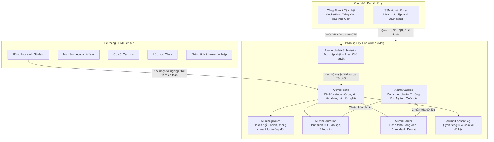

# BÁO CÁO AUDIT HỆ THỐNG VÀ THIẾT KẾ KIẾN TRÚC PHÂN HỆ SKY-LINE ALUMNI

**Dự án:** Quản lý Cựu học sinh – Sky-Line Alumni (Hệ thống SSM Sky-Line)  
**Vai trò:** Senior Full-Stack Architect, Database Engineer & Security Engineer  
**Thời điểm thực hiện:** 26/10/2026  
**Nguyên tắc tối thượng:** **Bảo tồn nguyên vẹn 100% dữ liệu hiện hành, không xóa dữ liệu, không làm gián đoạn các phân hệ đang vận hành của SSM.**

---

## 1. BÁO CÁO AUDIT HỆ THỐNG HIỆN TẠI (SYSTEM & DATABASE AUDIT)

### 1.1. Kiến trúc Tổng thể & Công nghệ
- **Frontend & App Framework:** Next.js 16.2.2 (App Router), React 19.2.4, TailwindCSS v4, Lucide React icons, Recharts 3.8.1.
- **Backend Runtime:** Node.js v22.23.2 (64-bit) chạy dạng service nền tại cổng `3000`, liên kết hostname `ssm.skylineschool.edu.vn`.
- **Database Architecture (Dual-Core):**
  - **On-Premise:** SQLite 3 (`d:\SSM\skyline-survey\local.db`, kích thước ~802.45 MB, 118 bảng).
  - **Cloud Failover:** LibSQL Turso (`@libsql/client` + `@prisma/adapter-libsql`) đồng bộ qua Tokyo AWS.
- **ORM:** Prisma 5.20.0 với driver adapter LibSQL.
- **Authentication & Authorization:**
  - NextAuth.js v5.0.0-beta.30 (CredentialsProvider, JWT session).
  - Phân quyền RBAC qua bảng `Permission` và `src/lib/permissions.ts`.
  - Cổng học sinh/phụ huynh sử dụng xác thực session chuyên biệt hoặc mã token HMAC SHA-256 (`src/lib/student-session.ts`).
- **Ghi log & Kiểm toán:** Bảng `AuditLog` và hàm `logActivity(...)` tại `src/lib/audit.ts`.
- **Hệ thống Email:** `nodemailer` với cấu hình chuẩn hóa tiêu đề `[Sky-line SMS]` tại `src/lib/mail.ts`.

### 1.2. Hiện trạng Dữ liệu Học sinh & Năm học
Qua kiểm tra trực tiếp CSDL `local.db`:
- **Tổng số học sinh:** `4,755` bản ghi `Student` (`4,493` trạng thái `ACTIVE`, `262` trạng thái `TRANSFERRED_OUT`).
- **Mã học sinh (`studentCode`):** Là định danh duy nhất xuyên suốt quá trình học tập. Một học sinh qua nhiều năm học sẽ có cùng một `studentCode` và liên kết với các bản ghi `Student` theo từng `academicYearId`.
- **Cơ sở (Campus):** 5 cơ sở hoạt động (`CS1`, `CS2`, `CS3`, `CS4`, `CS5`).
- **Năm học (AcademicYear):** Hiện hữu các niên khóa chính thức (ví dụ: `2025-2026`, `2026-2027`).
- **Khối lớp tốt nghiệp trọng điểm:**
  - Khối 12 (THPT - Tốt nghiệp cấp 3): 72 HS (2025-2026), 60 HS (2026-2027).
  - Khối 9 (THCS): 128 HS (2025-2026), 171 HS (2026-2027).
  - Khối 5 (Tiểu học): 266 HS (2025-2026), 211 HS (2026-2027).
- **Hồ sơ liên quan:** `StudentTermScore` (9,627 dòng), `StudentCompetencyAssessment` (31,100 dòng), `StudentAchievement`, `StudentCareerOrientation`, `StudentProjectExperience`, `ActivityParticipant`, `StudentPhoto`.

### 1.3. Phân quyền hiện hành
- Các vai trò quản trị và nhân sự: `ADMIN` (4), `GDCS` (5), `GIAO_VU` (4), `CTHS` (Công tác học sinh - 5), `TVAN` (9), `TEACHER` (213), `PARENT` (1,677).
- Scoping theo cơ sở: Xác định qua bảng `UserCampusAssignment`. Nếu user có `role === "ADMIN"` sẽ xem toàn bộ; các vai trò khác lọc theo `session.user.campusIds`.

### 1.4. Đánh giá Rủi ro & Thành phần Tái sử dụng
| Hạng mục | Rủi ro tiềm ẩn | Biện pháp kiểm soát & Tái sử dụng |
| :--- | :--- | :--- |
| **Toàn vẹn CSDL** | Migration làm khóa bảng hoặc lỗi bảng hiện tại | **Tách biệt hoàn toàn**: Bảng Alumni là bảng mới độc lập, chỉ liên kết Foreign Key `studentCode` / `studentId` ở tầng quan hệ logic, không sửa đổi cấu trúc các bảng `Student`, `Class`, `Score` hiện tại. |
| **Hiệu năng & Bộ nhớ** | Bảng `StudentPhoto` đang chiếm 86% RAM/Disk | Alumni Profile chỉ lưu tham chiếu `studentCode` để nạp ảnh khi cần, **không copy Base64 ảnh** sang bảng mới. |
| **Bảo mật & PII** | QR code làm lộ thông tin cá nhân | Mã QR chỉ chứa **Public Opaque Token** ngẫu nhiên (UUID v4), hoàn toàn không chứa mã HS, CCCD hay tên. Cổng truy cập yêu cầu OTP/xác thực bảo mật. |
| **Spam / Tấn công DoS** | Cổng cập nhật công khai bị spam dữ liệu giả | Áp dụng Rate-limiting trên IP và Session (tối đa 5 yêu cầu/phút), trạng thái dữ liệu gửi lên là `PENDING` (chờ duyệt), không ghi đè tự động. |
| **Thư viện Tái sử dụng** | Tránh cài đặt package xung đột | Tái sử dụng: `nodemailer` (email OTP/thông báo), `recharts` (dashboard), `crypto` native (HMAC session token), `src/lib/audit.ts` (audit log). Bổ sung module sinh SVG QR nhẹ, zero-bloat. |

---

## 2. SƠ ĐỒ KIẾN TRÚC PHÂN HỆ ALUMNI



---

## 3. THIẾT KẾ CƠ SỞ DỮ LIỆU (DATABASE SCHEMA SPECIFICATION)

Các bảng mới được thiết kế bổ sung vào schema Prisma với tiền tố rõ ràng, tương thích hoàn toàn cả SQLite On-premise và Turso Cloud:

```prisma
// ==========================================
// MODULE: SKY-LINE ALUMNI (CỰU HỌC SINH)
// ==========================================

// 1. Hồ sơ Cựu học sinh chính (Kế thừa từ Student)
model AlumniProfile {
  id                  String    @id @default(cuid())
  studentCode         String    @unique // Khóa định danh liên kết xuyên suốt
  originalStudentId   String?   // ID bản ghi năm tốt nghiệp
  studentName         String
  englishName         String?
  gender              String?
  dateOfBirth         DateTime?
  personalEmail       String?
  personalPhone       String?
  
  // Dữ liệu thời điểm tốt nghiệp tại Sky-Line
  campusId            String
  graduationGrade     String    @default("12") // 12 (THPT), 9 (THCS), 5 (TH)
  graduationYear      Int       // Năm tốt nghiệp, e.g. 2024, 2025, 2026
  graduationBatch     String?   // Khóa, e.g. "Niên khóa 2023-2026", "Khóa 10"
  educationSystem     String?   // Song ngữ, Hội nhập, Quốc tế
  lastClassName       String?   // Lớp cuối cùng tại Sky-Line
  
  // Trạng thái hiện tại
  currentResidenceCountry String? @default("Việt Nam")
  currentResidenceCity    String?
  currentAcademicStatus   String? @default("STUDYING") // STUDYING, GRADUATED, WORKING, BOTH, OTHER
  currentCareerStatus     String? @default("WORKING")  // WORKING, INTERN, LOOKING_FOR_JOB, SELF_EMPLOYED
  currentEmployer         String?
  currentJobTitle         String?
  
  // Trạng thái xác minh dữ liệu
  verificationStatus  String    @default("UNVERIFIED") // UNVERIFIED, PENDING_REVIEW, VERIFIED, REJECTED
  lastVerifiedAt      DateTime?
  verifiedById        String?
  lastSelfUpdatedAt   DateTime?

  // Cấu hình hiển thị & Mạng lưới
  allowContact        Boolean   @default(true)
  joinAlumniNetwork   Boolean   @default(true)
  allowMediaSharing   Boolean   @default(false)
  dataConsentAccepted Boolean   @default(false)
  dataConsentDate     DateTime?

  createdAt           DateTime  @default(now())
  updatedAt           DateTime  @updatedAt

  // Quan hệ
  qrTokens            AlumniQrToken[]
  educations          AlumniEducation[]
  careers             AlumniCareer[]
  submissions         AlumniUpdateSubmission[]
  consentLogs         AlumniConsentLog[]

  @@index([graduationYear])
  @@index([campusId])
  @@index([verificationStatus])
  @@index([graduationGrade])
}

// 2. Quản lý Token & Mã QR Cá nhân
model AlumniQrToken {
  id              String        @id @default(cuid())
  alumniId        String
  publicToken     String        @unique // UUID v4 bí mật, không chứa PII
  status          String        @default("ACTIVE") // ACTIVE, REVOKED, EXPIRED
  expiresAt       DateTime?
  generatedById   String?
  revokedById     String?
  revokedAt       DateTime?
  revocationReason String?
  scanCount       Int           @default(0)
  lastScannedAt   DateTime?
  createdAt       DateTime      @default(now())

  alumni          AlumniProfile @relation(fields: [alumniId], references: [id], onDelete: Cascade)

  @@index([alumniId])
  @@index([publicToken])
  @@index([status])
}

// 3. Quá trình Học tập Sau Phổ thông (Đại học, Sau ĐH)
model AlumniEducation {
  id              String        @id @default(cuid())
  alumniId        String
  degreeLevel     String        // Cử nhân, Thạc sĩ, Tiến sĩ, Cao đẳng, Chứng chỉ
  institutionName String        // Tên trường đại học / cơ sở đào tạo
  institutionCode String?       // Mã trường (nếu có trong danh mục)
  majorName       String        // Tên ngành học
  specialization  String?       // Chuyên ngành
  country         String        @default("Việt Nam")
  city            String?
  startYear       Int
  endYear         Int?
  isCurrent       Boolean       @default(false)
  scholarshipInfo String?       // Học bổng, thành tích
  isVerified      Boolean       @default(false)
  createdAt       DateTime      @default(now())
  updatedAt       DateTime      @updatedAt

  alumni          AlumniProfile @relation(fields: [alumniId], references: [id], onDelete: Cascade)

  @@index([alumniId])
  @@index([country])
  @@index([institutionName])
}

// 4. Quá trình Nghề nghiệp & Công tác
model AlumniCareer {
  id              String        @id @default(cuid())
  alumniId        String
  jobTitle        String        // Chức danh công việc
  industry        String        // Nhóm ngành nghề (CNTT, Tài chính, Y tế...)
  organization    String?       // Đơn vị / Doanh nghiệp công tác
  workCountry     String        @default("Việt Nam")
  workCity        String?
  startDate       DateTime?
  endDate         DateTime?
  isCurrent       Boolean       @default(true)
  isVerified      Boolean       @default(false)
  createdAt       DateTime      @default(now())
  updatedAt       DateTime      @updatedAt

  alumni          AlumniProfile @relation(fields: [alumniId], references: [id], onDelete: Cascade)

  @@index([alumniId])
  @@index([industry])
  @@index([workCountry])
}

// 5. Yêu cầu Cập nhật từ Cựu học sinh (Workflow kiểm duyệt)
model AlumniUpdateSubmission {
  id              String        @id @default(cuid())
  alumniId        String
  submissionCode  String        @unique
  payload         String        // JSON toàn bộ dữ liệu tự khai gửi lên
  status          String        @default("PENDING") // PENDING, APPROVED, REJECTED, NEEDS_INFO
  reviewerId      String?
  reviewedAt      DateTime?
  reviewNotes     String?
  ipAddress       String?
  userAgent       String?
  createdAt       DateTime      @default(now())
  updatedAt       DateTime      @updatedAt

  alumni          AlumniProfile @relation(fields: [alumniId], references: [id], onDelete: Cascade)

  @@index([alumniId])
  @@index([status])
  @@index([createdAt])
}

// 6. Danh mục Chuẩn hóa Dùng chung (Trường, Ngành, Quốc gia)
model AlumniCatalog {
  id              String        @id @default(cuid())
  type            String        // COUNTRY, PROVINCE, UNIVERSITY, MAJOR_GROUP, MAJOR, DEGREE_LEVEL, INDUSTRY
  code            String
  name            String
  nameEn          String?
  parentCode      String?       // Phân cấp (ví dụ: Tỉnh thuộc Quốc gia, Ngành thuộc Nhóm ngành)
  isVerified      Boolean       @default(true)
  usageCount      Int           @default(0)
  createdAt       DateTime      @default(now())
  updatedAt       DateTime      @updatedAt

  @@unique([type, code])
  @@index([type])
  @@index([parentCode])
}

// 7. Nhật ký Cam kết Quyền riêng tư & Thu hồi Đồng ý
model AlumniConsentLog {
  id              String        @id @default(cuid())
  alumniId        String
  consentType     String        // DATA_PROCESSING, CONTACT, NETWORK, MEDIA_SHARING
  granted         Boolean
  ipAddress       String?
  timestamp       DateTime      @default(now())

  alumni          AlumniProfile @relation(fields: [alumniId], references: [id], onDelete: Cascade)

  @@index([alumniId])
}
```

---

## 4. QUY TRÌNH NGHIỆP VỤ & DATA FLOW

### 4.1. Quy trình Kế thừa Hồ sơ (Graduation to Alumni Onboarding)
1. **Tiêu chí đủ điều kiện:**
   - Học sinh lớp cuối cấp (ưu tiên Khối 12, hỗ trợ mở rộng Khối 9, Khối 5).
   - Trạng thái `status === "ACTIVE"` tại niên khóa xét tốt nghiệp.
   - Được Hội đồng/Admin xét xác nhận tốt nghiệp.
2. **Nguyên tắc Idempotency (Chống trùng lặp tuyệt đối):**
   - Sử dụng `studentCode` làm khóa logic định danh duy nhất.
   - Thao tác chuyển hàng loạt (Bulk Ingestion) sử dụng `upsert` hoặc kiểm tra tồn tại `findUnique({ where: { studentCode } })`. Chạy lại nhiều lần không tạo thêm bản ghi rác.
   - Giữ nguyên 100% hồ sơ học tập gốc của học sinh tại các bảng `Student`, `StudentTermScore`, `SubjectGradeEntry`...

### 4.2. Vòng đời Mã QR & Cổng Cập nhật Bảo mật
1. **Khởi tạo:** Hệ thống tạo một `publicToken` ngẫu nhiên (UUID v4) cho hồ sơ và lưu bản ghi `AlumniQrToken` với `status: 'ACTIVE'`.
2. **Cung cấp QR:** QR render liên kết `https://ssm.skylineschool.edu.vn/alumni/portal?token={publicToken}`. Có thể tải PNG, SVG hoặc in trực tiếp từ SSM Admin.
3. **Quét & Xác thực 2 bước:**
   - Cựu học sinh quét QR -> Cổng hiển thị trang chào đón, chỉ hiển thị thông tin tối thiểu (Họ tên viết hoa, Khóa học, Cơ sở đã học).
   - Để mở khóa phần tự cập nhật hoặc xem chi tiết: Cựu học sinh xác thực bảo mật bằng **Mã sinh viên + Năm sinh** hoặc **Mã OTP** gửi qua Email/SĐT đã đăng ký.
4. **Thu hồi & Cấp lại:** Admin có quyền thu hồi (Revoke) token cũ nếu phát hiện rủi ro và phát hành token mới ngay lập tức. Token cũ tự động vô hiệu hóa.

### 4.3. Quy trình Kiểm duyệt Dữ liệu Tự khai (Verification Workflow)
1. Cựu học sinh nộp thông tin mới (trường ĐH, ngành học, công việc, nơi sống, tùy chọn chia sẻ).
2. Hệ thống ghi nhận vào `AlumniUpdateSubmission` ở trạng thái `PENDING`.
3. Hồ sơ `AlumniProfile` chuyển trạng thái xác minh sang `PENDING_REVIEW`.
4. Ban quản trị (CTHS / Ban Giám hiệu / Admin) xem xét:
   - **Phê duyệt:** Dữ liệu mới được áp dụng vào `AlumniEducation`, `AlumniCareer` và cập nhật trường hiện tại trên `AlumniProfile`. Trạng thái chuyển thành `VERIFIED`.
   - **Yêu cầu bổ sung:** Gửi thông báo kèm ghi chú yêu cầu cựu học sinh làm rõ.
   - **Từ chối:** Lưu lý do từ chối, giữ nguyên dữ liệu đã xác minh trước đó.
5. Ghi nhật ký vào `AuditLog` với đầy đủ `oldValues`, `newValues`, `userId` người duyệt.

---

## 5. ĐẶC TẢ API & HỆ THỐNG MENU SSM

### 5.1. Định vị Menu trong SSM (`src/config/modules.ts`)
Tạo một Category mới **"Cựu học sinh Sky-Line"** (`ALUMNI_MANAGEMENT`) gồm 7 module con:

| Mã Module | Tên Menu | Đường dẫn URL | Vai trò truy cập |
| :--- | :--- | :--- | :--- |
| `ALUMNI_DASHBOARD` | **1. Tổng quan Alumni** | `/admin/alumni` | Admin, GDCS, CTHS, BGH |
| `ALUMNI_LIST` | **2. Danh sách cựu học sinh** | `/admin/alumni/danh-sach` | Admin, GDCS, CTHS, BGH |
| `ALUMNI_QR` | **3. Quản lý mã QR** | `/admin/alumni/ma-qr` | Admin, CTHS |
| `ALUMNI_SUBMISSIONS`| **4. Tiếp nhận cập nhật** | `/admin/alumni/tiep-nhan` | Admin, CTHS, BGH |
| `ALUMNI_JOURNEY` | **5. Hành trình học tập & nghề nghiệp** | `/admin/alumni/hanh-trinh` | Admin, GDCS, CTHS |
| `ALUMNI_REPORTS` | **6. Báo cáo & phân tích** | `/admin/alumni/bao-cao` | Admin, GDCS, CTHS, BGH |
| `ALUMNI_CONFIG` | **7. Cấu hình & phân quyền** | `/admin/alumni/cau-hinh` | Super Admin |

### 5.2. Danh sách API Endpoints Chính
1. `GET/POST /api/admin/alumni/profiles` – Danh sách, tìm kiếm, lọc theo khóa/cơ sở/ngành, kế thừa hồ sơ từ `Student`.
2. `GET/PUT/DELETE /api/admin/alumni/profiles/[id]` – Chi tiết hồ sơ, cập nhật trực tiếp bởi quản trị viên.
3. `POST /api/admin/alumni/qr/generate` – Cấp/cấp lại mã QR token, tải thẻ QR hàng loạt.
4. `POST /api/admin/alumni/qr/revoke` – Thu hồi mã QR khi có yêu cầu.
5. `GET/POST /api/admin/alumni/submissions` – Quản lý danh sách đơn cập nhật, phê duyệt hoặc từ chối.
6. `GET /api/admin/alumni/catalogs` – Quản lý danh mục chuẩn hóa (Trường ĐH, Ngành, Quốc gia).
7. `GET /api/admin/alumni/analytics` – Số liệu thống kê, phân bố trường học, ngành nghề, quốc gia.
8. `GET/POST /api/alumni/portal` (Public API) – Xác thực token QR, kiểm tra danh tính, nộp form cập nhật.

---

## 6. DANH SÁCH TEST CASES & KẾ HOẠCH ROLLBACK

### 6.1. Danh mục Test Cases Trọng yếu
1. **Kiểm thử Bảo tồn Dữ liệu:**
   - Chạy migration -> Kiểm tra số lượng bản ghi `Student` giữ nguyên `4,755`, không đổi một byte.
   - Thử nghiệm kế thừa 1 lớp tốt nghiệp -> Kiểm tra bản ghi `Student` gốc không bị sửa đổi, bản ghi `AlumniProfile` sinh đúng thông tin.
2. **Kiểm thử Tính Idempotent (Chống trùng lặp):**
   - Chạy lệnh kế thừa danh sách tốt nghiệp 2 lần liên tiếp -> Số lượng bản ghi `AlumniProfile` không tăng gấp đôi, không phát sinh lỗi khóa duy nhất.
3. **Kiểm thử Bảo mật QR & Cổng Cập nhật:**
   - Quét QR với token hợp lệ -> Không trả về CCCD hay PII nhạy cảm nếu chưa xác thực 2 bước.
   - Thử quét token đã bị thu hồi (`REVOKED`) -> Trả về lỗi 403 / "Mã QR đã hết hiệu lực".
   - Thử nghiệm tấn công Brute-force OTP -> Kích hoạt Rate-limit sau 3 lần sai.
4. **Kiểm thử Phân quyền & Scoping Cơ sở:**
   - Tài khoản GDCS cơ sở CS1 chỉ xem được cựu học sinh tốt nghiệp tại CS1.
   - Tài khoản Admin xem toàn hệ thống.

### 6.2. Kế hoạch Triển khai An toàn & Rollback
- **Bước 1: Backup CSDL:** Trước khi chạy lệnh migration, tạo snapshot sao lưu vật lý `local.db.bak_alumni_pre_deploy`.
- **Bước 2: Cập nhật Schema Prisma:** Thêm các model Alumni vào `schema.prisma` và chạy `npx prisma db push` hoặc lệnh SQL DDL an toàn (chỉ dùng `CREATE TABLE IF NOT EXISTS` và `CREATE INDEX IF NOT EXISTS`).
- **Bước 3: Seed Danh mục:** Nạp danh mục chuẩn ban đầu (Quốc gia, một số trường ĐH lớn tại VN & Quốc tế).
- **Bước 4: Kiểm thử trên Staging/Sandbox:** Thực thi toàn bộ test cases nghiệp vụ.
- **Kế hoạch Rollback tức thì:**
  - Nếu xảy ra bất kỳ sự cố nào, chỉ cần xóa các bảng có tiền tố `Alumni*` hoặc khôi phục file sao lưu `local.db.bak_alumni_pre_deploy`. Hệ thống SSM hiện hữu hoàn toàn không bị ảnh hưởng.
