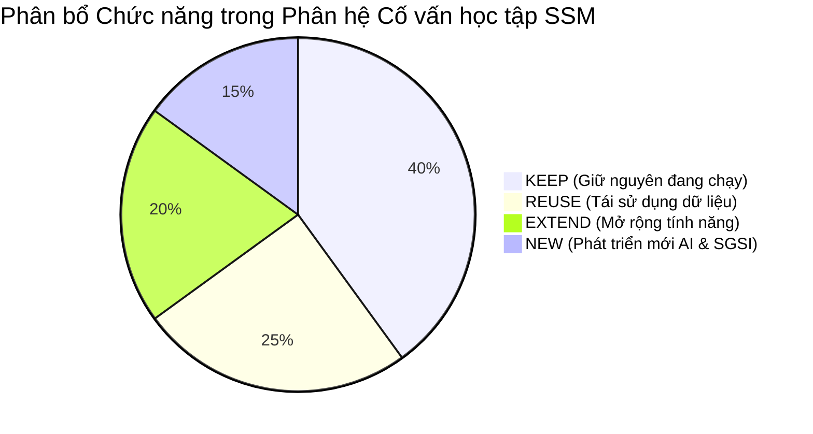

# TÀI LIỆU 1: BÁO CÁO AUDIT HIỆN TRẠNG PHÂN HỆ CỐ VẤN HỌC TẬP VÀ LIÊN THÔNG SSM SKY-LINE
## Mã tài liệu: AUDIT_SSM_CVHT.md | Phiên bản: 2.0 | Ngày: 20/10/2026

---

## 1. MỤC TIÊU VÀ PHẠM VI AUDIT
Rà soát thực tế toàn bộ mã nguồn, mô hình dữ liệu (Prisma Schema), các bảng vật lý trên SQLite (`local.db`) / Cloud Turso, hệ thống API nội bộ, phân quyền và giao diện người dùng của Hệ thống Quản lý Học sinh Sky-Line (SSM).

**Nguyên tắc audit:** Kiểm tra trên mã nguồn thực tế, không giả định tính năng chưa kiểm chứng, phân định rạch ròi giữa **Đang hoạt động (KEEP)**, **Tái sử dụng (REUSE)**, **Mở rộng (EXTEND)** và **Phát triển mới (NEW)**.

---

## 2. AUDIT 4 CHỨC NĂNG CỐ VẤN HỌC TẬP HIỆN HỮU

### 2.1. Chức năng 1: Phiếu Mục tiêu Năm học (Student Goal Setting)
- **Mã nguồn UI:** `src/app/teacher/co-van-hoc-tap/page.tsx` (Tab `tracking`), `src/components/advisory/K1GoalForm.tsx`, `GoalMultiSelector.tsx`, `GoalUnlockWizard.tsx`.
- **Cơ sở dữ liệu:**
  - Bảng `StudentGoal`: `id`, `studentId`, `academicYearId`, `semester`, `gradeLevel`, `category`, `targetText`, `presetId`, `teacherSupportRequest`, `parentSupportRequest`, `smartSpecific`, `smartMeasurable`, `smartAchievable`, `smartRelevant`, `smartTimeBound`, `checkpointDate`, `achievementLevel`, `status`, `studentCommitment`, `parentMessage`, `teacherComment`, `signedByStudent`, `signedByParent`, `signedByTeacher`.
  - Bảng `StudentGoalAction`: `id`, `goalId`, `actionText`, `status`, `deadline`.
  - Bảng `GoalPreset`: `id`, `gradeGroup`, `category`, `goalText`, `actionPreset`, `sortOrder`.
  - Bảng `StudentGoalUnlock`: Mở khóa mục tiêu giai đoạn 2 (sprint 7 ngày cho K9-K12).
  - Bảng `StudentGoalAdjustmentRequest`: Tiếp nhận và phê duyệt yêu cầu xin điều chỉnh mục tiêu của học sinh.
- **API Backend:**
  - `GET /api/advisory/goals`: Truy vấn mục tiêu theo `studentId`, `academicYearId`, fallback linh hoạt theo `studentCode`.
  - `POST /api/advisory/goals`: Lưu/cập nhật mục tiêu, cam kết và chữ ký xác nhận 3 bên.
  - `GET/POST/PATCH /api/advisory/goals/adjustment-request`: Quy trình xin mở phiếu điều chỉnh.
- **Đánh giá thực tế:** Hệ thống đã hỗ trợ phân tầng lứa tuổi (K1-K3 dùng preset, K4-K5 chọn nhanh, K6-K12 SMART). Số lượng bản ghi thực tế: **1.354 mục tiêu**.
- **Phân loại:** **KEEP & EXTEND** (Bổ sung trạng thái gợi ý từ AI Advisor: `DRAFT_AI_SUGGESTED` $\rightarrow$ `CONFIRMED`).

---

### 2.2. Chức năng 2: Tiến độ & Check-in GVCN (Goal Progress Tracking)
- **Mã nguồn UI:** `src/app/teacher/co-van-hoc-tap/page.tsx` (Bảng check-in theo checkpoint), `src/lib/advisory/advisoryWeights.ts`.
- **Cơ sở dữ liệu:**
  - Bảng `StudentGoalTrackingLog`: `id`, `studentId`, `academicYearId`, `goalId`, `category`, `targetText`, `checkPoint` (`GIUA_KY_1`, `CUOI_KY_1`, `GIUA_KY_2`, `CUOI_NAM`), `progressStatus` (`TIEN_TRIEN`, `DAT`, `CHUA_DAT`), `teacherNotes`, `evaluatedById`.
  - Bảng `StudentAdvisoryStatus`: Gắn cờ cảnh báo rủi ro màu `GREEN`, `YELLOW`, `RED` kèm lý do.
- **Trọng số chuẩn hóa theo khối (`advisoryWeights.ts`):**
  - Khối 1, 4, 5: Học tập 50%, Sức khỏe 20%, Sở thích 15%, Phẩm chất 15%.
  - Khối 2, 3: Học tập 50%, Kỹ năng 20%, Sức khỏe 10%, Sở thích 10%, Phẩm chất 10%.
  - Khối 6 đến 12: Học tập 50%, Thói quen 15%, Kỹ năng cảm xúc 15%, Định hướng 20%.
- **API Backend:** `GET/POST /api/advisory/tracking`.
- **Đánh giá thực tế:** Check-in hoạt động tốt, đã lưu vết **670 lượt tracking**. Tuy nhiên, việc phát hiện quá hạn hoặc trượt mục tiêu còn phụ thuộc giáo viên quan sát thủ công.
- **Phân loại:** **KEEP & EXTEND** (Bổ sung cơ chế AI tự động tính toán khoảng cách Gap giữa mục tiêu và thực tế).

---

### 2.3. Chức năng 3: Đánh giá Định kỳ theo Rubric (Term Evaluation)
- **Mã nguồn UI:** `src/app/teacher/co-van-hoc-tap/page.tsx` (Tab `rubric_eval`).
- **Cơ sở dữ liệu:**
  - Bảng `StudentTermEvaluation`: `id`, `studentId`, `academicYearId`, `term` (`HK1`, `HK2`), `goalCompletionLevel` (1-5), `initiativeLevel` (1-5), `participationAttitude` (1-5), `recommendations`, `evaluatedById`.
- **API Backend:** `GET/POST /api/advisory/term-evaluations`.
- **Đánh giá thực tế:** Đã có cấu trúc bảng chuẩn hóa thang điểm 1-5, phục vụ báo cáo định kỳ HK1/HK2.
- **Phân loại:** **KEEP & REUSE** (Tái sử dụng làm một trong các biến số đầu vào tính điểm Chất lượng Quy trình $P$ trong SGSI).

---

### 2.4. Chức năng 4: Nhật ký Cố vấn từ GVCN (Consultation Logs)
- **Mã nguồn UI:** `src/app/teacher/co-van-hoc-tap/page.tsx` (Tab `consultations`), `QuickConsultationModal.tsx`.
- **Cơ sở dữ liệu:**
  - Bảng `AcademicConsultationLog`: `id`, `studentId`, `teacherId`, `academicYearId`, `meetingDate`, `content`, `difficulties`, `nextActions`, `deadline`, `notes`, `studentReflection`, `status` (`PENDING`, `COMPLETED`), `academicTopic`.
  - Bảng `AdvisoryActionItem`: Quản lý các hành động sau phiên cố vấn với deadline và trạng thái quá hạn.
- **API Backend:**
  - `GET/POST /api/advisory/consultations`: Đã lọc loại trừ triệt để nhận xét trao đổi điểm số kỳ khảo sát `[GradePeriod:]`.
  - `GET/POST/PATCH /api/advisory/action-items`: Quản lý danh sách việc cần làm.
- **Đánh giá thực tế:** Đã có **501 biên bản cố vấn** được lưu trữ.
- **Phân loại:** **KEEP & EXTEND** (Tích hợp AI tóm tắt trước phiên và phân tích kết quả sau phiên).

---

## 3. AUDIT KHẢ NĂNG LIÊN THÔNG VỚI CÁC PHÂN HỆ SSM KHÁC

| STT | Phân hệ SSM | Thực thể CSDL & API hiện hữu | Khả năng Tái sử dụng (Reuse) | Nội dung cần Bổ sung / Mapping | Rủi ro & Kiểm soát |
| :--- | :--- | :--- | :--- | :--- | :--- |
| **1** | **Hồ sơ học sinh** | Model `Student`, `ParentStudentLink`. API `api/advisory/profile-360`. | Lấy định danh `studentCode`, họ tên, ngày sinh, lớp, cơ sở, phụ huynh. | Thêm cờ tổng hợp tình trạng mục tiêu & điểm SGSI vào Profile 360. | Không sinh bản ghi học sinh trùng lặp khi đổi lớp. |
| **2** | **Kết quả học tập** | Model `SubjectGradeEntry`, `TermScore`, `TermSummary`. API `api/advisory/academic-comparison`. | Điểm tổng kết các môn, điểm thành phần, so sánh với mốc chuẩn 6.0. | Trích xuất xu hướng điểm tăng/giảm theo từng môn phục vụ AI phân tích và tính $G$ trong SGSI. | Tải chậm nếu quét bảng điểm lớn. Kiểm soát: cache tạm và index theo `(studentId, academicYearId)`. |
| **3** | **Đánh giá năng lực** | Model `StudentCompetencyAssessment`, `StudentSubjectCompetencySummary`. | Điểm % năng lực cốt lõi, dữ liệu radar chart JSON. | Trích xuất năng lực thế mạnh và năng lực cần cải thiện cho AI Advisor dẫn chứng. | Dữ liệu import có thể khuyết kỳ. Kiểm soát: kiểm tra null trước khi tính. |
| **4** | **KSCL đầu năm & Kỳ thi** | Model `InputAssessmentStudent`, `Exam`, `ExamStudent`, `Achievement`. | Điểm khảo sát đầu vào (Toán, Anh, Văn), giải thưởng đạt được. | Sử dụng điểm KSCL làm mốc xuất phát điểm (Baseline) để tính mức độ tiến bộ thực chất. | Mã học sinh tuyển sinh có thể khác mã chính thức. Kiểm soát: tra cứu qua `StudentCodeMapping`. |
| **5** | **Hỗ trợ học tập** | Model `LearningSupportTarget`, `LearningSupportAssignment`, `LearningSupportEvaluation`. API `api/advisory/refer-support`. | Tình trạng hỗ trợ học thuật (`ACADEMIC`) và tâm lý (`PSYCHOLOGICAL`). | Đồng bộ 2 chiều: CVHT phát hiện khó khăn $\rightarrow$ Chuyển ca hỗ trợ; Kết quả hỗ trợ $\rightarrow$ Tính $S$ trong SGSI. | Lộ lọt thông tin tâm lý nhạy cảm. Kiểm soát: Tách biệt cờ bảo mật, không xuất nội dung nhạy cảm ra API chung. |
| **6** | **Trải nghiệm & Dự án** | Model `ActivityRecord`, `ActivityParticipant`, `StudentProjectExperience`. | Số lượng hoạt động, vai trò (Trưởng nhóm, thành viên), kết quả đạt được. | Đưa dữ liệu hoạt động ngoại khóa vào hồ sơ năng lực học sinh K10-K12. | Dữ liệu lưu trong cột JSON `locationId`/`note`. Kiểm soát: parser an toàn có try/catch. |
| **7** | **Hướng nghiệp** | Model `StudentCareerOrientation`, `StudentOrientationRecord`, `StudentOrientationModal.tsx`. | Định hướng nghề nghiệp, kết quả khảo sát đầu vào, chỉ đạo của GĐCS. | Đồng bộ định hướng nghề vào nhóm mục tiêu "ĐỊNH HƯỚNG NGHỀ NGHIỆP" của K10-K12. | Tránh xung đột khi GĐCS và GVCN cập nhật đồng thời. |

---

## 4. TỔNG HỢP MA TRẬN PHÂN LOẠI CHỨC NĂNG (KEEP / REUSE / EXTEND / NEW)

- **KEEP (Giữ nguyên 100%):** Bảng `StudentGoal`, `StudentGoalAction`, `AcademicConsultationLog`, `StudentTermEvaluation`, `StudentGoalTrackingLog`, phân quyền Campus.
- **REUSE (Tái sử dụng trực tiếp):** Bảng điểm `SubjectGradeEntry`, đánh giá năng lực `StudentSubjectCompetencySummary`, khảo sát `InputAssessmentStudent`, ca hỗ trợ `LearningSupportTarget`.
- **EXTEND (Mở rộng an toàn):** Bảng `AdvisoryActionItem` (bổ sung liên kết task), API `profile-360` (nhúng chỉ số SGSI), Modal phiên 1-1 (tích hợp nút gợi ý AI).
- **NEW (Xây dựng mới có kiểm soát):**
  1. Engine AI Advisor nội bộ (`/api/advisory/ai-advisor/*`).
  2. Bộ tính toán và lưu vết chỉ số SGSI (`/api/advisory/sgsi/*`).
  3. Dashboard đo lường Cố vấn học tập đa cấp (HS / CVHT / Lớp / Khối / Cơ sở).
