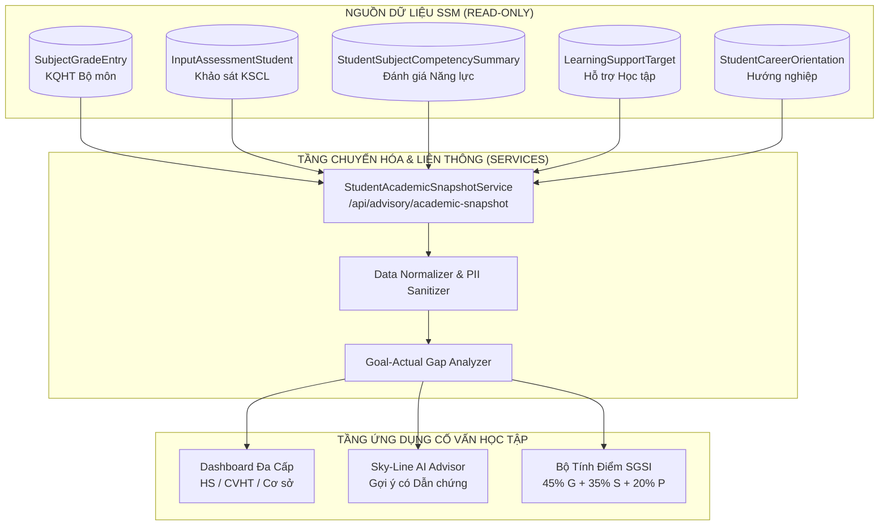

# TÀI LIỆU 5: MA TRẬN ÁNH XẠ DỮ LIỆU LIÊN THÔNG (DATA MAPPING SPECIFICATION)
## Mã tài liệu: DATA_MAPPING_CVHT.md | Phiên bản: 2.0 | Ngày: 20/10/2026

---

## 1. NGUYÊN TẮC LIÊN THÔNG DỮ LIỆU
1. **Không nhân bản dữ liệu (Zero Duplication):** Truy vấn trực tiếp từ các bảng nguồn thông qua khóa định danh chuẩn `(studentId, academicYearId)` hoặc `studentCode`, tuyệt đối không sao chép dữ liệu tạo ra các bảng song song dễ bị lệch pha.
2. **Read-Only đối với dữ liệu chuyên môn gốc:** Phân hệ Cố vấn học tập chỉ đọc (Read) kết quả điểm từ sổ điểm, khảo sát KSCL và năng lực; việc nhập/sửa điểm vẫn do giáo viên bộ môn và giáo vụ thực hiện theo đúng thẩm quyền.
3. **Chuẩn hóa Định dạng (Data Normalization):** Dữ liệu được đưa qua hàm chuẩn hóa thống nhất trước khi cấp cho AI Advisor và bộ máy tính toán chỉ số SGSI.

---

## 2. BẢNG ÁNH XẠ CHI TIẾT CÁC PHÂN HỆ NGUỒN

| Phân hệ Nguồn | Bảng Nguồn (Prisma Model) | Trường Dữ liệu Nguồn | Trường Đích trong CVHT / AI / SGSI | Tần suất Cập nhật | Logic Xử lý & Chuẩn hóa |
| :--- | :--- | :--- | :--- | :--- | :--- |
| **Hồ sơ Học sinh** | `Student` | `id`, `studentCode`, `studentName`, `dateOfBirth`, `gender`, `studentType`, `status` | Định danh học sinh trong Profile CVHT, Dashboard | Khi có biến động học sinh | Lọc bỏ học sinh đã chuyển trường (`status = 'TRANSFERRED_OUT'`). |
| **Lớp & Cơ sở** | `Class`, `Campus` | `Class.className`, `Class.grade`, `Campus.campusName` | Phân cấp xem dữ liệu (Cơ sở $\rightarrow$ Khối $\rightarrow$ Lớp) | Theo năm học | Chuẩn hóa tên khối thành mã chuẩn `K1` đến `K12` qua `normalizeGradeLevel()`. |
| **KQHT Bộ môn** | `SubjectGradeEntry` | `compositeScore`, `evaluationPeriod`, `subjectId` | $G_{\text{Academic}}$ trong SGSI; AI phân tích môn dưới chuẩn | Sau mỗi kỳ thi định kỳ (GK1, CK1, GK2, CK2) | Bỏ qua bản ghi có `compositeScore is null`; so sánh với `benchmarkScore` (mặc định 6.0). |
| **Đánh giá Năng lực** | `StudentSubjectCompetencySummary` | `subjectScore`, `totalCompetencies`, `radarData` (JSON) | Biểu đồ Radar năng lực trong Profile CVHT; AI phân tích thế mạnh | Cuối mỗi học kỳ | Parse chuỗi JSON `radarData`; nếu chuỗi lỗi thì fallback hiển thị điểm trung bình năng lực. |
| **KSCL Đầu năm** | `InputAssessmentStudent` | `mathScore`, `englishScore`, `literatureScore`, `totalScore` | Điểm xuất phát ban đầu ($S_{\text{Baseline}}$) để so sánh $\Delta$ | Đầu năm học (Tháng 8 - Tháng 9) | Tra cứu qua `studentCode`; nếu không có dữ liệu thì kích hoạt cơ chế Re-weighting trong SGSI. |
| **Kỳ thi & Giải thưởng** | `ExamStudent`, `Achievement` | `score`, `level` (Nhất, Nhì, Ba, Khuyến khích), `category` | Ghi nhận thành tích nổi bật trong Profile CVHT | Khi có kỳ thi HSG, kỳ thi năng khiếu | Chuyển đổi cấp giải thưởng thành điểm thưởng khuyến khích trong mục tiêu SMART. |
| **Hỗ trợ Học tập** | `LearningSupportTarget` | `supportType` (ACADEMIC / PSYCHOLOGICAL), `status`, `reason` | Phối hợp chuyển ca hỗ trợ; $S_{\text{Resolution}}$ trong SGSI | Khi phát sinh ca can thiệp | Tách biệt và bảo mật: Nếu `supportType = 'PSYCHOLOGICAL'`, mã hóa lý do đối với người không có thẩm quyền. |
| **Theo dõi Can thiệp** | `LearningSupportEvaluation` | `trackingLevel`, `comment`, `updatedStatus` | Đánh giá hiệu quả sau can thiệp (Impact Matrix) | Hàng tuần / Hàng tháng | Trích xuất mức độ tiến bộ quan sát được của giáo viên phụ đạo. |
| **Hoạt động Trải nghiệm** | `ActivityParticipant`, `ActivityRecord` | `record.name`, `note.roles`, `note.finalResult` | Mục tiêu "Kỹ năng & Ngoại khóa" của học sinh K10-K12 | Sau mỗi sự kiện/dự án | Parse trường JSON `note` lấy vai trò (Trưởng nhóm/Thành viên) và kết quả đánh giá. |
| **Hướng nghiệp** | `StudentCareerOrientation` | `surveyResult`, `initialOrientation`, `counselingResult` | Mục tiêu "Định hướng nghề nghiệp" (K10-K12); AI gợi ý lộ trình | Đầu năm & Giữa năm học | Đồng bộ trực tiếp với kết quả phỏng vấn tuyển sinh đầu vào (`StudentOrientationRecord`). |

---

## 3. SƠ ĐỒ ĐƯỜNG ỐNG DỮ LIỆU (DATA PIPELINE)

