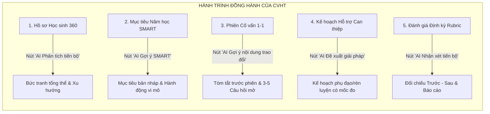

# TÀI LIỆU 3: ĐẶC TẢ CHỨC NĂNG VÀ THIẾT KẾ CHI TIẾT SKY-LINE AI ADVISOR
## Mã tài liệu: FUNCTIONAL_SPEC_AI_ADVISOR.md | Phiên bản: 2.0 | Ngày: 20/10/2026

---

## 1. MỤC TIÊU VÀ NGUYÊN TẮC THIẾT KẾ AI ADVISOR
**Sky-Line AI Advisor** là trợ lý thông minh hỗ trợ Cố vấn học tập (CVHT) và Giáo viên chủ nhiệm (GVCN) trong công tác định hướng, đồng hành và thúc đẩy sự phát triển toàn diện của học sinh K12.

### 4 Nguyên tắc Sư phạm Bất biến:
1. **Human-in-the-loop 100%:** AI đóng vai trò người chuẩn bị bản nháp (Drafting Assistant). Con người (CVHT) là người duy nhất có quyền thẩm định, chỉnh sửa và xác nhận kết quả cuối cùng.
2. **Dẫn chứng Dữ liệu (Evidence-based):** Mọi nhận định, gợi ý mục tiêu hay câu hỏi phỏng vấn đều phải gắn liền với số liệu cụ thể và mốc thời gian thực tế trong SSM (Ví dụ: *"Điểm Toán GK1 đạt 5.2, giảm 1.8 điểm so với KSCL đầu năm"*).
3. **Cấm Tuyệt đối Chẩn đoán Tâm lý & Phán xét Đạo đức:** Cấm AI đưa ra các thuật ngữ bệnh lý tâm thần (trầm cảm, tự kỷ, tăng động...), không phán xét năng lực hoặc hoàn cảnh gia đình học sinh.
4. **Xử lý Minh bạch khi Thiếu Dữ liệu:** Nếu học sinh mới chuyển đến hoặc thiếu mốc khảo sát, hệ thống bắt buộc hiển thị: *"Chưa đủ dữ liệu để kết luận xu hướng môn học này"*, không được phép tự suy diễn.

---

## 2. NĂM VỊ TRÍ TÍCH HỢP ĐIỂM CHẠM TRÊN SSM



---

### 2.1. Vị trí 1: Tại Hồ sơ Học sinh 360 – Nút "AI Phân tích tiến bộ"
- **Vị trí UI:** Đặt tại thanh tiêu đề trang `src/app/teacher/ho-so-hoc-sinh/page.tsx` và Drawer xem nhanh học sinh.
- **Dữ liệu đầu vào:**
  - Điểm số các môn học theo từng đợt đánh giá (`SubjectGradeEntry`).
  - Điểm khảo sát chất lượng đầu năm (`InputAssessmentStudent`).
  - Điểm radar năng lực cốt lõi (`StudentSubjectCompetencySummary`).
  - Danh sách mục tiêu đã hoàn thành và chưa hoàn thành (`StudentGoal`).
- **Nội dung hiển thị cho CVHT:**
  1. **Thế mạnh nổi trội:** Các môn học/lĩnh vực có kết quả $\ge 8.0$ hoặc năng lực đạt mức cao, kèm thời điểm gần nhất.
  2. **Vùng cần củng cố:** Môn học dưới mức benchmark chuẩn (< 6.0) hoặc giảm $\ge 1.5$ điểm so với kỳ trước.
  3. **Khoảng cách mục tiêu (Goal-Actual Gap):** So sánh mục tiêu ban đầu học sinh đặt ra với điểm số thực tế.
  4. **Nội dung CVHT cần xác minh thêm:** Liệt kê các điểm bất thường cần hỏi trực tiếp học sinh.

---

### 2.2. Vị trí 2: Tại Nhật ký Cố vấn – Nút "AI Gợi ý nội dung trao đổi"
- **Vị trí UI:** Đặt trong `QuickConsultationModal.tsx` và Tab `consultations` tại `teacher/co-van-hoc-tap`.
- **Dữ liệu đầu vào:** Toàn bộ bức tranh học thuật + khó khăn ghi nhận từ phiên cố vấn trước đó.
- **Nội dung bản tóm tắt tự động chuẩn bị trước buổi gặp:**
  1. **Những chuyển biến tích cực:** Lời khen ngợi cụ thể giúp mở đầu buổi gặp bằng cảm xúc hào hứng.
  2. **Vấn đề cần tập trung:** 1-2 điểm nghẽn học tập lớn nhất hiện tại.
  3. **3 đến 5 câu hỏi gợi mở chuẩn Sư phạm (Empathetic Questioning):**
     - Thiết kế theo mô hình GROW (Goal - Reality - Options - Will).
     - Phù hợp cấp học: Khối 1-5 dùng ngôn từ gần gũi, ấm áp; Khối 6-12 dùng ngôn từ định hướng tự chủ.
     - Khuyến khích học sinh tự tìm giải pháp thay vì giáo viên áp đặt.
  4. **Dẫn chứng số liệu đi kèm:** Giúp CVHT có số liệu ngay trước mắt để trò chuyện tự tin.

---

### 2.3. Vị trí 3: Tại Phiếu Mục tiêu Năm học – Nút "AI Gợi ý mục tiêu SMART"
- **Vị trí UI:** Đặt trong biểu mẫu lập kế hoạch mục tiêu cá nhân (`StudentGoal` form).
- **Quy trình hoạt động:**
  - Học sinh chọn lĩnh vực quan tâm (Học tập, Sức khỏe, Kỹ năng, Định hướng).
  - Bấm nút **"AI Gợi ý mục tiêu SMART"**:
    - **S (Cụ thể):** Gợi ý nội dung cải thiện rõ ràng dựa trên môn học yếu hoặc thế mạnh cần bồi dưỡng.
    - **M (Đo lường được):** Đề xuất chỉ số đo lường thực tế (Ví dụ: làm đúng 8/10 bài tập, điểm số $\ge 7.0$).
    - **A (Khả thi):** Đặt mục tiêu tăng từ 0.5 - 1.0 điểm so với điểm hiện tại, không đặt mục tiêu phi thực tế.
    - **R (Thích đáng):** Giải thích lý do vì sao mục tiêu này quan trọng cho kỳ học này.
    - **T (Thời hạn rõ ràng):** Hạn chót hoàn thành gắn với kỳ Giữa kỳ hoặc Cuối kỳ.
  - **Trạng thái:** Mục tiêu do AI sinh ra mặc định mang cờ `isAiSuggested: true` và `status: "DRAFT"`. Chỉ khi CVHT và học sinh thống nhất bấm "Xác nhận", mục tiêu mới chuyển thành chính thức.

---

### 2.4. Vị trí 4: Tại Kế hoạch Hỗ trợ Học tập – Nút "AI Đề xuất giải pháp"
- **Vị trí UI:** Màn hình chuyển ca hỗ trợ (`refer-support`) hoặc trang `teacher/ho-tro-hoc-tap`.
- **Chức năng:**
  - Dựa trên khó khăn học tập cụ thể (mất gốc môn Toán, phát âm Tiếng Anh, quản lý thời gian ôn thi...), AI đề xuất:
    - 2 hành động vi mô học sinh có thể làm ngay trong 3 ngày tới (Micro-habits).
    - 1 giải pháp phối hợp cho giáo viên bộ môn phụ đạo.
    - 1 lưu ý đồng hành dành cho phụ huynh tại nhà.
  - Cung cấp phương án kiểm tra lại (Check-back schedule) sau 14 ngày.

---

### 2.5. Vị trí 5: Tại Đánh giá Định kỳ – Nút "AI Nhận xét tiến bộ"
- **Vị trí UI:** Đặt trong màn hình Đánh giá định kỳ Rubric (`StudentTermEvaluation`).
- **Bảng đối chiếu Trước - Sau can thiệp (Impact Matrix):**
  - **Mục tiêu ban đầu:** (VD: Đạt điểm kiểm tra môn Toán $\ge 6.5$).
  - **Giải pháp đã thực hiện:** (VD: Đã tham gia 4 buổi phụ đạo cùng thầy Nam + nộp đủ bài tập).
  - **Thời gian áp dụng:** (VD: Từ 15/09/2026 đến 15/10/2026).
  - **Kết quả trước hỗ trợ:** Điểm đầu vào 4.5.
  - **Kết quả sau hỗ trợ:** Điểm Giữa kỳ đạt 7.0.
  - **Mức độ cải thiện quan sát được:** Tăng +2.5 điểm.
  - **Đề xuất tiếp theo:** Duy trì thói quen tự học, chuyển trạng thái ca hỗ trợ sang Theo dõi định kỳ.
- **Ghi chú bắt buộc:** Hệ thống ghi rõ: *"Mức độ cải thiện dựa trên số liệu quan sát thực tế; ghi nhận nỗ lực của học sinh và sự đồng hành của giáo viên bộ môn."*

---

## 3. BỘ TIÊU CHUẨN AN TOÀN VÀ PEDAGOGICAL GUARDRAILS

```json
{
  "safetyRules": [
    "RULE_NO_PSYCH_DIAGNOSIS: Cấm sử dụng các từ: trầm cảm, tăng động, tự kỷ, rối loạn, tâm thần, bất thường.",
    "RULE_NO_AUTO_DECISION: Cấm tự động xếp loại học sinh, cấm tự động lưu vào hồ sơ chính thức khi chưa có xác nhận của CVHT.",
    "RULE_NO_PII_EGRESS: Cấm đưa họ tên đầy đủ, số điện thoại, địa chỉ, hình ảnh học sinh vào prompt gửi ra ngoài.",
    "RULE_EVIDENCE_ATTACHED: Mọi nhận định tích cực hay hạn chế đều phải trích dẫn số liệu điểm số hoặc ngày ghi nhận."
  ]
}
```
