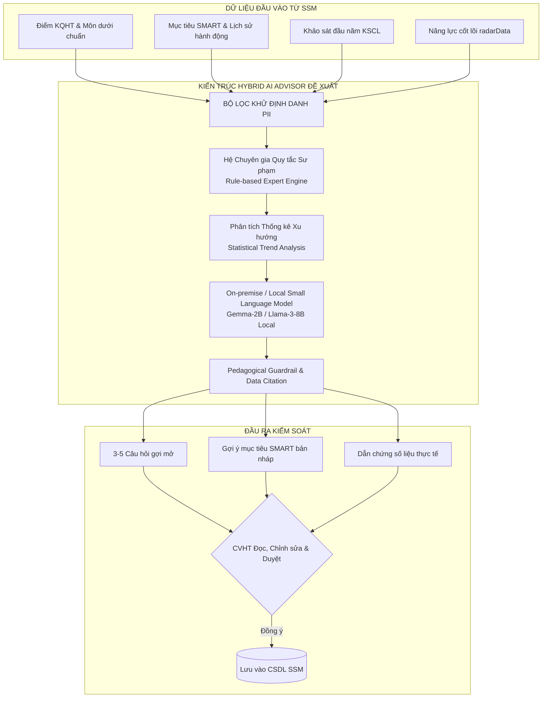

# TÀI LIỆU 2: PHÂN TÍCH KHOẢNG TRỐNG (GAP ANALYSIS) VÀ ĐỊNH HƯỚNG BỔ SUNG AI ADVISOR & SGSI
## Mã tài liệu: GAP_ANALYSIS_AI_SGSI.md | Phiên bản: 2.0 | Ngày: 20/10/2026

---

## 1. TỔNG QUAN PHÂN TÍCH KHOẢNG TRỐNG
Hệ thống SSM Sky-Line đã có nền tảng vững chắc về quản lý học sinh, sổ điểm, khảo sát đầu năm và biểu mẫu cố vấn. Tuy nhiên, hoạt động Cố vấn học tập hiện tại chủ yếu mang tính chất **ghi nhận hành chính (Record-keeping)** thay vì **đồng hành phát triển chủ động (Proactive Mentoring)**.

---

## 2. MA TRẬN KHOẢNG TRỐNG VỀ CÔNG NGHỆ VÀ NGHIỆP VỤ

| Phân hệ / Nghiệp vụ | Trạng thái Hiện tại trên SSM | Nhu cầu Thực tế của Sky-Line | Khoảng trống (GAP) | Giải pháp Kiến trúc & Kỹ thuật |
| :--- | :--- | :--- | :--- | :--- |
| **1. Phân tích Dữ liệu Học sinh** | Giáo viên tự nhìn các bảng điểm thô, tự mở từng tab để đọc nhận xét. | Hệ thống tự động tổng hợp bức tranh 360, phát hiện xu hướng tăng/giảm và môn dưới benchmark. | Chưa có công cụ phân tích tự động gắn với dữ liệu căn cứ và mốc thời gian. | Xây dựng Service `StudentDataSynthesizer`: trích xuất KQHT, năng lực, KSCL và gắn mốc thời gian. |
| **2. Chuẩn bị Phiên Cố vấn 1-1** | Giáo viên gặp học sinh mà không có tài liệu tóm tắt sẵn; mất thời gian suy nghĩ câu hỏi. | Trước buổi gặp, hệ thống tự động chuẩn bị bản tóm tắt: chuyển biến tích cực, nội dung chưa đạt, 3-5 câu hỏi gợi mở. | Thiếu module tiền xử lý dữ liệu trước phiên; câu hỏi chưa được phân tầng theo lứa tuổi. | Tích hợp **AI Advisor Pre-briefing**: sinh bản tóm tắt và 3-5 câu hỏi mở khuyến khích tư duy phát triển. |
| **3. Thiết lập Mục tiêu SMART** | Học sinh tự nhập văn bản thô; giáo viên mất nhiều thời gian hướng dẫn lại từng bước. | AI gợi ý mục tiêu SMART có căn cứ từ điểm xuất phát; mục tiêu ở trạng thái Đề xuất để CVHT duyệt. | Thiếu cơ chế gợi ý mục tiêu gắn với năng lực thực tế của học sinh; form dễ bị hình thức. | Xây dựng chức năng **"AI Gợi ý mục tiêu SMART"**: đề xuất mục tiêu, tiêu chí đo lường và hành động vi mô. |
| **4. Đánh giá Sau Hỗ trợ (Before vs After)** | Chưa có so sánh đối chiếu định lượng sau khi áp dụng giải pháp can thiệp. | Đo lường rõ: Trước hỗ trợ đạt bao nhiêu? Sau can thiệp đạt bao nhiêu? Giải pháp có hiệu quả không? | Thiếu công cụ so sánh trực quan Trước - Sau; không đo lường được hiệu quả của giải pháp. | Thiết kế bảng đối chiếu **Impact Tracker**: so sánh mốc baseline và mốc sau can thiệp. |
| **5. Đo lường Hiệu quả Cố vấn** | Thống kê số lượng biểu mẫu đã nộp hoặc số buổi gặp (mang tính đếm đầu việc hành chính). | Đánh giá dựa trên sự tiến bộ thực chất của học sinh và chất lượng quy trình can thiệp. | Chưa có chỉ số đo lường khoa học phản ánh sự tăng trưởng của học sinh (SGSI). | Triển khai chỉ số **SGSI (45% Tiến bộ + 35% Hiệu quả + 20% Quy trình)** chuẩn hóa thang 100. |
| **6. Dashboard Đo lường Đa cấp** | Đã có Dashboard theo lớp; chưa có dashboard riêng cho Học sinh, và góc nhìn hệ thống cho Ban KT&ĐBCL. | 3 tầng Dashboard chuyên biệt: Học sinh tự xem tiến độ; CVHT quản lý nguy cơ; Ban Giám đốc xem chỉ số toàn trường. | Dashboard chưa phân tầng theo đúng nhóm đối tượng người dùng; chưa có phân tích dữ liệu khuyết. | Nâng cấp **Dashboard Đa tầng**: phân quyền nghiêm ngặt, xử lý dữ liệu thiếu và không xếp hạng máy móc. |
| **7. An toàn & Kiểm soát AI** | Chưa có cơ chế Guardrail ngăn chặn ảo giác hoặc suy diễn tâm lý sai lệch. | AI chỉ là trợ lý tham mưu; mọi nhận định phải dẫn chứng số liệu; cấm tuyệt đối chẩn đoán tâm thần/bệnh lý. | Rủi ro AI tự động quyết định hoặc đưa ra kết luận thiếu căn cứ sư phạm. | Thiết lập **Pedagogical Guardrails & Human-in-the-loop 100%**: AI chỉ đề xuất bản nháp, con người phê duyệt. |

---

## 3. ĐÁNH GIÁ CÔNG NGHỆ AI PHÙ HỢP VỚI ĐẶC THÙ SKY-LINE

Sky-Line đặt yêu cầu nghiêm ngặt: **Không phát sinh chi phí API thương mại theo lượt, bảo mật tuyệt đối PII và không phụ thuộc dịch vụ đám mây bên ngoài**.

### So sánh 3 Phương án Công nghệ AI:
1. **Phương án 1 - Thuần Cloud Commercial API (OpenAI GPT-4, Claude):**
   - *Ưu điểm:* Chất lượng văn bản cao, cài đặt nhanh.
   - *Nhược điểm:* Phát sinh chi phí định kỳ theo token; rủi ro rò rỉ dữ liệu cá nhân học sinh ra máy chủ nước ngoài; vi phạm chính sách bảo mật nội bộ. $\rightarrow$ **KHÔNG KHUYẾN NGHỊ**.
2. **Phương án 2 - Thuần Rule-based & Thuật toán Thống kê:**
   - *Ưu điểm:* Tốc độ tức thời (< 50ms), 0 đồng chi phí, an toàn dữ liệu 100%, dễ giải thích số liệu.
   - *Nhược điểm:* Câu văn có thể khô cứng nếu không có mẫu câu phong phú. $\rightarrow$ **ÁP DỤNG LÀM NỀN TẢNG CỐT LÕI (CORE FOUNDATION)**.
3. **Phương án 3 - Hybrid (Hệ Chuyên gia Thống kê + Local LLM/SLM On-premise):**
   - *Ưu điểm:* Kết hợp sức mạnh tính toán số liệu chính xác của thuật toán thống kê với khả năng diễn đạt sư phạm truyền cảm hứng của mô hình ngôn ngữ nhỏ tự host nội bộ; 0 đồng chi phí API theo lượt; dữ liệu không bao giờ rời khỏi hạ tầng trường. $\rightarrow$ **PHƯƠNG ÁN ĐƯỢC CHỌN VÀ THIẾT KẾ CHO SKY-LINE**.
