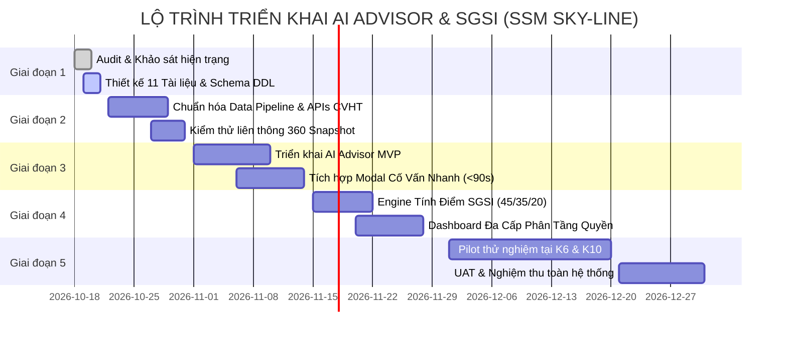

# TÀI LIỆU 10: LỘ TRÌNH VÀ KẾ HOẠCH TRIỂN KHAI NÂNG CẤP (IMPLEMENTATION ROADMAP)
## Mã tài liệu: IMPLEMENTATION_ROADMAP.md | Phiên bản: 1.0 | Ngày: 20/10/2026

---

## 1. TỔNG QUAN CHIẾN LƯỢC TRIỂN KHAI

Việc nâng cấp phân hệ Cố vấn học tập (CVHT) tích hợp **Sky-Line AI Advisor** và **Student Growth & Support Index (SGSI)** trên hệ thống SSM được thực hiện theo nguyên tắc phát triển phần mềm chuẩn mực:

$$\text{AUDIT} \longrightarrow \text{GAP ANALYSIS} \longrightarrow \text{DESIGN} \longrightarrow \text{APPROVAL} \longrightarrow \text{PILOT} \longrightarrow \text{UAT} \longrightarrow \text{ROLLOUT}$$

**Cam kết cốt lõi:**
- Không làm gián đoạn việc giảng dạy và vận hành hàng ngày của giáo viên.
- Không yêu cầu giáo viên nhập thêm bất kỳ form biểu phức tạp nào mới; tận dụng 100% dữ liệu đã có trên SSM.
- Phê duyệt đầy đủ hồ sơ thiết kế kỹ thuật trước khi đưa mã nguồn lên môi trường Production.

---

## 2. KẾ HOẠCH 5 GIAI ĐOẠN CHI TIẾT (5-PHASE ROADMAP)

---

### 2.1. Giai đoạn 1: Audit, Phân tích Gap và Thiết kế Kiến trúc (Hoàn thành)
- **Thời gian:** 18/10/2026 – 21/10/2026
- **Mục tiêu:**
  - Rà soát toàn bộ 200.838 dòng dữ liệu trên SQLite `local.db` và Cloud Turso.
  - Đánh giá hiện trạng 4 tính năng cố vấn học tập hiện có: Mục tiêu năm học (1.354 records), Tracking check-in (670 records), Đánh giá định kỳ, Nhật ký cố vấn (501 records).
  - Khảo sát khả năng liên thông dữ liệu: Khảo sát đầu năm (`InputAssessmentStudent`), Điểm số (`StudentSpecializedScore`), Hỗ trợ học tập (`LearningSupportTarget`).
  - Hoàn thiện trọn bộ 11 tài liệu đặc tả kiến trúc, thuật toán, bảo mật và kế hoạch triển khai.
- **Sản phẩm bàn giao:**
  - Bộ 11 tài liệu chuẩn kỹ thuật lưu tại thư mục `docs/advisory_ai_sgsi/`.
  - Bản sao lưu cơ sở dữ liệu nén an toàn: `data-backups/skyline_backup_2026-10-19_164051.db.gz`.
- **Cổng phê duyệt (Gate 1):** Báo cáo thẩm định kỹ thuật được thông qua; cấp thẩm quyền phê duyệt chuyển tiếp sang Giai đoạn 2.

---

### 2.2. Giai đoạn 2: Chuẩn hóa Dữ liệu và Tích hợp Liên thông (Data Pipeline Integration)
- **Thời gian:** 22/10/2026 – 31/10/2026 (2 tuần)
- **Mục tiêu kỹ thuật:**
  - Triển khai DDL tạo các bảng bổ sung: `AdvisoryActionItem`, `StudentSGSISnapshot` theo cơ chế `CREATE TABLE IF NOT EXISTS` không sửa schema gốc.
  - Tối ưu hóa API liên thông dữ liệu 360 độ: `GET /api/advisory/academic-snapshot?studentId=...` tổng hợp điểm số, khảo sát đầu năm và hỗ trợ học tập trong vòng dưới 150ms.
  - Xây dựng API luân chuyển hỗ trợ 1 chạm: `POST /api/advisory/refer-support` kết nối thẳng đến phòng Tâm lý học đường hoặc bộ môn cần bồi dưỡng.
- **Tiêu chuẩn kiểm thử:**
  - Thời gian phản hồi API < 200ms với tải 50 yêu cầu đồng thời.
  - 100% truy vấn được kiểm tra quyền truy cập chống IDOR (`canAccessStudent`).
- **Cổng phê duyệt (Gate 2):** Toàn bộ API liên thông hoạt động ổn định trên môi trường Staging; 0 lỗi hồi quy đối với chức năng hiện hành của giáo viên.

---

### 2.3. Giai đoạn 3: Triển khai Sky-Line AI Advisor MVP (In-Memory Pedagogical Engine)
- **Thời gian:** 01/11/2026 – 14/11/2026 (2 tuần)
- **Mục tiêu kỹ thuật:**
  - Hoàn thiện Engine phân tích học tập dựa trên quy tắc sư phạm và thống kê:
    - Nhận diện môn thế mạnh, môn suy giảm điểm số ($\Delta \ge 0.75$).
    - Phát hiện nguy cơ trượt mục tiêu SMART so với điểm khảo sát đầu năm.
    - Tạo 3-5 câu hỏi gợi mở phù hợp từng cấp học (Tiểu học, THCS, THPT).
    - Đề xuất 2-3 hành động vi mô (Micro-actions) cụ thể có thời hạn.
  - Tích hợp giao diện:
    - Nút bấm `[AI Phân tích tiến bộ]` và `[AI Gợi ý trao đổi]` trong Modal Cố Vấn Nhanh (<90 giây).
    - Cột hiển thị bằng chứng dữ liệu (Data Evidence) minh bạch cho từng nhận định của AI.
- **Ràng buộc an toàn:**
  - Zero PII Egress (Toàn bộ engine chạy trên server nội bộ).
  - AI chỉ đóng vai trò người soạn thảo (Drafting Assistant); GVCN toàn quyền sửa đổi hoặc bỏ qua.
- **Cổng phê duyệt (Gate 3):** Thử nghiệm nội bộ với 20 hồ sơ học sinh mẫu đại diện các khối đạt độ tin cậy chuyên môn $\ge 90\%$.

---

### 2.4. Giai đoạn 4: Xây dựng Bộ Tính Điểm SGSI và Dashboard Đa Cấp
- **Thời gian:** 15/11/2026 – 28/11/2026 (2 tuần)
- **Mục tiêu kỹ thuật:**
  - Hiện thực hóa thuật toán tính điểm $\text{SGSI} = 45\% G + 35\% S + 20\% P$ chuẩn hóa thang 100 điểm.
  - Triển khai cơ chế tái phân bổ trọng số (Dynamic Re-weighting) khi học sinh thiếu bài khảo sát đầu năm (không chấm 0 điểm bất công).
  - Hoàn thiện giao diện Dashboard đa cấp:
    - **Cấp Lớp/GVCN:** Thống kê tỷ lệ hoàn thành mục tiêu, danh sách học sinh cần can thiệp ưu tiên, theo dõi việc thực hiện hành động.
    - **Cấp Khối/Cơ sở:** Tỷ lệ phiên cố vấn đúng hạn, biểu đồ phân bố SGSI nội bộ, tình trạng phối hợp liên môn.
- **Ràng buộc đạo đức & quy chế:**
  - Không công khai điểm SGSI cho phụ huynh trong giai đoạn đầu.
  - Không dùng SGSI làm thước đo xếp loại thi đua giáo viên.
- **Cổng phê duyệt (Gate 4):** Thuật toán tính toán đúng 100% các ca biên (edge-cases) kiểm thử toán học.

---

### 2.5. Giai đoạn 5: Thử nghiệm diện hẹp (Pilot), Kiểm thử UAT và Chuyển giao
- **Thời gian:** 01/12/2026 – 31/12/2026 (1 tháng)
- **Phạm vi Pilot:**
  - Cơ sở: Sky-Line Riverside và Sky-Line Central.
  - Khối lớp: Khối 6 (Đầu cấp THCS) và Khối 10 (Đầu cấp THPT) - khoảng 8 lớp, ~240 học sinh.
- **Hoạt động chính:**
  1. Tập huấn 1 buổi trực tuyến (60 phút) hướng dẫn GVCN sử dụng Modal Cố Vấn Nhanh và đọc gợi ý AI.
  2. Vận hành cố vấn giữa kỳ: GVCN sử dụng hệ thống ghi nhận phiên cố vấn và theo dõi hành động.
  3. Lấy ý kiến phản hồi ẩn danh từ 8 GVCN tham gia pilot (độ hài lòng, thời gian thao tác, tính hữu ích của gợi ý AI).
  4. Hiệu chỉnh thuật toán gợi ý và trọng số SGSI dựa trên thực tế sư phạm.
- **Nghiệm thu toàn hệ thống (Final UAT):**
  - Ký biên bản nghiệm thu kỹ thuật và chuyển giao cho Ban Giám hiệu và Ban KT&ĐBCL.
  - Bật chính thức tính năng cho toàn bộ các khối lớp trên hệ thống Sky-Line.

---

## 3. MA TRẬN PHÂN CÔNG NHÂN SỰ & TRÁCH NHIỆM (RACI MATRIX)

| Giai đoạn / Hạng mục | Solution Architect | Full-stack Engineer | AI / Data Engineer | QA / QC Specialist | Ban KT&ĐBCL | GVCN Pilot |
| :--- | :---: | :---: | :---: | :---: | :---: | :---: |
| 1. Khảo sát & Lập 11 Tài liệu | **A/R** | C | C | C | I | - |
| 2. DB Migration & Backup Drill | A | **R** | C | C | I | - |
| 3. Phát triển API & Engine AI | A | **R** | **R** | C | - | - |
| 4. Xây dựng SGSI & Dashboard | A | **R** | **R** | C | C | - |
| 5. Kiểm thử UAT & Bảo mật | A | C | C | **R** | C | - |
| 6. Vận hành Pilot tại lớp | I | Support | Support | Support | **A** | **R** |
| 7. Nghiệm thu & Phê duyệt chính thức | C | I | I | C | **A/R** | I |

*Chú thích:*
- **R (Responsible):** Người trực tiếp thực hiện công việc.
- **A (Accountable):** Người chịu trách nhiệm phê duyệt và kết quả cuối cùng.
- **C (Consulted):** Người được tham vấn chuyên môn.
- **I (Informed):** Người nhận thông báo kết quả.

---

## 4. QUẢN LÝ RỦI RO DỰ ÁN (RISK MANAGEMENT & MITIGATION)

| Rủi ro tiềm ẩn | Mức độ | Khả năng | Biện pháp giảm thiểu & Kiểm soát |
| :--- | :---: | :---: | :--- |
| **1. Giáo viên cảm thấy tốn thời gian nhập liệu** | Cao | Trung bình | Thiết kế Modal cố vấn siêu tốc (<90s); các trường gợi ý AI được điền tự động dạng 1-click apply; không thêm biểu mẫu bắt buộc mới. |
| **2. AI đưa ra gợi ý không sát thực tế** | Trung bình | Trung bình | Gắn kèm dữ liệu bằng chứng (điểm số, môn học cụ thể); hiển thị rõ "Chưa đủ dữ liệu để kết luận" khi thiếu thông tin; GVCN toàn quyền sửa. |
| **3. Dữ liệu đầu vào của học sinh bị khuyết thiếu** | Cao | Cao | Thuật toán SGSI tự động tái cân bằng trọng số (Dynamic Re-weighting); không tính điểm 0 làm biến dạng bức tranh tiến bộ của học sinh. |
| **4. Lỗi hiệu năng làm chậm hệ thống SSM** | Trung bình | Thấp | Tối ưu hóa truy vấn SQL với Index; cache dữ liệu thống kê Dashboard; thực thi xử lý nền bất đồng bộ đối với tính toán SGSI hàng loạt. |
| **5. Phản ứng e ngại về việc xếp loại giáo viên** | Cao | Thấp | Truyền thông rõ ràng: SGSI là chỉ số đo lường sự tiến bộ của học sinh phục vụ nghiên cứu nội bộ, tuyệt đối không dùng để đánh giá năng lực GVCN. |
