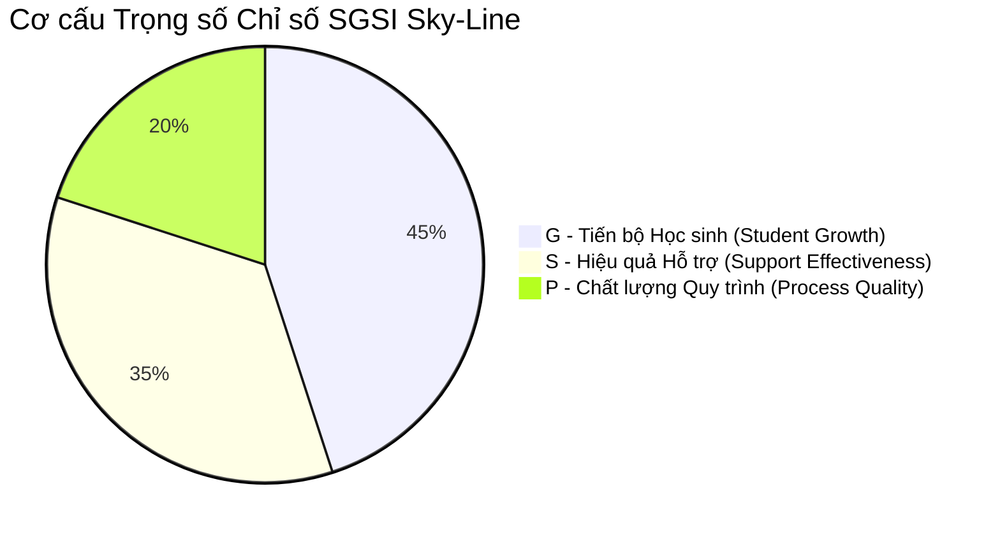

# TÀI LIỆU 4: PHƯƠNG PHÁP LUẬN VÀ THUẬT TOÁN TÍNH CHỈ SỐ TIẾN BỘ & HIỆU QUẢ CỐ VẤN HỌC TẬP (SGSI)
## Mã tài liệu: SGSI_METHODOLOGY.md | Phiên bản: 2.0 | Ngày: 20/10/2026

---

## 1. MỤC TIÊU VÀ TRIẾT LÝ CỦA CHỈ SỐ SGSI
**Chỉ số Tăng trưởng và Hiệu quả Cố vấn Sky-Line (Student Growth & Support Index - SGSI)** được xây dựng nhằm:
- Đo lường **sự tiến bộ thực chất** của từng học sinh so với chính xuất phát điểm của mình (Growth mindset), thay vì so sánh tuyệt đối giữa học sinh này với học sinh khác.
- Đánh giá **hiệu quả của các giải pháp can thiệp** và **chất lượng quy trình đồng hành** của đội ngũ giáo viên cố vấn.
- Chuyển đổi công tác cố vấn từ "hoàn thành thủ tục hành chính" sang "tác động giáo dục thực tế".

---

## 2. CÔNG THỨC VÀ CƠ CẤU TRỌNG SỐ THỬ NGHIỆM

$$\mathbf{SGSI} = \mathbf{0.45 \times G} + \mathbf{0.35 \times S} + \mathbf{0.20 \times P}$$

Tất cả các thành phần $G, S, P$ và chỉ số tổng hợp $\text{SGSI}$ đều được chuẩn hóa về **thang điểm 100**.

---

### 2.1. Thành phần G: Tiến bộ Học sinh (Student Growth - Trọng số 45%)
Đo lường mức độ tiến bộ của học sinh so với điểm xuất phát ban đầu và mục tiêu cá nhân đã cam kết.

$$\mathbf{G} = \frac{30}{45} \times \mathbf{G_{\text{SMART}}} + \frac{15}{45} \times \mathbf{G_{\text{Academic}}}$$

#### (a) Điểm hoàn thành mục tiêu SMART ($G_{\text{SMART}}$ - Quy về thang 100):
Được tính dựa trên kết quả theo dõi tiến độ (`StudentGoalTrackingLog`) có nhân với hệ số trọng số danh mục theo từng khối lớp từ `advisoryWeights.ts`:
- Mục tiêu đạt trạng thái `DAT` hoặc `COMPLETED`: 100 điểm.
- Mục tiêu đang duy trì `TIEN_TRIEN` hoặc `IN_PROGRESS`: 75 điểm.
- Mục tiêu ở mức `CHUA_DAT` nhưng có nỗ lực thực hiện: 40 điểm.
- Không thực hiện hoặc bỏ dở: 10 điểm.
- *Công thức:* $G_{\text{SMART}} = \sum (\text{Điểm mục tiêu}_i \times \text{Trọng số danh mục}_i) \Big/ \sum \text{Trọng số danh mục}$.

#### (b) Điểm cải thiện học thuật so với Baseline ($G_{\text{Academic}}$ - Quy về thang 100):
So sánh điểm trung bình môn học kỳ hiện tại ($S_{\text{Hiện tại}}$) với điểm khảo sát chất lượng đầu năm hoặc kỳ trước ($S_{\text{Baseline}}$):
- Nếu $\Delta = S_{\text{Hiện tại}} - S_{\text{Baseline}} \ge +1.5$ điểm: $G_{\text{Academic}} = 100$ điểm.
- Nếu $+0.5 \le \Delta < +1.5$: $G_{\text{Academic}} = 85$ điểm.
- Nếu $-0.5 \le \Delta < +0.5$ (Duy trì ổn định ở mức khá giỏi): $G_{\text{Academic}} = 75$ điểm.
- Nếu tụt dốc $\Delta < -1.0$: $G_{\text{Academic}} = 50$ điểm.

---

### 2.2. Thành phần S: Hiệu quả Hỗ trợ (Support Effectiveness - Trọng số 35%)
Đánh giá mức độ tháo gỡ khó khăn và khả năng thực thi các hành động cam kết sau buổi gặp.

$$\mathbf{S} = \frac{20}{35} \times \mathbf{S_{\text{Resolution}}} + \frac{15}{35} \times \mathbf{S_{\text{Actions}}}$$

#### (a) Tỷ lệ giải quyết khó khăn ($S_{\text{Resolution}}$):
- Căn cứ vào các khó khăn ghi nhận trong `AcademicConsultationLog`:
  $$S_{\text{Resolution}} = \frac{\text{Số khó khăn đã tháo gỡ / chuyển biến tốt}}{\text{Tổng số khó khăn được ghi nhận}} \times 100$$
- Nếu học sinh không có khó khăn học tập nghiêm trọng nào trong kỳ: Mặc định tính điểm ổn định 85 điểm.

#### (b) Tỷ lệ hoàn thành hành động đúng hạn ($S_{\text{Actions}}$):
- Căn cứ vào bảng theo dõi việc cần làm `AdvisoryActionItem`:
  $$S_{\text{Actions}} = \max\left(20, \min\left(100, \frac{\text{Hành động đúng hạn} \times 100 - \text{Hành động quá hạn} \times 20}{\text{Tổng số hành động được giao}}\right)\right)$$

---

### 2.3. Thành phần P: Chất lượng Quy trình (Process Quality - Trọng số 20%)
Đánh giá tính chuyên cần, kỷ luật thực hiện quy trình cố vấn và tinh thần tự đánh giá của học sinh.

$$\mathbf{P} = 0.50 \times \mathbf{P_{\text{Presence}}} + 0.50 \times \mathbf{P_{\text{Reflection}}}$$

- **$P_{\text{Presence}}$ (Tính đầy đủ của phiên cố vấn):**
  - Hoàn thành $\ge 1$ phiên cố vấn 1-1 chính thức trong học kỳ kèm biên bản đầy đủ: 100 điểm.
  - Chưa gặp phiên 1-1 nào: 30 điểm.
- **$P_{\text{Reflection}}$ (Tính chủ động tự đánh giá):**
  - Học sinh có gửi phiếu tự đánh giá (`StudentReflection`) hoặc tham gia phản hồi: 95 điểm.
  - Giáo viên phải nhắc nhở nhiều lần: 65 điểm.

---

## 3. THUẬT TOÁN XỬ LÝ DỮ LIỆU KHUYẾT THIẾU (RE-WEIGHTING ALGORITHM)

### Nguyên tắc Nhân văn và Khách quan:
1. **Tuyệt đối không chấm 0 điểm** khi một thành phần bị thiếu do nguyên nhân khách quan (Ví dụ: học sinh mới chuyển trường vào giữa kỳ nên không có điểm KSCL đầu năm).
2. **Thuật toán Tái Chuẩn Hóa Mẫu Số (Re-weighting):**
   Nếu tập hợp các chỉ số có dữ liệu là $K \subset \{G_{\text{SMART}}, G_{\text{Academic}}, S_{\text{Resolution}}, S_{\text{Actions}}, P\}$, chỉ số SGSI được tính trên tổng trọng số khả dụng:
   $$\mathbf{SGSI}_{\text{Normalized}} = \frac{\sum_{i \in K} (S_i \times W_i)}{\sum_{i \in K} W_i}$$
3. **Cờ Kiểm toán Minh bạch:**
   Ghi rõ tỷ lệ đầy đủ của dữ liệu: `dataCompletenessRate = (Tổng trọng số các phần có dữ liệu / 100)`. Nếu `dataCompletenessRate < 0.70`, hệ thống gắn nhãn cảnh báo: *"Chỉ số mang tính tham khảo tương đối do đang cập nhật dữ liệu ban đầu"*.

---

## 4. XẾP LOẠI VÀ CHÍNH SÁCH BẢO MẬT CHỈ SỐ

### 4.1. Bảng Phân hạng Chỉ số SGSI
| Thang điểm SGSI | Xếp loại Tăng trưởng | Ý nghĩa Sư phạm | Màu sắc nhận diện |
| :---: | :---: | :--- | :---: |
| **85 – 100** | **TIẾN BỘ XUẤT SẮC** | Học sinh vượt mục tiêu, quy trình đồng hành chặt chẽ và chủ động cao. | Xanh cổ vịt (Teal) |
| **70 – 84** | **ĐẠT TIẾN BỘ TỐT** | Đạt mục tiêu kỳ vọng, thói quen học tập ổn định, can thiệp hiệu quả. | Xanh lá (Emerald) |
| **55 – 69** | **CẦN DUY TRÌ ĐỒNG HÀNH** | Tiến bộ chậm hoặc còn 1 số hành động trễ hạn, cần nhắc nhở nhẹ. | Vàng hổ phách (Amber) |
| **Dưới 55** | **CẦN TĂNG CƯỜNG HỖ TRỢ** | Tụt dốc học tập hoặc chưa thực hiện mục tiêu, cần hội chẩn chuyên sâu. | Đỏ cảnh báo (Rose) |

---

### 4.2. Chính sách Bảo mật và Quản trị Rủi ro Chỉ số
1. **Chỉ phục vụ Phân tích Chuyên môn Nội bộ:** Trong giai đoạn thử nghiệm (Pilot), chỉ số SGSI chỉ hiển thị cho Ban Giám đốc Cơ sở (GĐCS), Ban Khảo thí & Đảm bảo Chất lượng (KT&ĐBCL) và CVHT phụ trách trực tiếp.
2. **Cấm Dùng Làm Tiêu Chí Thi Đua Giáo Viên:** Tuyệt đối không dùng điểm trung bình SGSI để xếp hạng thi đua hay trừ lương/thưởng của giáo viên nhằm tránh hiện tượng "chạy điểm số" hoặc làm đẹp hồ sơ.
3. **Không Công Khai cho Phụ Huynh:** Không gửi trực tiếp điểm số SGSI cho phụ huynh để tránh tạo áp lực so sánh con trẻ giữa các gia đình.
4. **Lưu vết Phiên bản (Version Control):** Mỗi lần tính toán đều ghi nhận `formulaVersion: "v2.0_pilot_2026"`, thời điểm tính và snapshot dữ liệu nguồn vào bảng `StudentGrowthIndexLog`.
