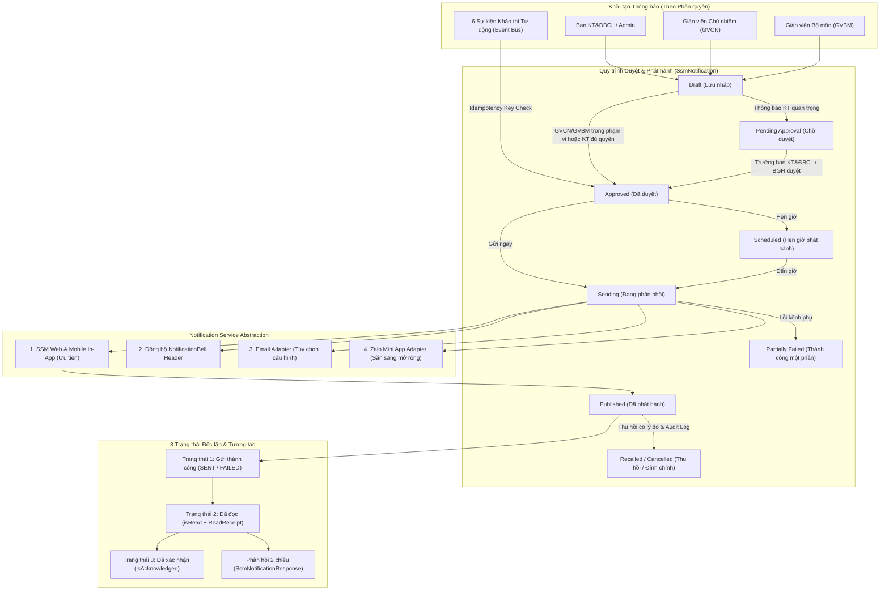

# KIẾN TRÚC & KẾ HOẠCH TRIỂN KHAI: TRUNG TÂM THÔNG BÁO & LIÊN LẠC (NOTIFICATION & COMMUNICATION CENTER) – SKY-LINE SSM

## 1. Báo cáo Phân tích Cấu trúc Hệ thống SSM Hiện hữu

### 1.1. Công nghệ & Kiến trúc Nền tảng
- **Framework**: Next.js 16 (App Router) + React 19 + TypeScript.
- **Database & ORM**: Prisma ORM (`v5.20.0`) kết nối SQLite (`local.db` / `dev.db`) và Turso LibSQL Cloud (`src/lib/db/index.ts`).
- **Authentication & Session**:
  - Nhân sự (Admin, Ban KT&ĐBCL, BGH, GVCN, GVBM) & Phụ huynh (PHHS): NextAuth v5 (`src/lib/auth.ts`), phân quyền theo Role + Module Permissions (`src/lib/permissions.ts`) + Campus Scope (`src/lib/campus-guard.ts`).
  - Học sinh (Student Portal 360°): Cookie session chuyên biệt `hs_token` (`src/lib/student-session.ts`, endpoint `/api/hocsinh/me`).
- **Design System Sky-Line**:
  - Màu nhận diện thương hiệu: **Sky-Line Purple** (`#5B2D8B`, `#6D28D9`, `#7C3AED`), **Sky-Line Teal** (`#00A19A`), **Deep Pine** (`#003B3A`).
  - Icons: `lucide-react`.

### 1.2. Các Thực thể Dữ liệu Cốt lõi Đang Vận hành (Tái sử dụng 100%)
1. **Học sinh, Phụ huynh, Lớp học & Năm học**:
   - `AcademicYear`, `Campus`, `Class`, `Subject`, `Student`, `Parent`, `ParentStudentLink` (quan hệ nhiều-nhiều giữa PHHS và Học sinh, hỗ trợ PHHS có nhiều con ở các lớp/cơ sở khác nhau).
2. **Giáo viên & Phân công Giảng dạy**:
   - `Teacher`, `Class.homeroomTeacherId`, `TeacherClassAssignment` (GVCN chính & đồng chủ nhiệm).
   - `TeachingAssignment` (GVBM chương trình MOET), `CtqtTeachingAssignment` (GVBM chương trình Quốc tế), `SpecialSubjectAssignment` (GVBM môn đặc thù).
3. **Phân hệ Khảo thí Số (`/admin/ktdbcl/khao-thi-so` & `/teacher/khao-thi-so`)**:
   - `TestingPeriod`: Kỳ kiểm tra định kỳ / kiểm tra bù (`code`, `name`, `semester`, `examType`, `programType`, `gradeLevels`, `isMakeup`).
   - `TestingSubjectExam`: Đề/Môn kiểm tra trong kỳ (`examFormat`: `PAPER_OMR` | `LMS_MOODLE` | `HYBRID`, `durationMinutes`, `moodleCourseId`, `moodleQuizId`, `status`).
   - `TestingSession`: Ca kiểm tra & phòng thi theo lớp (`classId`, `roomName`, `examDate`, `startTime`, `endTime`, `slotNumber`).
   - `TestingSessionRoster`: Danh sách thí sinh trong phòng thi (`studentId`, `candidateNumber`, `seatNumber`, `attendanceStatus`: `PRESENT` | `ABSENT_EXCUSED` | `ABSENT_UNEXCUSED`, `needsMakeup`).
   - `TestingCandidateResult`: Kết quả điểm số (`studentId`, `finalScore`, `approvalStatus`: `DRAFT` | `SUBMITTED` | `APPROVED`, `isLocked`).
4. **Thông báo hiện có**:
   - Bảng `Notification` (`prisma/schema.prisma` dòng 477): Lưu thông báo cơ bản cho `NotificationBell.tsx` trên thanh Header (`/api/notifications`) và PWA (`/api/pwa/notifications`).
   - Chưa có bảng quản lý vòng đời phê duyệt thông báo, phân tách 3 trạng thái (`Gửi thành công` – `Đã đọc` – `Đã xác nhận`), liên kết ngữ cảnh Khảo thí số theo từng học sinh (`studentId`), chống gửi trùng sự kiện (`idempotencyKey`), phản hồi 2 chiều trên thông báo, và Dashboard phân tích tỷ lệ đọc theo Cơ sở/Lớp.

---

## 2. Kiến trúc Module Notification & Communication Center

### 2.1. Sáu Nhóm Chức năng Trọng tâm & Khả năng Mở rộng
1. **Thông báo Khảo thí (`EXAM`)**: Lịch kiểm tra, hướng dẫn làm bài trên LMS, thay đổi lịch/phòng/hình thức thi, lịch kiểm tra bù/bổ sung, thông báo vắng thi.
2. **Thông báo Giáo viên (`TEACHER`)**:
   - **GVCN**: Thông báo lớp chủ nhiệm, nhắc lịch kiểm tra đã duyệt, dặn dò chuẩn bị cho học sinh, theo dõi & nhắc PHHS chưa đọc.
   - **GVBM**: Đề cương/nội dung ôn tập, tài liệu & dụng cụ cần chuẩn bị, hướng dẫn học tập trước kỳ kiểm tra theo đúng lớp phân công.
3. **Thông báo Kết quả Học tập (`ACADEMIC_RESULT`)**: Thông báo công bố kết quả kiểm tra khi điểm đã được phê duyệt (`approvalStatus = 'APPROVED'`), không lộ điểm chi tiết trên push notification, yêu cầu đăng nhập để xem điểm cá nhân.
4. **Thông báo Hệ thống (`SYSTEM`)**: Thông báo vận hành từ BGH, Quản trị hệ thống, lịch năm học.
5. **Phản hồi & Xác nhận Thông báo (`ACK & RESPONSE`)**: Xác nhận đã đọc độc lập với trạng thái mở xem (`requireAcknowledge`), luồng hỏi đáp/phản hồi (`allowReply`) trong phạm vi phân quyền.
6. **Dashboard Quản lý Thông báo (`ANALYTICS`)**: 10 chỉ số KPI, biểu đồ tỷ lệ đọc theo cơ sở và lớp, cảnh báo lớp có tỷ lệ đọc thấp, danh sách người nhận chưa đọc và xuất Excel.
7. **Khả năng mở rộng (Extensibility)**: Kiến trúc `category` + `sourceModule` + `sourceId` hỗ trợ mở rộng tức thì sang `ADVISORY` (Cố vấn học tập), `EXPERIENTIAL` (Hoạt động trải nghiệm), `PARENT_MEETING` (Họp PHHS số), `COMPETENCY` (Đánh giá năng lực) và `STUDENT_PROFILE` (Hồ sơ học tập 360°).

### 2.2. Sơ đồ Luồng Dữ liệu & Quy trình Duyệt – Phát hành

---

## 3. Ma trận Phân quyền (RBAC & Anti-IDOR)

| Hành động / Quyền hạn | Ban KT&ĐBCL / Admin | GVCN | GVBM | Phụ huynh (PHHS) | Học sinh (HS) |
| :--- | :---: | :---: | :---: | :---: | :---: |
| Tạo thông báo Khảo thí từ Kỳ kiểm tra (`TestingPeriod`) | ✅ Toàn trường / Cơ sở | ❌ | ❌ | ❌ | ❌ |
| Phát hành sự kiện tự động (`EVENT_EXAM_*`) | ✅ | ❌ | ❌ | ❌ | ❌ |
| Phê duyệt thông báo `PENDING_APPROVAL` | ✅ | ❌ | ❌ | ❌ | ❌ |
| Thu hồi (`RECALLED`) / Đính chính thông báo khảo thí | ✅ | ❌ | ❌ | ❌ | ❌ |
| Gửi thông báo lớp chủ nhiệm / Nhắc lịch thi đã duyệt | ✅ | ✅ Chỉ lớp chủ nhiệm | ❌ | ❌ | ❌ |
| Gửi hướng dẫn ôn tập / Dụng cụ môn học | ✅ | ✅ Lớp chủ nhiệm | ✅ Chỉ lớp/môn được phân công | ❌ | ❌ |
| Tự ý phát hành điểm chưa duyệt / Đổi lịch thi chính thức | ❌ (Chỉ công bố khi `APPROVED`) | ❌ Cấm tuyệt đối | ❌ Cấm tuyệt đối | ❌ | ❌ |
| Xem danh sách PHHS chưa đọc & Gửi nhắc nhở | ✅ Toàn phạm vi | ✅ Chỉ lớp chủ nhiệm | ✅ Chỉ lớp/môn dạy | ❌ | ❌ |
| Xem hộp thư thông báo & Lọc theo từng con (`studentId`) | ✅ | ✅ | ✅ | ✅ Chỉ con ruột (`ParentStudentLink`) | ✅ Chỉ bản thân |
| Xác nhận đã đọc (`Acknowledge`) & Gửi phản hồi (`Reply`) | ✅ | ✅ Trả lời PHHS | ✅ Trả lời câu hỏi môn | ✅ Khi thông báo cho phép | ✅ Khi thông báo cho phép |
| Xem Dashboard 10 KPI & Xuất báo cáo Excel | ✅ Toàn trường / Cơ sở | ✅ Phạm vi lớp CN | ✅ Phạm vi lớp dạy | ❌ | ❌ |

---

## 4. Thiết kế Cơ sở Dữ liệu (11 Bảng Mở rộng – Additive Schema)

Tất cả các bảng mới đặt tiền tố `SsmNotification*` (`ssm_notifications`, `ssm_notification_recipients`, ...) để **tương thích 100%** với bảng `Notification` hiện hữu:

1. `SsmNotification` (`ssm_notifications`): Thông tin chung, liên kết nghiệp vụ (`testingPeriodId`, `testingSubjectExamId`, `testingSessionId`, `campusId`, `classIdsJson`, `subjectId`), cấu hình xác nhận/phản hồi, trạng thái quy trình, bộ đếm tổng hợp.
2. `SsmNotificationRecipient` (`ssm_notification_recipients`): Lưu từng người nhận gắn với `studentId` và `classId`, tách biệt 3 trạng thái: `deliveryStatus` (`SENT`/`FAILED`), `isRead` (`readAt`), `isAcknowledged` (`acknowledgedAt`).
3. `SsmNotificationDelivery` (`ssm_notification_deliveries`): Lịch sử phân phối theo từng kênh (`IN_APP`, `EMAIL`, `ZALO_MINI_APP`).
4. `SsmNotificationTemplate` (`ssm_notification_templates`): Mẫu thông báo chuẩn cho Khảo thí, GVCN, GVBM.
5. `SsmNotificationAttachment` (`ssm_notification_attachments`): Tệp đính kèm đã kiểm tra định dạng an toàn.
6. `SsmNotificationApproval` (`ssm_notification_approvals`): Lịch sử trình duyệt và phê duyệt.
7. `SsmNotificationEvent` (`ssm_notification_events`): Quản lý 6 sự kiện tự động kèm `idempotencyKey` chống gửi trùng.
8. `SsmNotificationReadReceipt` (`ssm_notification_read_receipts`): Biên nhận thời điểm đọc và xác nhận chi tiết.
9. `SsmNotificationResponse` (`ssm_notification_responses`): Luồng phản hồi, hỏi đáp giữa PHHS/HS và GVCN/GVBM/KT&ĐBCL.
10. `SsmNotificationAuditLog` (`ssm_notification_audit_logs`): Nhật ký kiểm toán mọi thay đổi trạng thái, thu hồi, đính chính.
11. `SsmNotificationPreference` (`ssm_notification_preferences`): Tùy chọn nhận thông báo và cấu hình số ngày nhắc lịch trước kỳ thi.

---

## 5. Danh sách Rủi ro, Phụ thuộc & Hướng dẫn Vận hành
1. **Không phát sinh dữ liệu rác trên Production**: Mọi bài kiểm thử tự động (`vitest`) sử dụng cơ chế Mock CSDL (`vi.mock('@/lib/db')`), không ghi dữ liệu test vào `local.db` hay Turso Cloud.
2. **Bảo mật Điểm số Cá nhân**: Khi phát hành sự kiện `EVENT_EXAM_RESULT_PUBLISHED`, hệ thống kiểm tra `approvalStatus === 'APPROVED'` và chỉ gửi thông báo tổng quát yêu cầu đăng nhập, tuyệt đối không nhúng điểm số của học sinh vào tiêu đề/tóm tắt push notification hay hiển thị chéo giữa các học sinh.
3. **Kênh Zalo Mini App & LMS**: Được thiết kế qua lớp Adapter (`channelAdapters.ts`) và liên kết `moodleQuizId` từ bảng `TestingSubjectExam` thực tế của SSM, đảm bảo không phụ thuộc cứng vào dịch vụ bên ngoài khi chưa bật cấu hình.
